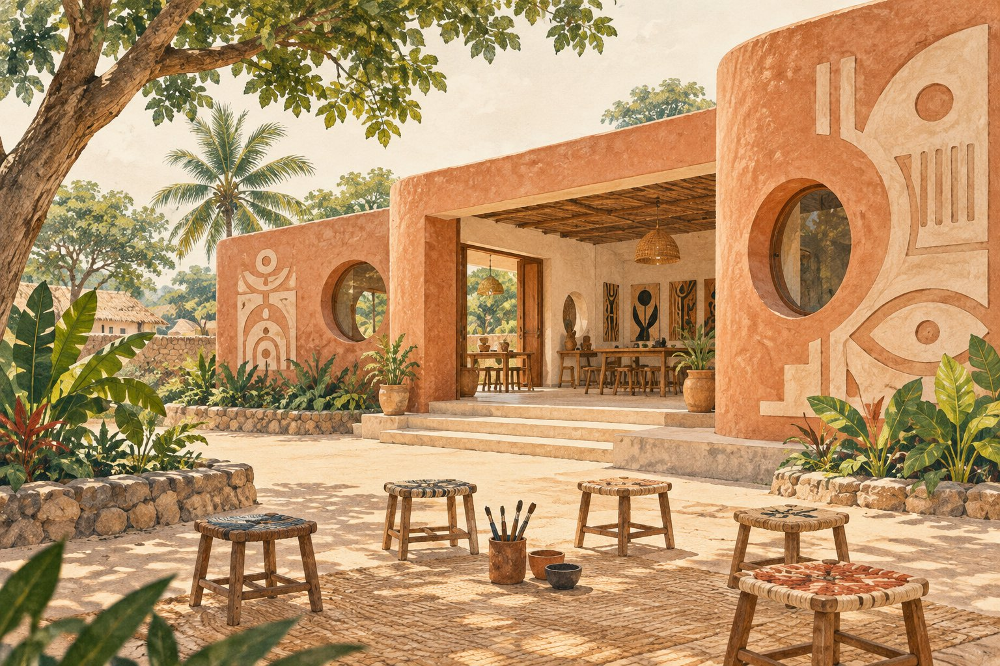

# 고향 마을에 둥근 창의 문화 공간을 만들다

*모잠비크 화가의 일이 그림 밖으로 이어진 순간*

Cities · Africa

> 자료 대조를 마친 검토용 이야기입니다. 공개 게시 승인은 아직 받지 않았습니다.

*KnowledgeWalk 제작 · AI 설명용 삽화. 실제 유물·작품·건축물·전시 배치를 재현한 사진이나 역사적 증거가 아닙니다.*

화가의 작업이라고 하면 캔버스 앞에 선 모습을 떠올리기 쉽다. 그런데 모잠비크의 화가 말랑가타나 응웨냐는 고향 마을에 문화센터를 만드는 일도 시작했다. 그림을 놓을 벽만이 아니라 사람들이 모일 공간을 생각한 것이다.

시카고 미술관의 연구 자료는 그가 1995년에 마탈라나에서 이 공간을 만들기 시작했다고 설명한다. 예술 교육과 마을 행사를 위한 곳이었다.

## 그림보다 먼저 만난 손일

그는 어린 시절 고향에서 도자기와 바구니 만들기, 그림 같은 지역의 예술과 공예를 접했다. 이후 도시로 나가 일하고 그림을 배우며 자신의 길을 넓혔다고 미술관은 소개한다.

이 대목은 그를 아무런 배움도 없이 등장한 특별한 천재로 보는 생각과 다르다. 마을에서 만난 손일과 도시에서의 배움, 다른 예술가들과의 관계가 함께 쌓인 삶이었다. 고향의 문화 공간도 그런 시간을 떠올리며 볼 수 있다.

## 둥근 창과 기하학적인 건물

미술관은 문화센터의 건축에 기하학적 구성과 산업 재료가 쓰였고, 둥근 창과 격자, 인물 형태의 벽면 부조 같은 요소가 더해졌다고 설명한다. 친구이자 후원자였던 건축가 판초 게드스와의 관계도 함께 소개한다.

이름난 건축 양식을 먼저 외울 필요는 없다. 둥근 창으로 빛이 들어오고 벽에도 무언가를 표현할 자리가 있는 공간을 떠올려 보자. 여기의 삽화는 그 생각을 돕는 개념 그림이며 실제 건물을 그대로 그린 사진은 아니다.

## 예술을 만나는 자리를 남기기

문화센터가 교육과 마을 행사를 위해 시작되었다는 사실이 인상적이다. 예술을 멀리 있는 전시장에서만 만나는 대신 자신이 자란 곳에서 배우고 모일 수 있도록 하는 선택이기 때문이다.

이 화가는 그림뿐 아니라 글과 시, 교육과 조각에서도 활동했다. 고향의 공간은 그 여러 일을 담을 또 하나의 형태로 읽힌다. 그림 한 점을 남기는 것과 함께, 다음 사람이 무언가를 시작할 자리도 만들고 싶었던 것이다.

## 이야기의 바탕이 된 자료

- [시카고 미술관 — Works in the Exhibition](https://raw.githubusercontent.com/art-institute-of-chicago/api-data/main/json/digital-publication-articles/10.json) · 확인일 2026-10-28
  - 확인 내용: 1995년 마탈라나 문화센터 건설 시작과 교육·행사 목적 / 고향의 도자기·바구니·회화 경험과 이후 교육 / 게드스 영향·기하학·산업재료·둥근창·격자·부조 / 교육자·시인·조각 등 다방면 활동

---

[같은 소주제의 이야기](README.md) · [전체 서가](../../README.md)
