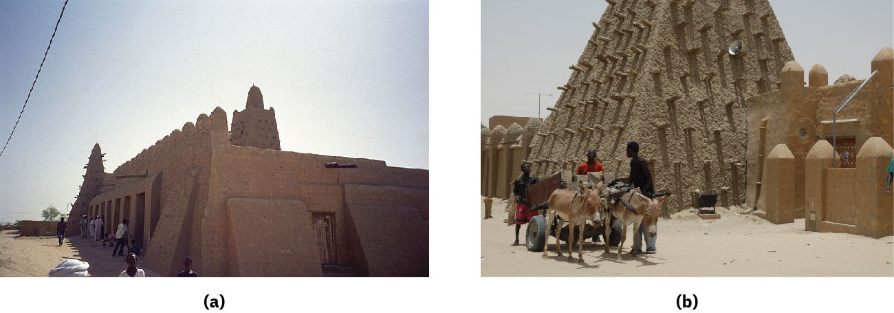

# 팀북투 — 사막의 길 끝에서 책을 펼치다

*금과 소금이 오가던 도시가 배움의 장소가 된 이유*

Cities · Africa

> 자료 대조를 마친 검토용 이야기입니다. 공개 게시 승인은 아직 받지 않았습니다.

*사진 a: upyernoz / Flickr, 사진 b: Emilio Labrador / Flickr · CC BY 2.0 · OpenStax가 구성한 두 사진 도판 그대로 사용.*

[이미지 출처·제작 근거](https://raw.githubusercontent.com/openstax/osbooks-world-history/main/media/OSX_WorldHist_A15_01_Timbuktu.jpg) · CC BY 2.0

팀북투라는 이름에서는 어딘가 아주 먼 곳의 느낌이 난다. 사막 너머의 외딴 도시를 떠올리기도 쉽다. 하지만 중세 서아프리카의 지도에 무역길을 그려 넣으면 인상이 바뀐다. 멀리 떨어진 끝자리가 아니라 여러 이동이 만나는 곳이 나타난다.

금과 소금, 직물만 그 길을 따라 움직였던 것은 아니다. 사람과 책, 공부하는 방식도 함께 건너갔다. 팀북투가 학문의 도시로 기억되는 까닭을 이해하려면 먼저 도서관의 문보다 도시 바깥의 길을 바라볼 필요가 있다.

## 1. 모래만 있는 곳으로 생각하면 놓치는 것

팀북투는 오늘날 말리에 있으며, 그 역사는 사하라와 사헬, 니제르강 일대의 교역과 연결되어 있다. 사헬은 사막 남쪽에 이어지는 지역이다. 북쪽을 가로지르는 길과 서아프리카 안쪽의 생산지가 만나는 도시들은 먼 곳의 물건을 서로 이어 주었다.

소금은 북쪽에서 운반되었고 금을 비롯한 여러 물품은 다른 경로를 통해 거래되었다. 물건의 출발지와 필요한 장소가 다르면 그 사이의 거리를 건너는 사람이 중요해진다. 팀북투를 사막에 고립된 점으로 그리면 바로 이 연결을 지워 버리게 된다.

## 2. 부유한 왕의 여행 뒤에 남은 것

14세기 말리의 통치자 만사 무사는 메카로 순례를 떠난 인물로 유명하다. 많은 금을 나누어 주었다는 이야기가 자주 따라붙지만, 도시의 문화라는 관점에서는 돌아오는 길도 중요하다. 그는 학자와 건축가, 책을 말리로 들여오는 데 기여했다.

교재는 이러한 흐름 속에서 팀북투의 이슬람 학문과 교육이 성장했다고 설명한다. 종교적 권위, 통치자의 후원, 교역으로 얻는 부가 서로 떨어져 있지 않았던 것이다. 금이 많았다는 일화만으로 기억하면, 그 자원이 어떤 활동을 가능하게 했는지는 보이지 않는다.

## 3. 모스크 옆에서 공부한다는 것

함께 실은 두 사진은 팀북투의 징게레베르 모스크를 보여 준다. 교재는 이 모스크의 건립을 1327년으로 소개한다. 팀북투에서는 꾸란을 공부하는 교육과 함께 이슬람 법, 철학과 과학에 관한 배움도 이루어졌다.

여기서 오늘날의 종합대학 캠퍼스를 그대로 상상할 필요는 없다. 옛 도시의 배움은 종교 공간, 교사와 제자의 관계, 후원의 방식 안에서 이루어졌다. 학문이 있었다는 사실을 존중하면서도, 현대 대학의 시간표와 학과 조직을 과거에 그대로 옮겨 놓지 않는 편이 도시를 더 정확하게 이해하게 한다.

## 4. 책이 도착하려면 사람이 움직여야 했다

책은 표지 안의 글만으로 존재하지 않는다. 만든 사람이 있고 운반한 사람이 있으며, 그 글을 읽거나 가르칠 사람이 필요하다. 먼 곳에서 책을 들여온다는 설명에는 이런 여러 단계가 함께 들어 있다. 교역로와 지식의 이동을 같이 보아야 하는 이유다.

이렇게 생각하면 상인과 학자는 서로 무관한 인물만은 아니다. 도시를 드나드는 사람들의 연결과 안정적인 생활의 기반이 교육을 뒷받침할 수 있다. 그렇다고 모든 상인이 학자였거나 거래가 곧바로 학문을 낳았다는 뜻은 아니다. 서로 다른 활동이 같은 도시 안에서 만날 조건을 살펴보는 것이다.

## 5. 한 도시에도 여러 모습이 있었다

후대에 팀북투를 묘사한 레오 아프리카누스의 기록에는 상점과 직물 거래, 물과 식량, 궁정의 모습이 나온다. 배움의 명성만 있는 도시가 아니라 먹고 일하고 사고파는 생활의 공간이었다는 점을 알려 준다. 다만 여행자의 서술을 도시 주민 전체의 목소리로 읽을 수는 없다.

그 기록에는 노예가 된 사람들의 존재도 등장한다. 번영과 학문의 이야기가 당시의 불평등을 없애 주는 것은 아니다. 아름다운 문화의 성과와 그 도시를 떠받친 사회적 관계를 함께 보아야, 팀북투를 막연한 황금시대의 풍경으로만 소비하지 않게 된다.

## 6. 배움의 명성도 안전하게 보장되지는 않았다

팀북투는 말리와 송가이의 권력 변화 속에 있었다. 송가이의 순니 알리가 세력을 넓히던 시기를 두고, 아랍어 역사 기록은 학자들을 억압한 통치자로 비판한다. 반면 송가이의 구전 전통에서는 강력한 정복자이자 건국의 영웅으로 기억된다.

같은 인물의 평가가 다른 이유를 생각하면 역사가 조금 입체적으로 보인다. 전쟁에서 이긴 통치자의 성취와 학자들이 겪은 불안은 같은 점수표로 정리되지 않는다. 교재는 이 과정에서 학자들이 다른 도시로 떠나기도 했다고 설명한다. 지식을 나누는 환경은 정치의 변화와 무관하지 않았다.

## 7. 사진에서 도시의 규모를 다시 상상하기

사진의 흙빛 벽과 돌출된 부재, 문 앞의 사람을 차례로 보자. 누군가에게는 이름난 유적이지만 누군가에게는 생활 속 종교 공간이다. 사진은 중세의 수업 장면이나 책의 내부를 보여 주지는 않는다. 지금 보이는 건물과 역사 설명을 구별하며 읽으면 된다.

팀북투의 재미는 먼 사막에도 뜻밖에 책이 있었다는 놀라움에서 끝나지 않는다. 처음부터 그곳을 멀고 비어 있는 장소로 보았던 우리의 시선도 돌아보게 한다. 물건과 사람, 신앙과 배움이 오가던 길 위에서 이 도시는 오랫동안 다른 세계와 연결되어 있었다.

## 이야기의 바탕이 된 자료

- [OpenStax World History — 중세 아프리카의 문화와 교역](https://raw.githubusercontent.com/openstax/osbooks-world-history/main/modules/m00149/index.cnxml) · 확인일 2026-10-30
  - 확인 내용: 사하라·사헬과 니제르강 교역 도시의 연결 / 만사 무사의 순례와 학자·건축가·책의 도입; 징게레베르 모스크 1327년과 학문
- [OpenStax World History — 사헬과 팀북투의 기록](https://raw.githubusercontent.com/openstax/osbooks-world-history/main/modules/m00151/index.cnxml) · 확인일 2026-10-30
  - 확인 내용: 순니 알리에 대한 아랍어 역사 서술과 송가이 구전 전통의 다른 평가 / 학자들의 이동·레오 아프리카누스의 도시 묘사 및 노예제; 여행자 관점의 한계

---

[같은 소주제의 이야기](README.md) · [전체 서가](../../README.md)
