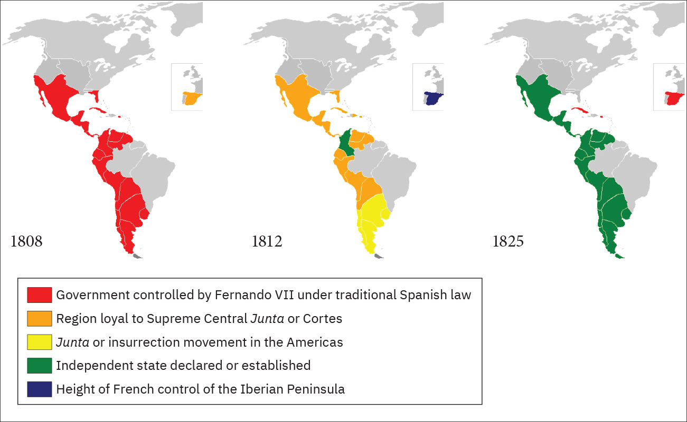

# 부에노스아이레스 — 항구가 커지자 왜 수도의 말이 달라졌을까

*1776년 부왕령의 설치와 교역 확대, 항구 엘리트가 바란 자치*

경제·산업·금융 · 무역과 시장

> 출처 대조와 공개 게시 승인을 마친 이야기입니다. 실제 게시 여부는 사이트 배포 상태를 따릅니다.

*Resvoluci/Wikimedia Commons, Spanish Americas revolutions를 바탕으로 한 지도 · OpenStax 수록. 현대 설명 지도이며 1776년 부왕령의 원본 지도와 구분합니다.*

[이미지 출처·제작 근거](https://raw.githubusercontent.com/openstax/osbooks-world-history/main/media/OSX_WorldHist_B08_03_M-SpanAmIn.jpg) · Public Domain

소가 자라는 초원과 은이 나오는 내륙을 바다와 잇는 항구가 있었다. 부에노스아이레스다. 18세기 후반 이 도시는 스페인 제국이 주변부를 더 잘 관리하려고 만든 새로운 부왕령의 중심이 되었다. 그러나 도시가 커지면서 주민 가운데 일부는 제국이 정한 무역의 틀을 더 좁게 느꼈다. 통치를 강화하려 한 개편이 오히려 자치를 요구할 힘을 키운 것이다.

## 01. 제국의 중심에서 멀다는 것은 거래의 조건이었다

스페인령 아메리카의 교역은 왕실의 규칙과 허용된 항구, 행정 구역에 묶여 있었다. 부에노스아이레스는 대서양을 향해 있었지만 이전에는 페루 부왕령의 관할에 속했다. 바다에 가깝다는 사실과 원하는 상대에게 자유롭게 물건을 판다는 것은 같지 않았다.

항구의 이해는 내륙의 행정 중심과 어긋날 수 있었다. 어느 길로 상품을 보내고 어디에서 세금을 거둘지에 따라 지역의 수입이 달라졌다. 제국의 국경 안에 있다는 이유만으로 모든 지역이 같은 경제적 목표를 가진 것은 아니었다.

## 02. 1776년 새 부왕령이 도시의 지위를 바꾸었다

1776년 리오데라플라타 부왕령이 설치되면서 부에노스아이레스가 그 중심이 되었다. 오늘날 아르헨티나와 볼리비아, 파라과이와 우루과이에 해당하는 넓은 지역이 연결되었다. 지금의 국가 지도와 당시의 관할 구역은 같지 않았다.

관리와 군사, 교역을 다루는 기능이 모이면 항구의 역할도 커진다. 단순히 물건을 싣는 곳이 아니라 사람과 명령, 세금이 모이는 행정 중심이 된 것이다. 도시의 지위 변화는 누구의 말을 어느 지역까지 전달할 수 있는지도 바꾸었다.

새 부왕령을 만든 것은 처음부터 독립을 돕기 위한 조치가 아니었다. 먼 지역을 더 잘 통치하고 세금과 교역을 관리하려는 제국의 선택이었다. 그러나 지방의 행정과 상업 역량이 커지면 그 지역이 스스로 운영할 수 있다는 주장도 힘을 얻을 수 있었다.

## 03. 초원의 가죽과 내륙의 은이 항구로 향했다

항구에서는 가죽과 소기름 같은 초원의 생산물, 볼리비아 지역에서 온 은 등이 바깥 시장으로 나갔다. 항구의 부는 도시 안에서만 생산되지 않았다. 넓은 지역에서 상품을 모으고 옮기는 길이 있어야 했다.

가죽 한 묶음에도 사육과 가공, 운송과 보관이 필요했다. 바다를 건너는 거래는 그 앞에 놓인 많은 작업의 마지막 단계였다. 항구 상인의 수익만 보면 상품이 이동할 때마다 누가 수고하고 어떤 비용을 감당했는지는 배경으로 밀려나기 쉽다.

## 04. 공식 거래 바깥에도 시장은 움직였다

항구의 주민들은 영국과 포르투갈 상인 등을 상대로 한 밀무역의 기회도 가졌다. 제국이 정한 규칙과 실제로 이익을 얻을 수 있는 거래가 어긋나는 지점이었다. 금지했다고 해서 주변 바다의 수요와 공급이 사라지는 것은 아니었다.

상인에게 다른 구매자가 있다는 것은 협상할 여지를 뜻한다. 반대로 왕실은 교역을 통제하지 못하면 세입과 권위를 잃을 수 있었다. 같은 물건의 이동이 도시에는 기회이고 제국에는 통치의 구멍이 될 수 있었던 것이다.

## 05. 성장한 도시의 엘리트는 더 많은 결정을 원했다

18세기 후반 도시의 인구와 상업은 크게 성장했다. 부를 얻은 상인과 지역의 유력자들은 세금과 항구의 운영, 외국과의 거래를 더 직접 결정하고 싶어 했다. 경제적 성장과 정치적 요구는 서로 연결되었다.

그러나 도시가 자치를 원했다고 모든 주민이 같은 권한을 요구한 것은 아니다. 상업 엘리트의 선택이 가난한 노동자나 다른 집단의 이해를 자동으로 대표하지는 않았다. 누가 독립을 주장했는지뿐 아니라 그 독립으로 무엇을 얻으려 했는지 보아야 한다.

외국의 구매자와 접촉한 경험은 다른 교역 질서를 상상할 자료가 되었다. 왕실의 허락이 줄어들면 반드시 도시가 가난해질 것이라는 전제를 상인들은 받아들이지 않을 수 있었다. 무역의 기회는 물건을 파는 방법뿐 아니라 통치의 필요를 평가하는 기준도 바꾸었다.

## 06. 왕의 위기는 항구의 선택을 재촉했다

1808년 나폴레옹의 스페인 침공은 식민지의 통치 정당성을 흔들었다. 왕이 권력을 제대로 행사하지 못한다면 누가 그 이름으로 명령할 수 있을까. 지역의 통치 기구를 만들고 권력을 재편하는 움직임이 커졌다.

1810년 부에노스아이레스에서 시작된 정치적 변화가 부왕령 전체의 한목소리는 아니었다. 파라과이와 우루과이 등은 이 도시가 대신 통치하는 데 저항했다. 스페인의 지배를 거부하는 일과 부에노스아이레스의 지도권을 인정하는 일은 같은 선택이 아니었다.

## 07. 항구의 자유는 내륙에 또 다른 중심일 수 있었다

1816년 독립 선언으로 이어지는 과정에서도 어떤 지역을 누구의 권한 아래 묶을지는 중요한 문제였다. 옛 제국의 통치가 사라진 자리를 하나의 도시가 자연스럽게 이어받는 것은 아니었다. 항구를 통해 세계와 연결된 이익은 지역마다 다르게 느껴졌다.

부에노스아이레스의 성장은 무역이 도시를 키우고, 커진 도시가 통치의 규칙을 다시 요구하는 과정을 보여 준다. 바다를 향한 문이 넓어졌을 때 사람들은 더 많은 상품만을 원하지 않았다. 그 문을 누가 열고 세금을 누가 거둘지도 직접 결정하고 싶어 했다.

## 이야기의 바탕이 된 자료

- [OpenStax, World History Volume 2 — Spanish South America](https://raw.githubusercontent.com/openstax/osbooks-world-history/main/modules/m00014/index.cnxml) · 확인일 2026-11-11
  - 확인 내용: 1776리오데라플라타 부왕령·항구/내륙 은·가죽·소기름/밀무역·도시 성장/1808왕권 위기·1810변화/주변 지역의 부에노스아이레스 지배 거부/1816독립. 본문에서 오늘날 국가와 당시 행정 영역을 구별.

---

[같은 소주제의 이야기](README.md) · [전체 서가](../../README.md)
