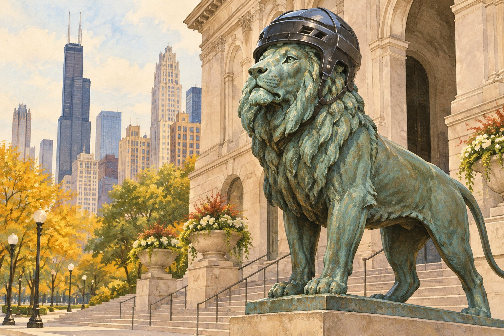

# 시카고의 사자는 가끔 헬멧을 쓴다

*미술관 앞 조각상이 도시의 응원단이 되는 날*

Cities · Americas

> 출처 대조와 공개 게시 승인을 마친 이야기입니다. 실제 게시 여부는 사이트 배포 상태를 따릅니다.

*KnowledgeWalk 제작 · AI 설명용 삽화. 실제 유물·작품·건축물·전시 배치를 재현한 사진이나 역사적 증거가 아닙니다.*

미술관 입구의 사자라면 근엄한 표정을 기대하게 된다. 그런데 미국 시카고에서는 그 사자에게 커다란 스포츠 헬멧을 씌우기도 한다. 조각상이 갑자기 동네 응원단이 된 것 같은 모습이다.

시카고 미술관은 지역 팀을 응원하는 사자들의 이야기를 공식 글에 남겼다. 작품의 제작 연도만 알면 끝나는 이야기가 아니다. 도시 사람들이 조각상과 어떻게 지내는지도 이 사자들의 이력이 된다.

## 1. 두 마리는 쌍둥이가 아니다

미술관 설명에 따르면 사자들은 에드워드 케미스가 만들었고 1894년 미술관 정문 앞에 설치되었다. 그런데 둘은 똑같은 조각이 아니다. 자세도 다르고 몸의 크기와 갈기의 모양도 다르다.

북쪽 사자는 먹잇감을 찾아 움직이는 듯한 자세이고 남쪽 사자는 당당히 버티는 자세로 소개된다. 같은 사자처럼 보고 지나쳤다면 다음에는 다리와 고개를 비교해 볼 만하다.

## 2. 처음 헬멧은 조금 뜻밖의 물건

미술관은 사자들이 스포츠 응원에 참여한 일을 1985년 시즌 시카고 베어스의 슈퍼볼 진출을 응원하던 때부터 설명한다. 당시의 헬멧은 뒤집은 바비큐 그릴에 간단한 안면 보호대를 붙여 만든 것이었다고 한다.

가게에서 사 온 기성품이 아니었던 셈이다. 사람보다 훨씬 큰 머리에 맞춰야 하니 응원 도구도 특별한 제작이 필요했다. 미술관 앞에서는 작품을 감상하는 일과 스포츠를 응원하는 일이 이렇게 만났다.

## 3. 한 쌍의 조각에도 서로 다른 성격이 있다

두 사자는 크기와 갈기, 자세가 서로 다르다. 공식 글은 북쪽 사자를 먹잇감을 찾아 움직이는 듯한 이름으로, 남쪽 사자를 도전적인 자세로 버티는 이름으로 소개한다. 같은 출입문을 사이에 두고 있어도 한 마리를 복사해 놓은 관계가 아니다. 작품 앞에서는 먼저 앞다리가 어디에 놓였고 고개가 어느 쪽으로 향하는지 비교해 보아도 좋다.

이 차이는 헬멧을 만들 때 뜻밖의 실무 문제가 된다. 한쪽에 맞는 장식이 다른 쪽에도 꼭 맞으리라는 보장이 없기 때문이다. 조각의 개성을 감상하는 일과 장식품의 치수를 재는 일이 같은 특징을 바라본다. 도시의 축제도 결국 실제 물건의 크기와 모양을 다루는 사람들의 손을 거쳐야 완성된다.

## 4. 추운 날 헬멧이 깨진 적도 있었다

미술관은 2007년 베어스 응원 행사를 준비하던 겨울의 일을 전한다. 거대한 플라스틱 헬멧을 북쪽 사자의 갈기에 맞추는 과정에서 일부가 깨졌다. 추운 날 재료가 수축한 상태에서 장식을 늘려 끼우다 문제가 생겼다는 설명이다. 사자의 몸이 아니라 별도로 제작한 헬멧에서 일어난 사고였다.

장식은 밤사이에 수리해 다음 날 다시 설치했다. 이후 팀의 패배를 사자 탓으로 돌리는 농담도 있었지만, 미술관은 그 말을 사실로 받아들이지 않는다. 이 일화의 재미는 승패를 점치는 데보다 조각상도 계절과 재료의 영향을 받는 행사의 무대가 된다는 데 있다. 도시의 익살 뒤에는 제작과 수선의 시간도 들어 있다.

## 5. 감상하러 온 사람과 응원하러 온 사람

미술관은 작품을 보러 찾아가는 장소지만 정문 앞은 거리를 지나던 사람도 만나는 공간이다. 헬멧을 쓴 사자는 입장권을 사지 않은 시민에게도 그날의 이야기를 건넨다. 특정 작품을 잘 아는 사람만 반응할 수 있는 표지가 아니라 지역 팀의 소식을 아는 사람이라면 함께 알아볼 수 있는 모습이 된다.

그렇다고 조각의 원래 뜻이 모두 사라지는 것은 아니다. 근엄한 자세는 그대로인데 임시 장식이 얹히면서 새로운 표정이 생긴다. 바뀌지 않는 부분과 잠시 달라지는 부분이 함께 보이기에 더 재미있다. 같은 장소를 여러 번 지나가는 사람에게는 이런 작은 변화가 계절이나 행사의 기억을 남길 수 있다.

## 6. 오래된 작품에 새로운 기억이 붙는 방식

1894년 설치라는 이력은 사자가 언제 그곳에 왔는지 알려 준다. 응원 헬멧의 일화는 그 뒤에 사람들이 어떤 관계를 만들어 왔는지 보여 준다. 공공 조각의 생애를 제작과 설치에서 끝내지 않으면 수리와 행사, 시민의 사진도 함께 질문할 수 있다. 작품은 움직이지 않아도 주변의 쓰임과 기억은 달라진다.

방문할 때 헬멧이 없더라도 이야기가 틀린 것은 아니다. 행사 때의 변화와 늘 볼 수 있는 모습을 구분하면 된다. 사자를 다시 보게 된다면 먼저 두 자세의 차이를 찾고, 다음에는 지나가는 사람들이 어느 쪽에서 멈추는지 살펴보자. 한 조각상을 감상하는 일이 도시가 자기 상징을 사용하는 방식을 읽는 일로 이어진다.

## 7. 오늘의 이야기가 더해지는 자리

이후 사자들은 아이스하키 팀 블랙호크스를 응원하는 헬멧도 썼다. 다만 방문할 때마다 헬멧을 볼 수 있다는 뜻은 아니다. 특정 응원 행사에 맞춰 옷차림이 달라지는 조각상들이다.

오래된 공공 조각은 가만히 서 있기만 하는 물건처럼 느껴진다. 하지만 주변 사람들이 무언가를 씌우고, 사진을 찍고, 추억을 보태면 새로운 이야기가 붙는다. 시카고의 사자들은 미술관을 지키는 동시에 도시의 기분을 함께 나누고 있다.

## 이야기의 바탕이 된 자료

- [시카고 미술관 — Our Civic-Minded Pride](https://raw.githubusercontent.com/art-institute-of-chicago/api-data/main/json/articles/74.json) · 확인일 2026-10-28
  - 확인 내용: 작가·1894년 설치와 두 사자의 다른 자세 / 1985년 베어스 응원과 그릴로 만든 초기 헬멧 / 블랙호크스 헬멧 행사

---

[같은 소주제의 이야기](README.md) · [전체 서가](../../README.md)
