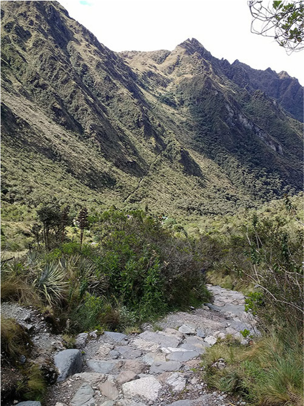

# 쿠스코 — 산길은 어떻게 제국을 묶었을까

*높은 수도에서 이어진 길과 다리의 이야기*

Cities · Americas

> 자료 대조를 마친 검토용 이야기입니다. 공개 게시 승인은 아직 받지 않았습니다.

*“Stone steps and mountains on the Inca Trail” · Mx._Granger / Wikimedia Commons · OpenStax 수록 · CC0 1.0. 쿠스코 시가지나 전체 도로망을 보여 주는 사진은 아닙니다.*

[이미지 출처·제작 근거](https://raw.githubusercontent.com/openstax/osbooks-world-history/main/media/OSX_WorldHist_A08_03_IncaRoad.jpg) · CC0 1.0

산길을 오르다가 돌계단이 능선 너머로 이어지는 모습을 만난다. 풍경은 멋지지만 무거운 짐을 들고 걸어야 한다면 생각이 달라진다. 멀리 있는 사람과 물건을 연결하는 일은 높은 산에서는 더욱 구체적인 수고가 된다.

인카의 수도 쿠스코는 안데스산맥의 높은 곳에 있었다. 이곳을 중심으로 넓은 영역을 다스리려면 좋은 돌 건물만으로는 부족했다. 계곡과 산, 건조한 지역을 지나 사람과 물자를 이어 줄 길이 필요했다. 도시를 이해하는 시선을 도로 쪽으로 옮겨 보자.

## 1. 처음부터 제국의 수도는 아니었다

쿠스코의 앞선 공동체는 감자와 옥수수를 기르고 라마 같은 동물을 기르는 농경 생활과 연결되어 있었다. 교재는 1000년 무렵 이 지역에 농경 마을 사람들이 자리하고 있었음을 설명한다. 후대의 거대한 제국이 처음부터 완성되어 있던 것은 아니다.

시간이 흐르며 쿠스코의 세력은 주변과 경쟁하고 관계를 넓혔다. 도시가 성장한 뒤에는 그 시작을 설명하는 전승도 중요해졌다. 돌이 전사로 변했다는 이야기나 황금 지팡이의 전설은 당시 사람들이 자신들의 기원을 어떻게 이해했는지 보여 주지만, 실제 사건의 기록과 그대로 같지는 않다.

## 2. 높은 곳에 모인 중심

쿠스코는 해발 3천 미터가 넘는 안데스 고지대에 자리한다. 인카의 석공들은 돌을 정교하게 다루어 건물을 만들었다. 오늘날 근처의 삭사이와만에 남은 석벽도 이런 기술을 알려 주는 자료다.

하지만 수도는 주변에서 먹을거리와 자원이 들어오지 않으면 유지되기 어렵다. 중요한 사람이 모이는 중심이 있다는 것은 그곳과 다른 지역 사이에 지속적인 이동이 필요하다는 뜻이기도 하다. 건물의 크기와 길의 존재를 함께 생각해야 도시의 생활이 보인다.

## 3. 같은 제국 안에도 다른 지형이 있었다

인카가 지배한 지역에는 높은 산과 깊은 계곡, 사막과 해안의 좁은 평지가 있었다. 곧은 길 하나를 모든 곳에 똑같이 놓을 수 있는 환경이 아니었다. 이동은 지형에 맞추어 다른 방법을 필요로 했다.

교재는 평지의 직선 구간과 산길의 굽이, 돌계단과 여러 재료의 다리를 함께 설명한다. 도로망이 있다는 한마디 뒤에는 서로 다른 형태의 길이 들어 있다. 길이 좋다는 것은 언제나 넓고 평평하다는 뜻만은 아니었던 셈이다.

## 4. 이미 있던 길을 잇고 바꾸기

도로망의 일부는 인카 이전부터 존재했다. 인카는 이를 더 크게 연결하고 확대하며 개선했다. 통치자가 넓은 땅을 다스리려는 목표와 지역에 축적된 이동의 기술이 만난 것이다.

이 점을 알면 거대한 길의 망을 한 사람이 처음부터 끝까지 설계해 세운 작품처럼 보기 어렵다. 여러 시대와 지역의 경험이 이어졌다. 제국의 이름으로 기억되는 기반시설에도 그보다 앞선 사람들의 길이 들어 있을 수 있다.

## 5. 길 위에는 군대와 물자가 함께 있었다

인카의 도로는 군대가 이동하는 데 쓰였고, 지방에서 생산한 물건을 저장고로 옮기는 데도 중요했다. 길은 여행의 즐거움만을 위해 존재한 시설이 아니었다. 통치와 자원의 배분을 가능하게 하는 장치이기도 했다.

어느 지역에서 물건을 거두고 어디에 모을지 정하는 힘은 주민의 생활과 연결된다. 길이 잘 이어졌다는 사실과 그 길을 이용한 제도가 모두에게 같은 이익을 주었다는 평가는 구별해야 한다. 편리한 이동의 역사에는 동원과 의무의 문제도 함께 있다.

## 6. 수도를 지탱한 일은 도시 바깥에도 있었다

인카는 정복한 지역에 공납과 노동 의무를 요구했다. 넓은 영역의 생산과 노동이 제국의 활동을 뒷받침한 것이다. 돌로 만든 수도의 모습만 보면 이 관계가 화면 밖에 남기 쉽다.

그래서 쿠스코를 감상할 때는 중요한 건물이 몇 개 있었는지뿐 아니라 그것을 유지한 먹을거리와 일손이 어디서 왔는지도 생각할 수 있다. 한 도시의 위상은 도시 안쪽의 성취와 바깥 지역의 부담이 연결된 결과일 수 있다. 수도에서 멀어진 길도 도시사의 일부다.

## 7. 사진의 돌계단을 천천히 보기

함께 실은 것은 인카 트레일의 실제 돌계단과 산 풍경이다. 쿠스코 시가지 자체를 촬영한 사진이나 전체 도로망의 모습은 아니다. 길의 한 구간에서 산악 지형과 사람의 이동 통로가 만나는 방식을 살펴볼 수 있다.

계단을 만든 돌과 주변의 경사, 길이 사라지는 방향을 차례로 보면 이동의 규모를 몸으로 조금 상상하게 된다. 다만 사진만으로 누가 어느 날 이 구간을 지나갔는지 확정할 수는 없다. 실제 관찰과 역사적 설명의 범위를 나누어 보아도 길의 인상은 충분히 강하다.

## 8. 도시의 경계는 건물에서 끝나지 않는다

쿠스코를 기억할 때 높은 돌 건물 곁에 먼 곳으로 이어지는 길도 남겨 보자. 산과 계곡을 건너오는 식량과 물자, 이동하는 사람들의 시간이 수도를 만들었다. 도시의 역사와 도로의 역사는 따로 떨어지지 않는다.

지금 우리가 사는 도시도 눈에 보이는 건물만으로 완성되지 않는다. 다른 지역과 연결된 이동이 매일의 생활을 가능하게 한다. 인카의 산길은 오래된 제국의 기술을 보여 주면서, 도시를 어디까지 보아야 할지 묻는 질문도 남긴다.

## 이야기의 바탕이 된 자료

- [OpenStax World History — 쿠스코와 인카의 도로망](https://raw.githubusercontent.com/openstax/osbooks-world-history/main/modules/m00116/index.cnxml) · 확인일 2026-10-30
  - 확인 내용: 쿠스코의 농경 기원·기원 전승과 역사적 근거 구분·안데스의 고도 / 인카 이전의 길을 확장·계곡과 산악의 도로 및 여러 재료의 다리 / 군대와 물자의 이동·공납과 노동·수도와 주변 지역의 연결·인카 트레일 사진의 캡션

---

[같은 소주제의 이야기](README.md) · [전체 서가](../../README.md)
