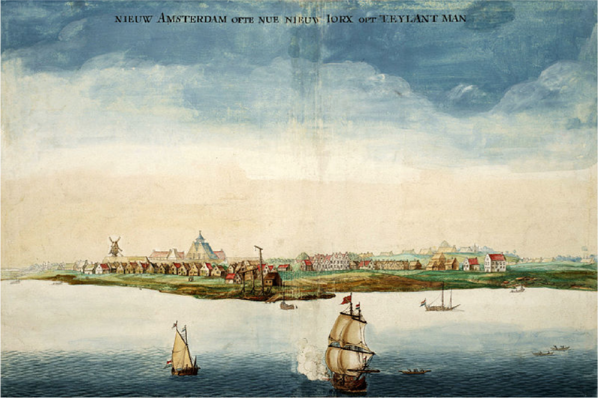

# 뉴욕 — 한때는 뉴암스테르담이었다

*도시의 이름을 바꾼 배와 교역, 그리고 성벽*

Cities · Americas

> 출처 대조와 공개 게시 승인을 마친 이야기입니다. 실제 게시 여부는 사이트 배포 상태를 따릅니다.

*Johannes Vingboons, 1664년 뉴암스테르담 그림 · Geheugen van Nederland / Wikimedia Commons · OpenStax 수록 · Public Domain. 사진이나 현대 측량도는 아닙니다.*

[이미지 출처·제작 근거](https://raw.githubusercontent.com/openstax/osbooks-world-history/main/media/OSX_WorldHist_B06_01_Amsterdam.png) · Public Domain

뉴욕이라는 이름은 너무 익숙해서 처음부터 그 이름이었을 것처럼 느껴진다. 그러나 맨해튼 남쪽에 자리한 초기의 유럽 식민 도시는 뉴암스테르담으로 불렸다. 암스테르담에 새로운 곳을 뜻하는 말을 붙인 이름이다. 도시 이름에 바다 건너의 고향이 들어 있었던 셈이다.

함께 실은 그림은 네덜란드의 화가이자 지도 제작자 요하네스 빙본스가 1664년에 그린 도시의 모습이다. 물가의 배와 낮은 건물들을 보면 오늘의 높은 빌딩 숲과는 다른 풍경이 열린다. 그 작은 해안선에 여러 대륙의 관계가 겹쳐 있었다.

## 1. 이미 사람이 살던 땅에 들어선 식민 도시

교재는 네덜란드인들이 1624년 오늘날 맨해튼 섬의 남쪽에 뉴암스테르담을 세웠다고 설명한다. 이것은 사람이 없던 섬에서 도시의 역사가 처음 시작되었다는 뜻이 아니다. 유럽인이 오기 전부터 원주민 공동체의 땅과 생활이 있었다.

식민 도시의 설립 연도는 특정 세력이 거점을 만든 때를 알려 준다. 그 이전의 사람과 장소까지 지워 주는 숫자는 아니다. 도시의 옛 이름을 읽을 때도 누구의 기록에서 붙인 이름인지 물어볼 필요가 있다. 같은 땅에 관한 이야기가 하나의 언어로만 시작되는 것은 아니다.

## 2. 배 뒤에는 강을 따라가는 길이 있었다

네덜란드 식민자들의 거주지는 뉴암스테르담에서 허드슨강 계곡을 따라 북쪽으로 이어졌다. 교재는 농업도 이루어졌지만 모피 교역이 중요한 수입원이었다고 설명한다. 항구에 도착한 물건은 바다 바로 옆에서만 만들어진 것이 아니었다.

지금의 뉴욕을 금융과 문화의 도시로 먼저 떠올리는 사람에게는 동물의 모피가 낯선 출발점처럼 보인다. 하지만 초기의 교역은 내륙과 강, 대서양을 연결했다. 그림 속의 배 한 척을 볼 때도 그 배에 실릴 물건이 어디서 왔는지 생각하면 도시의 지도가 넓어진다.

## 3. 거래는 언제나 평화로운 만남이었을까

초기에는 모피와 유럽의 금속 도구, 모직물, 무기 등을 교환하는 관계가 있었다. 그러나 교역이 이어졌다는 사실을 곧바로 평등하고 평화로운 공존으로 바꿀 수는 없다. 식민 지배의 확대와 원주민에 대한 요구는 충돌로 이어졌다.

교재는 네덜란드인들이 자신들이 제공했다고 여긴 혜택에 대가를 요구하며 갈등이 커졌다고 설명한다. 이 대목에서는 거래의 목록보다 누가 조건을 정하려 했는지가 중요하다. 서로 물건을 주고받았다고 힘의 차이나 땅을 둘러싼 문제가 사라지는 것은 아니었다.

## 4. 월스트리트의 벽을 누가 만들었을까

도시를 방어하기 위한 시설은 당시 거주지의 경계에 세워졌다. 교재는 네덜란드인들이 노예화된 아프리카인들에게 이 방어 시설을 짓도록 강요했다고 기록한다. 그 벽을 따라 난 길이 월스트리트라는 이름으로 불렸다.

오늘의 금융가를 떠올리게 하는 이름 뒤에 강제 노동의 역사가 있는 것이다. 길 이름의 유래를 안다는 것은 재미있는 말풀이만은 아니다. 누가 힘든 일을 했으며 누구의 이름은 기념되지 않았는지 돌아볼 기회이기도 하다. 도시의 유명한 주소에는 알려진 성공담 밖의 시간이 들어 있다.

## 5. 1664년, 항구 앞에 다른 배들이 왔다

1664년 영국의 군사 원정대가 뉴암스테르담에 도착했다. 네덜란드와 영국 사이의 더 큰 경쟁 속에서 벌어진 일이었다. 교재는 방어가 어렵다고 본 네덜란드 측이 항복했고, 도시 이름이 뉴욕으로 바뀌었다고 설명한다.

새 이름은 원정을 조직한 요크 공작을 기리는 것이었다. 이름 변경은 단순한 새 간판이 아니라 어떤 권력이 그 장소를 차지했는지 드러내는 표시였다. 다만 그 순간 주민의 모든 습관과 언어, 집의 모습까지 한 번에 달라졌다고 생각할 필요는 없다.

## 6. 이름은 바뀌어도 항구는 남는다

도시의 이름이 달라지면 역사가 두 동강 난 것처럼 느껴질 수 있다. 그러나 배가 드나드는 지리와 이미 형성된 거래 관계, 그곳에 사는 사람들은 새 권력 아래에서도 이어지는 조건이었다. 지배자가 바뀌는 일과 생활의 모든 요소가 교체되는 일은 같은 속도로 일어나지 않는다.

이 점을 생각하면 뉴암스테르담은 오늘의 뉴욕과 무관한 사라진 동네가 아니다. 그렇다고 현대 도시의 성격을 모두 초기 식민지에서 설명할 수도 없다. 오랜 변화 가운데 하나의 층을 읽는 것이다. 옛 이름은 그 층으로 들어가는 손잡이가 된다.

## 7. 옛 그림이 보여 주는 물가

빙본스의 그림에서는 물과 건물 사이의 관계를 먼저 살펴보자. 바다 쪽에서 바라보는 도시의 모습에는 항구의 성격이 잘 드러난다. 오늘의 지도에서 익숙한 거리와 건물 하나하나를 그대로 찾으려 하기보다 당시 화가가 어떤 윤곽을 보여 주었는지 보는 편이 좋다.

그림은 사진이나 정밀 측량도와 같지 않다. 화가의 시점과 표현을 거친 자료다. 보이지 않는 원주민의 생활과 강제 노동까지 이 화면 한 장이 모두 담지는 않는다. 그래서 그림을 감상하는 일과 역사 기록을 함께 읽는 일이 서로를 보완한다.

## 8. 익숙한 이름을 한 번 뒤집어 보기

뉴욕의 옛 이름은 유럽의 도시 이름이 바다를 건너온 이야기이면서, 교역과 식민 경쟁이 겹친 이야기다. 모피가 오간 강과 항구, 노예화된 이들이 세운 방어 시설, 영국 원정대가 들어온 물길이 이름의 변화 뒤에 놓여 있다.

다음에 도시 이름의 유래를 만나면 누가 붙였는지만 묻지 말고 그 이전에는 누가 살았는지도 떠올려 보자. 짧은 이름은 많은 시간을 접어 넣고 있다. 뉴암스테르담이라는 오래된 이름을 펴 보는 일은 익숙한 뉴욕을 조금 더 넓게 이해하는 시작이 된다.

## 이야기의 바탕이 된 자료

- [OpenStax World History — 뉴암스테르담과 식민지 경쟁](https://raw.githubusercontent.com/openstax/osbooks-world-history/main/modules/m00076/index.cnxml) · 확인일 2026-10-31
  - 확인 내용: 네덜란드 정착과 허드슨강의 모피 교역·원주민과의 충돌 / 노예화된 아프리카인의 방어 시설 건설·월스트리트 / 1664년 영국 원정과 이름 변경·빙본스의 그림

---

[같은 소주제의 이야기](README.md) · [전체 서가](../../README.md)
