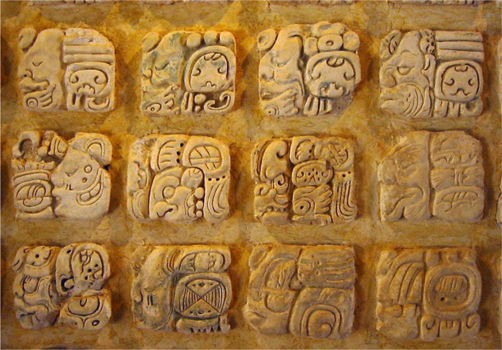

# 팔렝케 — 마야의 글자는 어떻게 도시의 역사가 되었을까

*멕시코 마야 도시의 채색 건축·문자·왕실 기록을 읽는 방법*

Cities · Americas

> 자료 대조를 마친 검토용 이야기입니다. 공개 게시 승인은 아직 받지 않았습니다.

*Kwamikagami / Wikimedia Commons · Public Domain. OpenStax 수록 원본 사진.*

[이미지 출처·제작 근거](https://raw.githubusercontent.com/openstax/osbooks-world-history/main/media/OSX_WorldHist_A08_02_MayaScrip.jpg) · Public Domain

마야 유적의 문자를 처음 보면 사람의 얼굴과 기묘한 무늬를 정교하게 이어 붙인 장식처럼 느껴질 수 있다. 그러나 그 안에는 읽을 수 있는 말이 있다. 오늘날 멕시코에 있는 팔렝케의 문자 자료를 출발점으로 삼으면 마야의 도시가 돌과 건축만 남긴 곳이 아니라는 사실이 보인다.

문자는 왕과 전쟁, 의례와 시간을 기록했다. 연구자들이 그것을 읽을 수 있게 되면서 침묵하는 듯했던 유적의 모습도 달라졌다. 이름 모를 사람들이 만든 신비한 건축이라는 인상에서, 스스로 과거를 남긴 사회의 역사로 한 걸음 더 들어갈 수 있게 된 것이다.

## 01. 마야 세계는 하나의 제국과 달랐다

마야의 여러 도시는 단 한 명의 황제가 모두 다스린 나라와 같지 않았다. 고전기에는 수많은 도시국가가 있었고 팔렝케도 그 가운데 하나였다. 각 도시에는 통치자가 있었으며 서로 경쟁하고 동맹을 맺었다. 오늘의 국가 지도와 당시의 정치 지도를 그대로 겹칠 수 없는 이유다.

도시마다 별도의 권력이 있었다는 사실을 알면 큰 사원과 기록도 다르게 보인다. 그것은 마야 전체를 위한 기념물이라는 넓은 설명만으로 끝나지 않는다. 특정 도시의 왕실이 자신의 위상을 드러내고 기억을 남기는 행위였다. 이웃 도시와의 관계도 그 기억에 들어간다.

## 02. 하얀 유적이 원래의 색은 아니다

지금 보는 석조 유적에서는 돌의 밝은 색과 녹색 숲의 대비가 눈에 띈다. 하지만 고전기의 마야 건축에는 채색이 있었다. 색이 사라진 표면을 처음부터 장식 없는 흰 건축으로 상상하면 과거의 시각적 경험을 놓친다. 남아 있는 모습은 긴 시간의 결과다.

문자와 조각도 같은 공간 안에서 보아야 한다. 건축의 규모와 표면의 표현이 함께 통치자의 이야기를 전했다. 유적은 그저 실용적인 건물의 잔해가 아니라 사람들에게 무엇인가를 보여 주려 했던 공간이다. 글을 읽을 수 있는 사람과 그렇지 못한 사람의 경험도 같지 않았을 것이다.

## 03. 그림처럼 보이는 기호 안에 소리가 들어 있다

마야 문자에는 언어의 소리를 기록하는 요소도 있다. 눈에 보이는 대상을 단순히 그림으로 그려 뜻을 전하는 방식만으로 설명할 수 없다. 복잡한 기호를 실제 언어와 연결해 읽어야 인물과 사건에 접근할 수 있다. 모양이 아름답다는 감상과 문장을 해독하는 일은 다르다.

연구자들은 오랜 대조와 해독을 거쳐 이런 기록을 읽어 왔다. 글자가 존재한다고 해서 후대의 사람이 곧바로 읽을 수 있는 것은 아니다. 자료가 눈앞에 남아 있는 것과 그 의미에 접근할 수 있는 것 사이에는 연구의 시간이 필요하다. 팔렝케의 문자도 그 과정을 생각하게 한다.

## 04. 왕은 자기 도시의 과거를 어떻게 남겼을까

마야의 비문에는 정치적 역사와 의례, 전투와 계보가 기록되었다. 왕실이 누구와 연결되고 어떤 행위를 했는지 드러내는 자료다. 이름과 사건을 읽을 수 있으면 건축물의 크기만으로 짐작하던 권력의 모습에 구체적인 인물이 들어온다.

그렇다고 기록된 내용이 모두 공정한 역사라는 뜻은 아니다. 통치자가 남기는 전쟁 이야기는 승리와 정당성을 강조할 수 있다. 무엇을 자랑하고 무엇을 생략했는지 묻는 일이 필요하다. 문자를 읽는 단계 다음에는 그 말을 한 권력의 입장까지 읽는 단계가 있다.

## 05. 전쟁은 이웃 도시의 생활도 바꾸었다

마야의 도시국가들은 전쟁을 벌였고 패배한 쪽은 물자나 노동으로 부담을 지기도 했다. 전쟁을 왕들의 영웅담으로만 소개하면 그 결과가 좁아진다. 농산물과 직물, 사람의 일이 다른 권력으로 넘어가는 과정이기도 했다. 왕실의 기록 뒤에는 이런 생활의 변화가 있다.

모든 도시가 언제나 같은 방식으로 지배되었다고 일반화해서는 안 된다. 다만 도시 사이의 경쟁이 실제 자원의 이동과 연결되었다는 점은 중요하다. 웅장한 기념물과 전쟁의 문장은 누가 비용을 감당했는가라는 질문과 함께 읽어야 한다. 권력의 자기소개가 곧 사회 전체의 경험은 아니다.

## 06. 시간의 기록을 종말의 예언으로 바꾸지 않기

마야는 서로 다른 주기의 달력을 사용했고 긴 시간을 세는 방법도 발전시켰다. 날짜를 적는 것은 의례와 정치적 사건을 질서 있게 연결하는 일이었다. 그런데 현대의 대중문화는 그 복잡한 체계를 세계의 끝에 관한 수수께끼로 바꾸어 소개하기도 했다.

대표적인 것이 2012년 종말설이다. 시간의 주기가 끝나고 새 주기로 넘어간다는 사실과 세계가 파괴된다는 주장은 같지 않다. 유적을 신비롭게 보이게 하려고 만든 설명이 오히려 실제 지식을 가릴 수 있다. 기록을 읽는 목적은 낯섦을 과장하는 것이 아니라 그 사회가 시간을 다룬 방식을 이해하는 데 있다.

## 07. 문자를 읽으면 폐허의 침묵도 달라진다

팔렝케를 마야 문자로 읽는 것은 건축 감상을 포기하는 일이 아니다. 그 건축을 세운 사람들이 남기려 했던 말까지 더하는 것이다. 돌과 회반죽의 표면은 장식이면서 기록이었고, 그 기록에는 특정한 권력의 기억이 담겼다. 아름다움과 역사적 해석이 함께 넓어진다.

마야의 과거를 모든 사람이 사라진 문명의 수수께끼로만 대하지 않는 것도 중요하다. 오래된 도시의 변화와 사람들의 완전한 소멸은 같은 말이 아니다. 남은 문자를 읽는 일은 과거를 낭만적인 침묵 속에 가두는 대신, 이름과 말과 선택을 가진 사람들의 시간으로 되돌려 놓는다.

## 이야기의 바탕이 된 자료

- [OpenStax World History — Early Cultures and Civilizations in the Americas](https://raw.githubusercontent.com/openstax/osbooks-world-history/main/modules/m00115/index.cnxml) · 확인일 2026-11-05
  - 확인 내용: 팔렝케와 고전기 마야 도시국가·채색 건축·왕과 의례/전투/계보의 기록·문자 해독·전쟁과 공납·260일/365일 달력·2012 종말설의 오류

---

[같은 소주제의 이야기](README.md) · [전체 서가](../../README.md)
