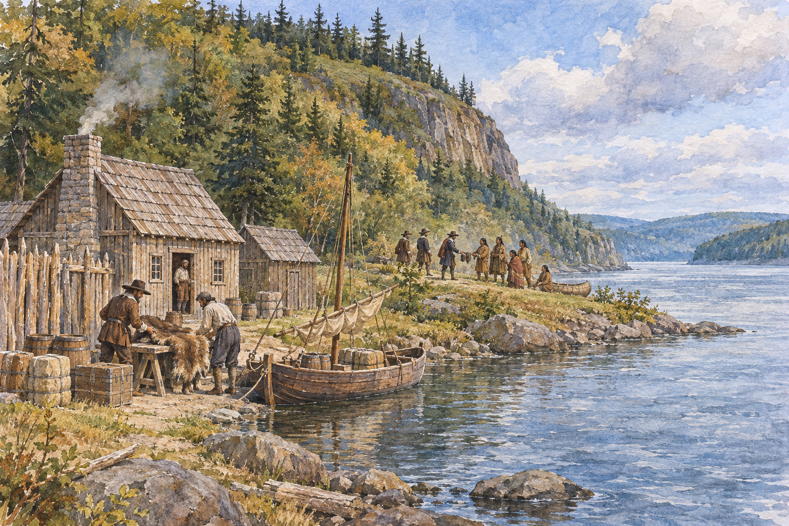

# 퀘벡 1608 — 강가의 작은 거처는 어떻게 교역의 중심이 되었을까

*샹플랭의 거처와 모피 교역으로 살피는 세인트로렌스강의 도시*

Cities · Americas

> 자료 대조를 마친 검토용 이야기입니다. 공개 게시 승인은 아직 받지 않았습니다.

*AI 이야기 장면 삽화 · 작품·역사적 상황을 떠올리기 위한 그림이며 실제 사진이나 정확한 복원이 아닙니다.*

큰 도시의 시작을 살펴보면 처음에는 창고와 거처, 물자를 내릴 강가가 보일 때가 있다. 사뮈엘 드 샹플랭이 1608년 프랑스 정착지를 세운 퀘벡도 그렇다. 세인트로렌스강의 위치와 교역의 가능성, 겨울을 살아남는 문제들이 먼 미래의 도시보다 먼저 있었다.

이것을 프랑스인이 빈 땅에 도시를 발명한 이야기로 읽어서는 안 된다. 강과 주변 지역에는 이미 원주민의 이동과 생활, 교역의 관계가 있었다. 샹플랭의 기록과 모피 교역의 배경을 함께 보면 작은 거처의 역사가 더 넓은 사람들의 만남으로 이어진다.

## 01. 강은 물길이면서 안쪽 세계로 이어지는 길이었다

세인트로렌스강은 배가 드나드는 공간이자 내륙으로 연결되는 통로였다. 강가에 정착지를 마련하는 일은 집 지을 땅을 얻는 것 이상을 뜻했다. 사람과 물자를 어느 방향으로 보낼지, 누가 그 이동을 관리할지의 문제와 이어졌다. 위치 자체가 경제적 가능성이었다.

오늘의 교통 지도를 떠올려 강을 풍경으로만 보면 이 중요성이 잘 보이지 않는다. 당시 물길은 먼 거리를 잇는 실제의 길이었다. 도시는 길이 모이고 물자가 머무는 곳에서 성장할 수 있었다. 퀘벡의 시작을 읽을 때에도 건물보다 먼저 강의 방향을 보는 것이 좋다.

## 02. 샹플랭은 무엇부터 만들었을까

샹플랭은 적합한 정착지를 살핀 뒤 나무를 베고 건설을 시작한 과정을 기록했다. 작업자는 판자를 켜고 땅을 파고 다른 곳에서 물자를 가져왔다. 그는 보급품을 비로부터 지킬 창고를 먼저 마련한 일도 설명한다. 거대한 계획보다 식량과 자재를 보존하는 일이 급했던 것이다.

이런 세부는 도시 건설을 영웅 한 사람의 결단으로만 설명하는 방식을 바꾼다. 장소를 고른 사람과 실제로 작업한 사람, 보급을 맡은 사람의 일이 함께 필요했다. 한 사람의 이름으로 기억되는 출발에도 여러 종류의 노동이 들어 있다.

## 03. 모피는 멀리 있는 소비와 강가를 연결했다

프랑스의 북아메리카 진출에서 모피는 중요한 상품이었다. 유럽의 시장에서 값이 나가는 동물의 가죽이 바다 건너 교역을 이끌었다. 강가의 정착지는 물건을 모으고 옮기는 거점이 될 수 있었다. 작아 보이는 건물이 먼 소비자의 욕망과 연결된 것이다.

하지만 정착민이 스스로 모든 지역을 알고 사냥하고 운송한 것은 아니다. 현지의 땅과 물길을 아는 원주민 공동체와의 관계가 중요했다. 상품을 얻는 일은 단순히 자연 속에서 물건을 꺼내 오는 일이 아니라 이미 존재하던 사람들의 지식과 이동망에 들어가는 과정이었다.

## 04. 교역에는 동맹과 갈등이 함께 있었다

서로 필요한 물건을 주고받는 관계가 생겼다고 이해관계까지 모두 같아지는 것은 아니다. 프랑스인들과 원주민 집단 사이의 동맹은 다른 집단과의 경쟁·갈등에도 연결되었다. 샹플랭의 기록에는 교역뿐 아니라 전투의 장면도 등장한다. 물건을 사고파는 일과 정치가 멀리 떨어져 있지 않았다.

식민지 관계를 언제나 우호적인 만남이나 언제나 같은 형태의 충돌로만 설명하면 구체성이 사라진다. 누가 누구와 어떤 조건에서 관계를 맺었는지 봐야 한다. 또한 원주민을 하나의 생각으로 움직이는 단일 집단처럼 부르지 않는 것이 중요하다.

## 05. 작은 거처에서 겨울을 지나는 일

초기 정착지는 추위와 식량, 질병의 문제를 겪었다. 강을 통해 들어온 사람들이 그 강가에서 겨울을 보내는 일은 도착 자체와 다른 난관이었다. 무역의 가능성을 발견했다는 사실만으로 안정적인 생활이 곧바로 만들어지지는 않았다. 몸이 견딜 조건을 마련해야 했다.

이런 생활의 제약을 알면 정착지의 창고와 건물 배치도 다르게 보인다. 화려한 도시 계획보다 보급을 지키고 일상을 유지하는 기능이 먼저였다. 오늘의 거리 아래에는 이런 작고 불안정한 거처의 시간이 있다. 도시가 성장한 결과만 보면 잊기 쉬운 부분이다.

## 06. 기록에 있는 퀘벡과 그 바깥의 퀘벡

샹플랭은 장소와 지도, 건설 과정을 자세히 남겼다. 덕분에 초기 정착의 구체적인 모습을 알 수 있지만 그의 글은 프랑스 진출을 이끈 사람의 기록이다. 주변 사람들에 대한 평가와 자신의 목적이 서술에 함께 들어 있다. 잘 적힌 기록도 하나의 입장에서 쓰였다는 사실은 달라지지 않는다.

지도에 붙인 이름과 설명을 읽을 때에도 그곳을 먼저 이용하던 사람들이 무엇이라고 부르고 어떻게 기억했는지의 질문이 남는다. 유럽인의 기록에서 처음 나타났다고 그 이전에 장소의 역사가 없었던 것은 아니다. 자료가 풍부한 쪽의 목소리만 전체로 받아들이지 않는 태도가 필요하다.

## 07. 캐나다의 도시를 더 긴 시간 속에 놓기

1608년은 퀘벡의 프랑스 정착지를 설명하는 중요한 출발점이다. 그러나 오늘의 캐나다가 그때 지금의 모습으로 탄생했다는 뜻은 아니다. 왕실과 회사, 교역망과 여러 공동체가 얽힌 뉴프랑스의 시간과 현대의 국가는 구별해야 한다.

샹플랭의 지도 설명에는 정원과 작은 물길, 농사와 시설에 이용할 만한 곳도 표시된다. 새 장소를 보는 눈이 이미 생활과 작업의 필요를 따라 움직였음을 알 수 있다. 지도를 풍경의 축소판보다 앞으로 할 일을 정리하는 도구로 읽을 수도 있다.

강가의 작은 거처를 떠올리며 도시를 보면 창고와 배, 모피와 식량, 서로 다른 사람들이 한눈에 들어온다. 퀘벡의 기원은 돌로 된 건물의 연대만이 아니다. 강을 따라 무엇이 오갔고 그 이동을 통해 어떤 관계가 생겼는지 읽는 일에서 도시의 역사가 넓어진다.

## 이야기의 바탕이 된 자료

- [Samuel de Champlain, Voyages, Volume 2 — First Voyage as Lieutenant 1608–1610](https://raw.githubusercontent.com/GITenberg/Voyages-of-Samuel-De-Champlain-Volume-02_6749/master/6749-0.txt) · 확인일 2026-11-05
  - 확인 내용: 퀘벡 장소 선택·벌목/판재/도랑/창고/보급·지도 범례·겨울과 질병·동맹과 전투. 원주민에 대한 옛 표현은 전재하지 않음
- [OpenStax World History — European Colonization in the Americas](https://raw.githubusercontent.com/openstax/osbooks-world-history/main/modules/m00076/index.cnxml) · 확인일 2026-11-05
  - 확인 내용: 1608년 샹플랭의 정착지·모피 중심 교역·원주민의 지리 지식과 관계·뉴프랑스의 식민지 맥락

---

[같은 소주제의 이야기](README.md) · [전체 서가](../../README.md)
