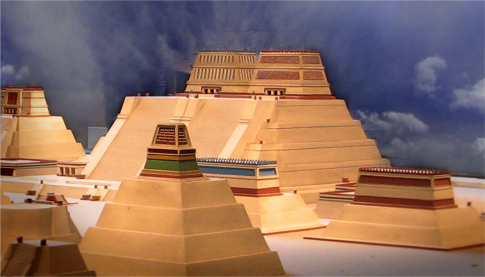

# 테노치티틀란 — 호수 위의 도시는 어떻게 먹고살았을까

*피라미드 너머에서 만나는 물길과 밭, 집의 이야기*

Cities · Americas

> 자료 대조를 마친 검토용 이야기입니다. 공개 게시 승인은 아직 받지 않았습니다.

*“Model of the Templo Mayor (main temple) of Tenochtitlan” · schizoform / Wikimedia Commons · CC BY 2.0 · OpenStax 수록. 고대 건물의 현장 사진이 아닌 현대 모형입니다.*

[이미지 출처·제작 근거](https://raw.githubusercontent.com/openstax/osbooks-world-history/main/media/OSX_WorldHist_A08_03_TemploMay.jpg) · CC BY 2.0

큰 도시를 짓고 싶은데 눈앞에 호수가 있다. 물을 피해 다른 곳으로 가는 방법도 있겠지만, 멕시코 분지에서는 호수의 섬들이 거대한 수도의 바탕이 되었다. 아스테카의 테노치티틀란이다. 이름은 조금 길어도 출발 장면은 쉽게 떠올릴 수 있다.

이 도시를 설명할 때는 높이 솟은 신전이 먼저 등장하곤 한다. 그러나 신전 계단 아래에서도 매일 식사가 필요했고, 사람은 집으로 돌아가야 했으며, 물건은 제때 도착해야 했다. 오늘은 유명한 꼭대기보다 도시를 계속 움직이게 한 낮은 곳의 이야기를 따라가 보자.

## 1. 작은 섬의 정착지가 수도로

아스테카 사람들은 1325년 무렵 텍스코코호의 섬들에서 도시를 만들기 시작했다. 초기에는 주변 세력과 거래하고 군사 활동에 참여하며 살아남았다. 처음부터 멕시코 중부를 지배하는 거대한 수도가 완성되어 있었던 것은 아니다.

1428년에는 테노치티틀란이 텍스코코, 틀라코판과 삼각동맹을 이루어 지역의 강력한 세력을 꺾었다. 이후 지배 영역이 확대되면서 수도의 위상도 커졌다. 도시는 좋은 자리에 건물을 모은 결과인 동시에, 주변과 어떤 관계를 맺었는지를 보여 주는 장소였다.

## 2. 육지에 닿는 길이 필요했다

16세기 초 테노치티틀란은 적어도 20만 명이 살았던 것으로 교재는 설명한다. 당시의 정확한 인구를 오늘날 주민등록 통계처럼 확정할 수는 없지만, 대규모 도시였다는 점은 분명하다. 섬과 호숫가를 연결하는 큰 제방길들이 바깥으로 뻗어 있었다.

제방길은 성곽도시의 문 앞 도로와는 조건이 다르다. 양옆이 물이기 때문이다. 사람과 물자가 드나드는 연결부가 어디에 놓였는지 생각해 보면, 호수가 도시를 보호하는 환경이면서 이동의 방법을 따로 마련해야 하는 조건이기도 했음을 이해할 수 있다.

## 3. 치남파는 떠다니는 화분이 아니다

도시 주변에는 치남파라고 부르는 인공적으로 조성한 경작지가 있었다. 흔히 물 위의 밭이라는 말만 듣고 작은 뗏목처럼 떠다니는 모습을 상상하지만, 호수의 얕은 곳에 흙 등을 쌓아 만든 고정된 밭으로 이해하는 편이 맞다. 그 사이의 수로는 물을 대고 이동하는 데 쓰였다.

이 밭들은 도시 주민에게 먹을거리를 공급했다. 건물을 세운 뒤 식량 문제를 따로 해결한 것이 아니라, 살 공간과 생산할 공간, 물길이 함께 연결되어 있었던 것이다. 오늘날 도시의 식재료가 어디서 오는지 잘 보이지 않는 것과 비교하면 호수 도시의 구조가 더 구체적으로 느껴진다.

## 4. 물가의 집에서 중심의 신전까지

주민의 집은 흙벽돌과 평평한 지붕, 작은 마당을 갖춘 형태가 많았다. 도시 중심에는 신전과 공놀이 경기장, 행정 건물과 지배층의 거처가 모였다. 사람마다 사는 자리와 도시에서 맡은 역할이 같지는 않았다.

함께 실은 이미지는 중심 신전인 템플로 마요르 등을 보여 주는 현대 모형의 사진이다. 실제 고대 건물을 그대로 촬영한 사진은 아니다. 위쪽에 나란히 선 두 신전과 넓은 계단을 보면, 도시 한복판의 제의 공간이 얼마나 두드러진 형태로 구성되었는지 짐작할 수 있다.

## 5. 주변에서 들어오는 물건에도 사연이 있었다

수도는 주변의 경작지뿐 아니라 넓은 지배 지역에서 들어오는 공납에도 의존했다. 지역에 따라 식량과 직물, 도구와 사치품 등 요구받는 물품이 달랐다. 가까운 곳에서 일상적인 먹을거리를, 더 먼 곳에서 특별한 물건을 들여오는 연결도 나타났다.

물건이 도착했다는 결과만 보면 거대한 시장의 풍요처럼 보이지만, 공납은 자유로운 거래와 같지 않다. 지배와 의무의 관계가 있었다. 수도의 번영을 이해하려면 무엇이 얼마나 모였는지뿐 아니라 누가 그것을 만들어 보내야 했는지도 함께 물어야 한다.

## 6. 피라미드만으로 도시 전체를 말할 수 없는 이유

아스테카 국가의 종교 의례에는 인신공희가 포함되어 있었다. 이 사실을 감추지 않더라도 자극적인 장면만으로 도시를 설명할 필요는 없다. 농사와 수공업, 시장 거래와 가정의 노동을 함께 보아야 이 사회가 어떻게 유지되었는지 알 수 있다.

주민들은 같은 높이의 계층에 서 있지 않았다. 귀족과 전문 장인, 상인과 농민, 노예가 된 사람들이 다른 조건에서 살아갔다. 특히 집 안에서 음식을 준비하고 직물을 만드는 일도 매일 도시를 지탱했다. 눈에 크게 보이는 건축과 오래 남기 어려운 일상의 노동은 모두 도시의 역사다.

## 7. 이 도시에 관해 누가 기록했을까

오늘날의 설명에는 원주민 그림 기록과 고고학 자료, 스페인인들이 남긴 기록이 함께 사용된다. 정복 과정에서 많은 토착 기록이 파괴되었고 유럽인의 설명에는 자신의 종교와 가치관이 들어갔다. 따라서 남아 있는 글을 투명한 창처럼 읽을 수는 없다.

테노치티틀란을 처음 떠올릴 때 물 위에 솟은 신전의 모습은 좋은 입구가 된다. 거기서 제방길을 따라가고 밭과 집, 도시로 들어오는 짐을 생각해 보자. 거대한 수도가 유지된 까닭은 인상적인 꼭대기 하나보다, 그 아래 수많은 생활이 서로 연결되어 있었기 때문이다.

## 이야기의 바탕이 된 자료

- [OpenStax World History — 아메리카의 제국과 테노치티틀란](https://raw.githubusercontent.com/openstax/osbooks-world-history/main/modules/m00116/index.cnxml) · 확인일 2026-10-30
  - 확인 내용: 1325년 무렵 도시 건설·1428년 삼각동맹·16세기 초 인구 추정 / 제방길·인공 경작지 치남파와 수로·주택·도시 중심·공납과 계층 / 식민 기록과 토착 기록의 한계; 템플로 마요르 현대 모형의 캡션

---

[같은 소주제의 이야기](README.md) · [전체 서가](../../README.md)
