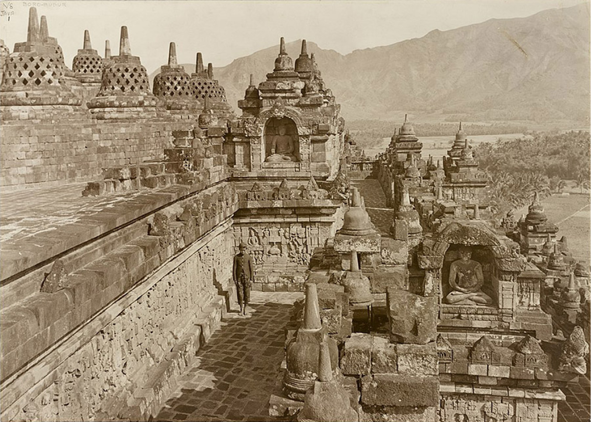

# 보로부두르 — 돌에 새긴 이야기를 따라 걷다

*큰 기념물에서 작은 조각으로 시선을 옮기면*

Cities · Asia

> 자료 대조를 마친 검토용 이야기입니다. 공개 게시 승인은 아직 받지 않았습니다.

*1913년 보로부두르 사진 · State Library of New South Wales, PXD 162/150 / Wikimedia Commons · OpenStax 수록 · Public Domain. 현재 보존 상태를 보여 주는 실시간 사진은 아닙니다.*

[이미지 출처·제작 근거](https://raw.githubusercontent.com/openstax/osbooks-world-history/main/media/OSX_WorldHist_A05_03_Borobudur.jpg) · Public Domain

높은 탑이나 큰 건물을 만나면 먼저 전체를 사진에 담고 싶어진다. 그런데 인도네시아 자바의 보로부두르에서는 조금 가까이 다가갈 이유도 있다. 거대한 구조물의 벽에 작은 장면들이 새겨져 있기 때문이다. 멀리서 본 덩어리와 걸으며 만나는 표면은 서로 다른 경험을 준다.

함께 실은 것은 1913년의 실제 사진이다. 돌길과 조각, 위쪽의 종 모양 구조물, 멀리 보이는 산이 한 화면에 들어온다. 오늘의 관광 안내도는 아니지만, 사람의 크기와 건축의 크기를 비교하며 오래된 장소를 읽기에 좋은 출발점이다.

## 1. 자바에 세워진 불교의 큰 기념물

보로부두르는 오늘날 인도네시아 중부 자바에 있다. 교재는 불교를 후원한 샤일렌드라 왕들의 시기와 이 기념물의 건설을 연결한다. 지금의 국경이나 종교 분포만으로 옛 자바의 모습을 짐작하면 이런 큰 불교 건축의 존재가 뜻밖처럼 느껴질 수 있다.

과거의 동남아시아에는 서로 다른 신앙과 권력이 자리했다. 가까운 지역이라고 모두 같은 길을 걸은 것도 아니다. 보로부두르는 그 가운데 불교가 건축과 미술, 통치자의 후원으로 표현된 경우다. 하나의 유적은 한 나라의 오늘과 다른 시대의 풍경을 함께 보여 준다.

## 2. 한 번에 보이는 건물과 조금씩 만나는 벽

사진 속의 사람을 기준으로 돌벽을 보면 세부 조각의 크기를 가늠할 수 있다. 교재는 이곳에 2,600개가 넘는 부조 패널이 있다고 설명한다. 부조는 돌의 표면을 깎아 장면이 도드라져 보이게 한 표현이다. 숫자를 외우기보다 건축의 많은 면이 이야기의 자리가 되었다고 생각하면 좋다.

멀리서 볼 때는 층과 윤곽이 먼저 눈에 들어온다. 가까이에서는 인물과 장식의 작은 차이를 살피게 된다. 같은 건축물이 시선의 거리에 따라 다르게 읽히는 것이다. 사진 한 장으로 모든 장면의 내용을 알아낼 수는 없지만, 벽이 단순한 경계 이상이라는 점은 느낄 수 있다.

## 3. 구멍 난 종 모양의 구조물

사진의 위쪽에는 작은 구멍이 난 종 모양의 스투파들이 보인다. 교재는 중앙의 큰 구조물 주위에 72개의 이런 스투파가 있다고 소개한다. 처음 보는 사람에게는 돌로 만든 바구니처럼 느껴질 수도 있다. 낯선 이름을 외우기 전에 반복되는 모양을 살펴보자.

작은 형태들이 함께 놓이면 전체의 질서가 생긴다. 각각의 구멍과 곡면, 그 너머의 산을 번갈아 보면 돌 건축이 주변 풍경과 만나는 방식도 보인다. 사진에서 확인한 형태와 종교적 상징의 세부 해석은 구분해야 한다. 보이는 모든 장식을 마음대로 하나의 뜻으로 풀 필요는 없다.

## 4. 멀리서 찾아온 사람들이 남긴 것

교재는 동남아시아 여러 지역의 불교도들이 보로부두르를 순례했고, 흙으로 만든 작은 판과 그릇 같은 봉헌물을 남겼다고 설명한다. 큰 돌 건물만 있었던 것이 아니라 그곳으로 이동한 사람들의 작은 물건도 있었다. 기념물의 역사는 건설을 끝낸 날 뒤에도 이어졌다.

순례는 신앙을 특정 장소에서 실천하는 여행이었다. 누가 어느 날 어떤 마음으로 왔는지까지 기록 없이 복원할 수는 없다. 다만 찾아온 사람들이 흔적을 남겼다는 사실에서 건축이 반복되는 방문의 목적지가 되었음을 알 수 있다. 큰 유적 옆의 작은 물건도 중요한 자료가 된다.

## 5. 섬은 바깥 세계와 단절되어 있지 않았다

자바가 섬이라는 이유로 고립된 장소였다고 생각하기 쉽다. 그러나 교재는 이 지역을 인도양과 해협을 통한 교역의 흐름 속에서 설명한다. 인도에서 전해진 종교와 미술의 영향도 있었다. 바다는 떨어뜨리는 경계이면서 사람과 생각이 오가는 길이기도 했다.

그렇다고 보로부두르를 외부의 설계를 그대로 옮겨 놓은 물건으로만 볼 수는 없다. 무엇을 받아들이고 어떤 규모로 세우며 어떻게 후원할지는 현지의 선택과 역량에 달려 있었다. 영향을 주고받는다는 말에는 받는 쪽의 활동도 들어 있다. 커다란 돌 건축 자체가 그 노력을 보여 준다.

## 6. 경건함과 왕의 권위가 만나는 자리

교재는 이 지역의 통치자들이 신앙을 후원하며 자신의 정당성을 드러냈다고 설명한다. 종교 건축은 신앙의 표현이면서 많은 자원과 노동을 모을 수 있는 힘의 표시이기도 했다. 아름다움과 권력은 같은 장소에 함께 남을 수 있다.

다만 이런 관계를 안다고 모든 방문자의 경험이 같았다고 할 수는 없다. 왕실의 목적과 순례자의 기도, 돌을 다듬은 사람의 일은 서로 다른 자리에서 이루어졌다. 한 건물에 참여한 여러 사람의 역할을 생각하면 기념물은 이름난 왕 한 명의 업적으로만 머물지 않는다.

## 7. 1913년의 사진이라는 거리

이 사진은 현재의 보존 상태를 실시간으로 보여 주지 않는다. 또한 사진에 사람이 한 명 보인다고 당시 방문자가 늘 적었다고 결론 낼 수도 없다. 촬영된 순간과 유적 전체의 오랜 역사는 다른 범위의 자료다. 사진의 연도를 아는 일은 상상을 막기보다 감상의 자리를 정확히 잡아 준다.

대신 사진이 잘 보여 주는 것을 차분히 읽을 수 있다. 돌의 반복, 길과 벽의 관계, 조각 옆에 선 사람의 크기다. 오래된 사진을 보는 즐거움은 당시의 모든 것을 안다고 느끼는 데만 있지 않다. 무엇이 남아 있고 무엇은 화면 밖에 있는지 찾아보는 데에도 있다.

## 8. 큰 풍경 속의 작은 이야기를 보기

보로부두르를 기억할 때는 거대한 기념물의 윤곽과 작은 돌조각을 함께 떠올려 보자. 멀리서 바라보고 가까이에서 살피는 두 시선이 한 장소 안에 있다. 여기에 바다를 건너온 신앙과 순례자의 물건까지 더하면 돌 건축은 훨씬 많은 움직임을 품는다.

다음에 유명한 건축을 만나면 전체 사진을 찍은 뒤 벽 가까이에서도 잠시 멈춰 보면 어떨까. 하나의 장면과 반복되는 모양이 눈에 들어올 수 있다. 보로부두르는 큰 장소를 이해하는 또 하나의 방법이 작은 표면을 읽는 일임을 알려 준다.

## 이야기의 바탕이 된 자료

- [OpenStax World History — 자바와 보로부두르](https://raw.githubusercontent.com/openstax/osbooks-world-history/main/modules/m00129/index.cnxml) · 확인일 2026-10-31
  - 확인 내용: 샤일렌드라 왕조의 불교 후원·순례와 교역 / 1913년 사진·부조 패널과 72개 스투파

---

[같은 소주제의 이야기](README.md) · [전체 서가](../../README.md)
