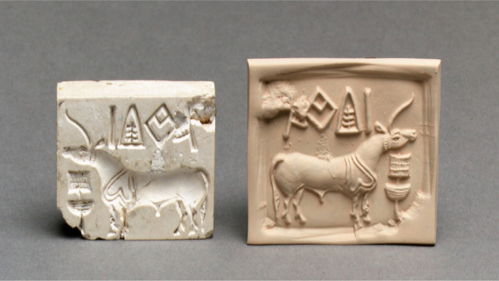

# 하라파 — 작은 인장은 왜 먼 도시에서 나왔을까

*아직 읽지 못한 글자와 물건이 건너간 길*

Cities · Asia

> 자료 대조를 마친 검토용 이야기입니다. 공개 게시 승인은 아직 받지 않았습니다.

*Metropolitan Museum of Art, Dodge Fund, 1949 · OpenStax 수록 · Public Domain. 왼쪽은 인더스 문명의 실제 인장, 오른쪽은 현대에 만든 압인입니다. 하라파에서 출토된 특정 인장이라고 단정하지 않습니다.*

[이미지 출처·제작 근거](https://raw.githubusercontent.com/openstax/osbooks-world-history/main/media/OSX_WorldHist_A03_04_IndusSeal2.jpg) · Public Domain

손바닥보다 작은 인장 하나에는 동물과 짧은 기호들이 새겨져 있다. 큰 궁전이나 왕의 무덤처럼 시선을 압도하지는 않는다. 그런데 이런 작은 물건은 오래된 도시가 다른 지역과 어떻게 연결되었는지 묻는 중요한 단서가 된다.

인더스 문명의 하라파를 만날 때도 그렇다. 도시의 이름은 낯설어도 물건에 표시를 남기고 다른 곳으로 보내는 일은 익숙하다. 함께 실은 실제 인장 사진에서 출발해, 옛 사람들은 무엇을 구별하려 했고 우리는 어디까지 읽을 수 있는지 살펴보자.

## 1. 하라파라는 이름이 문명의 이름이 되다

인더스 문명은 오늘날 파키스탄과 인도에 걸친 넓은 지역에서 발전했다. 하라파는 그 대표적인 고고학 유적 가운데 하나다. 교재는 근대의 연구에서 하라파가 일찍 알려진 주요 유적이어서 이 문명을 하라파 문명이라고도 부른다고 설명한다.

도시 하나의 이름이 넓은 문화를 가리키는 말이 된 셈이다. 그렇다고 그 넓은 지역이 언제나 한 왕의 명령 아래 움직였다는 뜻은 아니다. 정치 조직의 모습에는 아직 불확실한 부분이 있다. 같은 이름으로 묶는 일과 실제 통치 방식을 아는 일은 구별할 필요가 있다.

## 2. 큰 건물만으로 도시를 읽지 않기

교재는 인더스 도시들에서 잘 정리된 거리와 주거 구역, 작업장, 배수 시설이 발견되었다고 설명한다. 하라파에도 물건을 만드는 구역과 노동자의 거주 흔적이 있었다. 도시의 힘은 눈에 띄는 기념물뿐 아니라 일상을 조직하는 시설에서도 드러난다.

다만 모든 유적의 시설이 똑같다는 뜻은 아니다. 모헨조다로에서 확인된 특정 건물을 그대로 하라파의 건물로 옮겨 말해서는 안 된다. 여러 도시가 공유한 특징과 한 장소에서 직접 확인한 사실을 나누면, 닮은 문명이라는 말 안의 차이도 볼 수 있다.

## 3. 인장은 물건에 남기는 작은 표지였다

인더스 인장에는 동물과 사람의 모습, 짧은 기호가 새겨져 있다. 교재는 이런 인장으로 부드러운 점토에 자국을 남겨 그릇이나 짐과 관련된 표시를 했다고 설명한다. 새긴 물건과 그것이 남긴 흔적은 서로 연결되는 두 부분이다.

오늘의 택배 상자에 붙은 정보표와 완전히 같은 것은 아니다. 다만 여러 사람의 물건이 오갈 때 무엇을 구별하고 어떻게 확인할지라는 질문은 떠올릴 수 있다. 이름인지 지위인지, 소유와 거래의 어떤 내용을 표시했는지 세부는 아직 단정할 수 없다. 기능의 추정과 기호의 정확한 번역은 다르다.

## 4. 사진에는 옛 물건과 새 자국이 함께 있다

함께 실은 사진의 왼쪽은 인더스 문명의 실제 인장이고, 오른쪽은 그것을 눌러 만든 현대의 점토 압인이다. 두 물건이 모두 고대에 제작된 한 쌍은 아니다. 원래 새긴 면이 어떤 흔적을 만드는지 보기 좋게 함께 제시한 것이다.

이 차이를 알면 동물의 방향과 기호의 배치도 비교하게 된다. 거울처럼 뒤집히는 관계를 눈으로 살펴볼 수 있다. 사진의 설명을 읽는 일은 감상을 방해하는 부록이 아니다. 눈앞의 자료가 무엇이며 어떤 과정을 보여 주는지 정확하게 보는 첫 단계다.

## 5. 먼 메소포타미아에서도 발견되다

교재는 인더스 계통의 인장이 메소포타미아의 우르 같은 도시에서도 발견되었다고 설명한다. 인더스와 메소포타미아 사이에는 바다와 육지를 통한 교역이 있었다. 귀한 돌과 조개 같은 물품도 오갔다. 작은 인장이 자기 지역 밖에서 나온다는 사실이 그 연결을 보여 준다.

하지만 인장 한 개가 발견되었다고 특정 상인의 전체 여행을 복원할 수는 없다. 물건은 여러 사람의 손을 거쳤을 수 있기 때문이다. 자료가 알려 주는 교류의 존재와 우리가 붙이고 싶은 한 사람의 모험담은 다른 것이다. 정확히 아는 범위 안에서도 이동의 규모는 충분히 흥미롭다.

## 6. 그림을 알아보는 일과 글자를 읽는 일

사진에서 동물의 모양을 알아볼 수 있다고 그 위의 기호까지 읽은 것은 아니다. 인더스 문자는 아직 해독되지 않았다. 짧은 표시들이 어떤 언어를 담았는지, 모든 기호가 무엇을 뜻했는지는 합의된 해답이 없다. 익숙한 문자처럼 소리를 붙여 읽을 수 없는 상태다.

그렇다고 아무것도 연구할 수 없다는 뜻은 아니다. 기호의 반복과 배열, 발견된 장소를 비교할 수 있다. 다만 규칙을 찾았다는 말과 번역에 성공했다는 말은 다르다. 미지의 자료에서 흥미로운 패턴이 보일수록 그 차이를 지키는 일이 중요해진다.

## 7. 조용한 도시가 남기는 여러 증거

왕의 이름이 적힌 긴 기록을 읽을 수 없는 상황에서는 건물과 도구, 인장 같은 물건의 비중이 커진다. 도시의 주민이 글을 남기지 않았다는 말보다는 그들이 남긴 기호를 우리가 아직 읽지 못한다고 표현하는 편이 정확하다. 침묵은 때로 자료보다 독자의 능력에 있다.

하라파를 이해하는 일은 흩어진 단서를 함께 놓는 과정이다. 거리의 배치와 생산의 흔적, 먼 곳에서 나온 물건이 서로를 보완한다. 어느 한 종류의 유물만으로 사회 전체를 다 설명하지 않아도 된다. 질문을 여러 자료에 나누어 묻는 방식이 필요한 것이다.

## 8. 작은 물건이 넓혀 주는 세계

큰 도시의 이야기를 작은 인장으로 시작하면 시선이 달라진다. 이름난 통치자의 업적보다 물건을 만들고 표시하고 운반한 사람들이 떠오른다. 아직 읽지 못한 기호 옆에도 확실히 관찰할 수 있는 돌의 모양과 자국, 발견 장소의 연결이 있다.

다음에 박물관에서 작은 표지가 붙은 인장을 만나면 잠깐 멈춰 보자. 무엇을 새겼는지와 어디에서 나왔는지를 함께 읽으면 좋다. 하라파의 작은 인장은 알아낸 것과 남은 수수께끼를 나란히 놓을 때 오래된 도시의 세계가 더 넓어진다는 것을 보여 준다.

## 이야기의 바탕이 된 자료

- [OpenStax World History — 인더스 문명의 도시와 인장](https://raw.githubusercontent.com/openstax/osbooks-world-history/main/modules/m00107/index.cnxml) · 확인일 2026-10-31
  - 확인 내용: 하라파 명칭·도시 구획·배수와 생산 활동 / 인장의 점토 압인·우르의 인더스 인장·메소포타미아 교역 / 미해독 문자·실제 인장과 현대 압인의 구별

---

[같은 소주제의 이야기](README.md) · [전체 서가](../../README.md)
