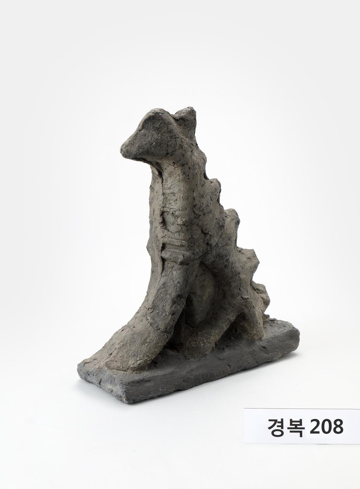

# 궁궐 지붕 위에는 낯선 동물이 앉아 있었다

*근정문에서 내려온 천산갑 잡상*

Cities · Asia

> 출처 대조와 공개 게시 승인을 마친 이야기입니다. 실제 게시 여부는 사이트 배포 상태를 따릅니다.

*잡상 '천산갑' · 국립고궁박물관 소장·제공. 전체 사진을 자르지 않고 사용했습니다.*

[이미지 출처·제작 근거](https://www.gogung.go.kr/gogung/pgm/psgudMng/view.do?menuNo=800065&psgudSn=438950) · 공공누리 제1유형(출처표시)

궁궐 지붕을 올려다보면 끝부분을 따라 작은 형상들이 늘어서 있다. 멀리서는 윤곽만 보여서 모두 비슷한 조각처럼 느껴지기 쉽다. 가까이 보면 그중 하나는 굵은 목과 작은 얼굴을 가진 낯선 모습이다.

국립고궁박물관이 천산갑이라고 소개하는 잡상이다. 경복궁 근정문 지붕의 추녀마루에 올렸던 것 가운데 하나다. 원래는 고개를 한참 들어야 보았을 물건을 이제 사진에서 눈높이로 만난다.

## 1. 등을 따라 돋은 모양

박물관 설명은 이 잡상에 뿔과 비늘이 있고 등에 규칙적인 돌기가 돋았다고 알려 준다. 사진을 보면 얼굴보다 몸을 따라 이어지는 굴곡이 먼저 인상에 남을 수도 있다.

한 방향에서만 보고 동물 이름 맞히기를 할 필요는 없다. 천산갑을 형상화한 지붕 장식이라는 박물관의 명칭과 실제 조각의 특징을 함께 읽으면 된다. 살아 있는 동물의 몸을 정확히 재현한 모형으로 생각할 물건은 아니다.

## 2. 만든 해는 조금 넓게 읽기

소장품 설명은 1867년 근정문을 다시 세울 때 또는 그 이후에 지붕에 올린 잡상이라고 한다. 딱 한 해에 제작되었다고 못 박는 대신 가능한 시기를 열어 놓은 설명이다.

이 차이는 작아 보여도 물건의 이력을 이해할 때 도움이 된다. 건물이 다시 세워진 해를 안다고 그 위의 모든 장식이 그날 함께 만들어졌다고 정할 수는 없는 것이다. 익숙한 궁궐에도 이렇게 조금씩 따로 확인해야 할 시간이 남아 있다.

## 3. 지붕의 선을 따라 놓인 작은 몸

추녀마루는 지붕 끝을 향해 시선이 흘러가는 자리다. 그 위에 놓인 형상은 실내에서 손에 들고 보는 조각과 다른 조건을 가진다. 보는 사람은 대개 아래에서 올려다보고, 세부보다 윤곽을 먼저 만난다. 큰 건축물의 가장자리에서 작은 조각이 어떻게 눈에 들어오는지 생각하면 장식의 자리가 구체적으로 느껴진다.

오늘 소장품 사진으로 보는 물건은 그 거리를 크게 줄여 준다. 멀리서는 한 덩어리였을 몸이 굵은 목과 작은 얼굴, 등 위의 돌기로 나뉜다. 높은 곳에서 보았던 경험과 눈높이에서 살펴보는 경험이 같은 것은 아니다. 박물관의 사진은 원래의 위치에서는 지나쳤을 특징을 알아차리게 한다.

## 4. 동물의 이름과 조각의 형상을 구분하기

천산갑이라는 명칭을 들으면 비늘로 덮인 실제 동물을 떠올릴 수 있다. 그러나 이 잡상은 생물학 수업의 표본으로 제작된 것이 아니다. 박물관이 소개하는 뿔과 돌기, 몸의 비례를 함께 보면 동물의 특징을 장식의 언어로 바꾼 형상으로 읽는 편이 자연스럽다. 이름을 맞혔다고 관찰이 모두 끝나는 것도 아니다.

어느 부분을 크게 하고 무엇을 단순하게 만들었는지 살펴보면 재미가 생긴다. 얼굴보다 목과 등에 더 눈이 갈 수도 있고, 옆모습에서만 윤곽이 분명해질 수도 있다. 이는 실제 물건을 보는 방법에 관한 제안이다. 조각의 모든 특징마다 반드시 숨은 상징 하나를 찾아 붙여야 한다는 뜻은 아니다.

## 5. 건물의 나이와 장식의 나이는 다를 수 있다

1867년 중건 때 또는 그 이후라는 설명은 건물과 부속물의 관계를 생각하게 한다. 건축물은 한 번 지어진 뒤에도 고치고 바꾸는 시간을 거칠 수 있다. 지붕 위 장식이 현재까지 남았다고 해서 처음의 모든 부재가 같은 시기에 만들어져 그대로 이어졌다고 단정할 수는 없다.

소장품 설명에 남은 넓은 시기 범위는 정보가 무의미하다는 뜻이 아니다. 어디까지 확인되고 어디부터 더 알아보아야 하는지 표시한 것이다. 연도를 딱 하나 외우는 대신 건물의 중건과 장식의 설치를 나누어 기억하면, 궁궐을 멈춘 그림이 아니라 여러 번 손본 장소로 볼 수 있다.

## 6. 큰 문을 지나기 전에 잠시 올려다보기

궁궐을 걷는 사람은 대문이 열어 주는 통로를 따라 이동한다. 잡상은 그 통로보다 높은 곳에서 다른 종류의 리듬을 만든다. 멀리서 이어진 작은 형상들이 줄을 이루고, 가까운 자료에서는 각각 다른 몸이 드러난다. 전체 건물에서 세부로 내려오는 보기와, 세부를 알고 다시 전체를 보는 보기가 오갈 수 있다.

이 물건을 다음에 떠올릴 때에는 어려운 이름 하나보다 목과 등의 모양을 먼저 기억해 보아도 좋다. 비슷하게 보이는 장식이 실제로는 다를 수 있다는 작은 단서다. 건축을 깊게 본다는 일은 전문 용어를 많이 쓰는 것보다, 늘 지나치던 자리에서 무엇이 달랐는지 알아보는 데서 시작되기도 한다.

## 7. 다음에는 지붕 끝을 보기

궁궐에 가면 큰 문이나 현판을 먼저 찾기 쉽다. 이 잡상을 한 번 보고 나면 시선이 지붕의 가장자리로도 향할 것 같다. 작게 보이던 윤곽 하나하나에 서로 다른 모습이 들어 있을 수 있기 때문이다.

상징의 뜻을 전부 외우지 않아도 괜찮다. 오늘은 굵은 목과 등 위의 돌기 정도만 기억해 보자. 이름조차 낯설던 조각 하나가 다음 궁궐 산책에서 눈길을 붙잡는 표지가 될 수 있다.

## 이야기의 바탕이 된 자료

- [국립고궁박물관 — 잡상 '천산갑'](https://www.gogung.go.kr/gogung/pgm/psgudMng/view.do?menuNo=800065&psgudSn=438950) · 확인일 2026-10-28
  - 확인 내용: 근정문 추녀마루 잡상과 천산갑 형상 / 1867년 중건 때 또는 이후 설치라는 범위 / 굵은 목·작은 얼굴·뿔·비늘·등 돌기

---

[같은 소주제의 이야기](README.md) · [전체 서가](../../README.md)
