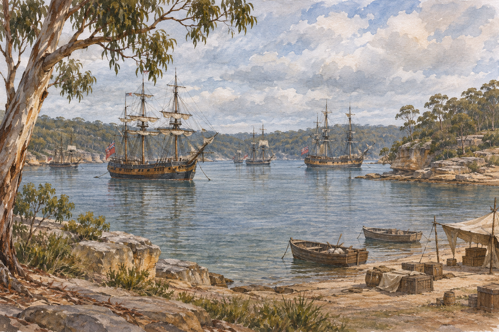

# 시드니 코브 1788 — 배가 도착했다고 역사가 시작된 것은 아니다

*첫 선단의 항해·정착 노동·원주민 접촉을 기록자의 시선과 함께 읽기*

Cities · Asia

> 출처 대조와 공개 게시 승인을 마친 이야기입니다. 실제 게시 여부는 사이트 배포 상태를 따릅니다.

*AI 이야기 장면 삽화 · 작품·역사적 상황을 떠올리기 위한 그림이며 실제 사진이나 정확한 복원이 아닙니다.*

오늘의 시드니를 떠올리면 항구와 오페라하우스가 먼저 보이지만 1788년의 만에는 전혀 다른 배들이 들어왔다. 영국에서 죄수와 해병대, 관리와 물자를 실어 온 선단이었다. 이 도착은 이후 도시의 형성에 중요한 사건이지만 그 땅에 사람이 처음 나타난 순간은 아니었다.

새 정착지에 관한 기록을 남긴 해병대 장교 왓킨 텐치의 글을 따라가면 긴 항해와 장소 선택, 물과 식량의 문제를 구체적으로 볼 수 있다. 동시에 그의 글이 도착한 사람의 시선이라는 점도 기억해야 한다. 항구에는 서로 다른 삶의 시간이 만나고 있었다.

## 01. 죄수를 싣고 간 선단은 어떤 이동이었을까

1787년 영국을 떠난 첫 선단에는 자신의 뜻대로 새로운 삶을 찾아가는 여행자만 있었던 것이 아니다. 형을 집행받기 위해 이송되는 죄수들이 있었고 그들을 관리할 군인과 식민지 운영을 맡은 사람들이 함께 갔다. 같은 배를 타도 이동의 의미와 가진 권한이 달랐다.

이 차이를 지우면 정착의 역사는 용기 있는 개척자들의 모험으로만 남기 쉽다. 누군가는 명령을 내리고 누군가는 그 명령에 따라 먼 곳으로 옮겨졌다. 새 도시의 출발을 읽을 때에는 풍경의 변화뿐 아니라 배 안의 위계와 강제성도 보아야 한다.

## 02. 세계의 여러 항구를 거친 긴 항해

선단은 영국에서 호주로 곧바로 건너간 것이 아니다. 여러 기항지를 거치며 보급하고 수리하고 사람들의 건강을 살펴야 했다. 텐치의 기록에도 대서양과 다른 지역에서 보낸 시간이 들어 있다. 목적지의 역사는 도착 이전의 긴 이동과 연결되어 있었다.

지금의 지도에서는 선 하나로 이어지는 길이 당시에는 식량과 물, 바람과 질병에 따라 달라지는 생활이었다. 얼마나 멀리 갔는지의 숫자보다 그 안에서 많은 사람이 매일 먹고 지내야 했다는 사실이 중요하다. 선단을 움직이는 것은 항해 기술만이 아니라 보급과 관리의 체계이기도 했다.

## 03. 보터니베이에서 다른 항구를 살피다

1788년 1월 선단은 보터니베이에 도착했지만 정착지는 그곳에 그대로 정해지지 않았다. 아서 필립 총독 일행은 주변을 조사한 뒤 포트잭슨으로 옮겼고 시드니 코브에 터를 잡았다. 지명 하나를 알고 도착하는 것과 실제로 오래 머물 자리를 고르는 일은 달랐다.

배를 안전하게 댈 수 있는지, 물을 구할 수 있는지, 사람과 물자를 어디에 놓을지가 중요했다. 항구가 아름답다는 감상만으로 해결할 수 없는 질문들이다. 도시의 시작은 큰 이상을 선언하는 순간뿐 아니라 이런 구체적인 조건을 비교하는 과정에도 있었다.

## 04. 나무를 베고 물자를 놓는 일이 정착을 만든다

배가 닻을 내렸다고 생활이 곧바로 안정되는 것은 아니다. 육지에 필요한 공간을 만들고 가져온 물자를 배치하며 먹고 잘 방법을 마련해야 했다. 벌목과 건설, 식량을 다루는 반복적인 일이 이어졌다. 지도 위의 점이 실제 거처가 되는 데에는 많은 노동이 필요했다.

죄수들은 감시받는 존재이면서 정착을 만들어 가는 노동력이기도 했다. 누가 일을 지시하고 누가 수행했는지의 관계는 땅에 내린 뒤에도 사라지지 않았다. 항구의 초기 모습에는 식민지와 형벌 제도가 함께 새겨져 있었다. 거리의 탄생은 제도의 역사와도 연결된다.

## 05. 해안에는 이미 그곳을 아는 사람들이 있었다

텐치의 기록에는 원주민과의 만남이 등장한다. 물을 구하는 일에서부터 서로의 몸짓을 해석하는 장면이 보인다. 도착한 사람들은 모든 것을 새롭게 알아가야 했지만 기존 주민에게 그곳은 이미 이름과 생활, 관계가 있는 공간이었다. 비어 있는 땅이라는 상상과 맞지 않는다.

처음의 만남에서 우호적인 장면이 있었다고 식민지화의 전체 결과까지 평화로웠다고 설명할 수는 없다. 한 번의 접촉과 오랜 지배의 과정은 다르다. 도착의 기록을 읽으면서 그 뒤의 토지와 권력 관계에 대한 질문을 남겨야 하는 이유다.

## 06. 텐치가 보았다고 모든 경험을 대표하지는 않는다

텐치는 현장을 관찰한 중요한 기록자지만 모든 사람의 입장을 같은 거리에서 담은 사람은 아니다. 군인으로서의 임무와 영국인 정착자의 관심이 서술에 들어 있다. 죄수나 기존 주민이 느낀 일을 그의 문장만으로 완전히 대신할 수 없다.

그렇다고 기록을 버릴 필요는 없다. 무엇을 직접 보았고 무엇을 판단했는지 나누어 읽으면 유용하다. 물자와 항해에 관한 구체적인 설명, 다른 사람을 평가하는 말은 서로 성격이 다르다. 오래된 여행기와 식민지 기록을 읽는 재미는 내용뿐 아니라 그 시선을 알아가는 데에도 있다.

## 07. 도시의 시작점을 하나만 세우지 않기

1788년은 시드니의 식민지 정착을 설명하는 중요한 연도다. 하지만 그것을 호주 전체의 역사나 그 땅의 인간 생활이 시작된 때라고 말하면 훨씬 긴 시간이 사라진다. 무엇의 시작인지 정확히 붙여 말하는 것만으로도 설명은 달라질 수 있다.

기록에서 물을 찾고 해안을 조사하는 장면을 읽으면 정착의 규모가 손에 잡힌다. 먼 제국의 명령도 현장에서는 배를 댈 곳과 마실 물이라는 조건을 만나야 했다. 새로운 이름을 붙이는 일보다 먼저 살아갈 환경을 파악해야 했던 셈이다.

오늘의 항구 풍경에 첫 선단의 배를 겹쳐 보되, 배에서 내리기 전부터 해안을 알고 있던 사람들도 함께 떠올려 보자. 시드니 코브는 새 도시를 세운 장면이면서 서로 다른 권한과 기억이 만난 장소였다. 그 두 측면을 함께 읽을 때 도시의 기원이 더 입체적으로 보인다.

## 이야기의 바탕이 된 자료

- [Watkin Tench, A Narrative of the Expedition to Botany Bay](https://raw.githubusercontent.com/GITenberg/A-Narrative-of-the-Expedition-to-Botany-Bay_3535/master/3535.txt) · 확인일 2026-11-05
  - 확인 내용: 1787년 영국 출항·죄수/해병대·기항과 보급·1788년 1월 도착·보터니베이와 포트잭슨 조사·시드니 코브·노동과 원주민 접촉. 기록자의 시선과 기존 주민의 입장 구분

---

[같은 소주제의 이야기](README.md) · [전체 서가](../../README.md)
