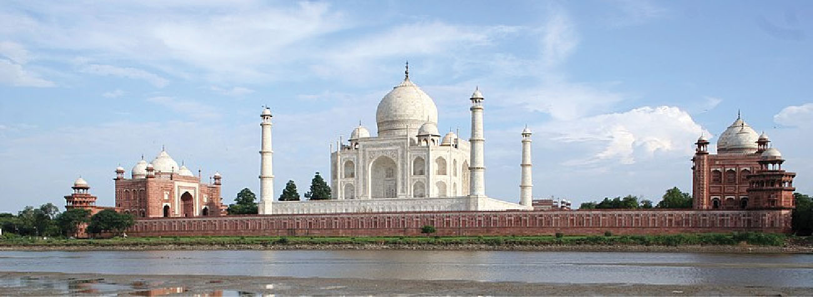

# 타지마할 — 하얀 무덤에 담긴 사랑과 제국

*아그라의 왕실 묘역에서 읽는 애도·정원·대리석의 의미*

Cities · Asia

> 출처 대조와 공개 게시 승인을 마친 이야기입니다. 실제 게시 여부는 사이트 배포 상태를 따릅니다.

*David Castor / Wikimedia Commons · Public Domain. OpenStax 수록 원본 사진.*

[이미지 출처·제작 근거](https://raw.githubusercontent.com/openstax/osbooks-world-history/main/media/OSX_WorldHist_B02_01_TajMahal.jpg) · Public Domain

야무나강 가에 흰 돔이 떠 있는 듯하다. 타지마할을 처음 보는 사람은 궁전을 떠올리기 쉽지만, 이 건물의 중심에는 무덤이 있다. 무굴제국의 황제 샤 자한이 세상을 떠난 아내 뭄타즈 마할을 위해 세운 묘당이다.

사랑의 기념물이라는 설명은 틀리지 않는다. 다만 그 말만으로 정원과 수로, 거대한 문과 네 개의 탑까지 모두 설명할 수는 없다. 한 사람에 대한 애도는 어떻게 제국을 대표하는 건축이 되었을까. 건물의 용도와 세부를 차례로 보면 익숙한 사진이 조금 다르게 읽힌다.

## 01. 황제의 슬픔이 건축의 출발점이 되다

샤 자한과 뭄타즈 마할은 17세기 무굴 궁정의 인물들이다. 아내의 죽음을 계기로 황제는 아그라에 대규모 묘역을 조성했다. 오늘의 관람객에게는 인도의 대표 유산이지만, 처음부터 관광객에게 보여 주기 위해 지은 건물은 아니었다. 죽은 이를 기리고 왕실의 기억을 남기는 장소였다.

이 때문에 타지마할을 평범한 사랑 이야기의 배경으로만 읽으면 중요한 차이가 사라진다. 황제에게는 개인의 감정을 국가 규모의 사업으로 옮길 수 있는 권력이 있었다. 애도의 깊이와 사업에 동원할 수 있는 자원의 크기는 서로 다른 문제이면서 이곳에서 함께 만난다.

## 02. 아그라는 왜 이 거대한 무덤의 자리가 되었을까

아그라는 무굴제국의 중요한 정치적 거점이었다. 타지마할은 이름 없는 외딴곳에 갑자기 등장한 기념물이 아니다. 궁정과 도시의 역사가 쌓인 장소, 그리고 강을 끼고 있는 땅에 들어섰다. 건물 뒤쪽의 야무나강을 함께 떠올려야 묘역이 도시의 어느 풍경 속에 놓였는지 보인다.

정면 사진에서는 건물만 독립해 있는 듯하지만 실제 건축은 주변의 땅과 물, 접근하는 방향을 포함한다. 관람객이 문을 통과해 먼 돔을 바라보는 경험과 강 건너에서 건물을 보는 경험도 같지 않다. 타지마할의 아름다움은 정면의 외곽선뿐 아니라 그것을 만나게 하는 배치에 있다.

## 03. 물에 비치는 건물은 두 번 보인다

정원과 길게 뻗은 수로는 시선을 중앙의 묘당으로 모은다. 물에 돔이 비치면 땅 위의 건물과 수면의 모습이 마주한다. 정원은 거대한 건물을 남은 공간에 장식한 부속물이 아니라, 사람들이 속도를 늦추고 건물을 바라보도록 만드는 장치다.

건물에 가까이 갈수록 멀리서 보이던 전체 형태는 돌 표면의 작은 무늬로 바뀐다. 이처럼 큰 축선과 세부 장식 사이를 오가며 보는 것이 좋다. 정면 사진 한 장은 전체의 균형을 잘 보여 주지만, 그 안으로 걸어 들어가는 동안 시야가 달라진다는 사실까지 담지는 못한다.

## 04. 흰 대리석은 빈 표면이 아니다

타지마할의 흰색은 장식이 없다는 뜻이 아니다. 대리석에는 준보석을 이용한 장식과 정교한 문양이 더해졌다. 멀리서는 하나의 밝은 덩어리처럼 보이던 표면이 가까이에서는 재료와 기술이 겹친 자리로 드러난다. 돔의 크기를 감탄한 다음에는 돌을 다룬 손의 규모를 생각해 볼 차례다.

무굴의 건축 문화에는 인도와 이슬람권, 페르시아계 미감이 만나는 복합적인 성격이 있다. 그래서 이 건물을 어느 한 지역의 양식이 그대로 옮겨 온 결과로만 설명하기 어렵다. 재료와 장식, 정원의 구성 속에서 여러 전통이 왕실의 요구에 맞게 새롭게 결합했다.

## 05. 네 개의 탑과 글씨를 함께 읽기

중앙 돔 주위에는 독립된 네 개의 미나레트가 서 있다. 이 탑들은 중앙의 묘당이 외롭게 남지 않도록 전체의 윤곽을 잡아 준다. 그러나 종교 건축의 탑을 단순한 장식 기둥처럼 생각해서는 안 된다. 형태에는 이슬람 건축의 전통과 의미가 함께 들어 있다.

건물의 글씨 역시 빈 공간을 채운 무늬만은 아니다. 꾸란의 구절이 아름다운 서체로 새겨져 있어 묘당의 종교적 성격을 드러낸다. 읽을 수 없는 관람객에게는 선과 비례가 먼저 보이겠지만, 원래는 의미를 가진 언어였다. 보는 건축과 읽는 건축이 같은 표면에 겹쳐 있는 셈이다.

## 06. 사랑의 이야기 곁에 남는 노동의 질문

거대한 왕실 건축은 황제 한 사람의 상상만으로 완성되지 않는다. 설계하고 돌을 운반하며 가공하고 장식을 맞추는 사람들이 필요하다. 완성된 건물 앞에서 후원자의 이름은 쉽게 기억되지만, 수많은 작업자의 개별 삶은 좀처럼 보이지 않는다.

이 차이를 기억한다고 아름다움을 부정해야 하는 것은 아니다. 오히려 감탄의 대상을 넓힐 수 있다. 황제의 애도와 권력, 재료를 다룬 기술과 이름이 전해지지 않는 노동이 함께 있었다. 타지마할을 사랑의 증거라고 부를 때 그 사랑을 거대한 물질로 만든 사람들까지 생각하면 이야기가 풍부해진다.

## 07. 궁전이 아니라 무덤이라는 사실로 돌아가기

타지마할을 다시 바라볼 때에는 먼저 묘당이라는 용도를 떠올려 보자. 머무는 사람의 일상을 위한 방이 아니라 죽은 이를 기억하는 장소라는 점이 돔과 정원, 글씨를 읽는 방향을 바꾼다. 아름다운 외관과 죽음에 대한 생각이 서로 멀리 떨어져 있지 않다.

묘역을 본 뒤 도시의 궁정 건축과 비교하면 질문이 하나 더 생긴다. 살아 있는 권력이 머무는 공간과 죽은 이를 기억하는 공간은 무엇을 공유하고 무엇이 다를까. 타지마할의 정연함은 이런 비교를 시작하게 하는 좋은 실마리다.

이곳은 한 부부의 사연이면서 한 제국의 문화와 자원이 모인 결과다. 사진 속 하얀 건물을 아는 것에서 한 걸음 더 나아가, 왜 이 자리에 무엇을 위해 이런 형태를 세웠는지 묻는다면 타지마할은 유명한 풍경을 넘어 하나의 읽을거리가 된다.

## 이야기의 바탕이 된 자료

- [OpenStax World History — India and International Connections](https://raw.githubusercontent.com/openstax/osbooks-world-history/main/modules/m00008/index.cnxml) · 확인일 2026-11-05
  - 확인 내용: 샤 자한·뭄타즈 마할, 아그라와 야무나강, 흰 대리석·준보석 장식·꾸란 서체·네 미나레트와 정원

---

[같은 소주제의 이야기](README.md) · [전체 서가](../../README.md)
