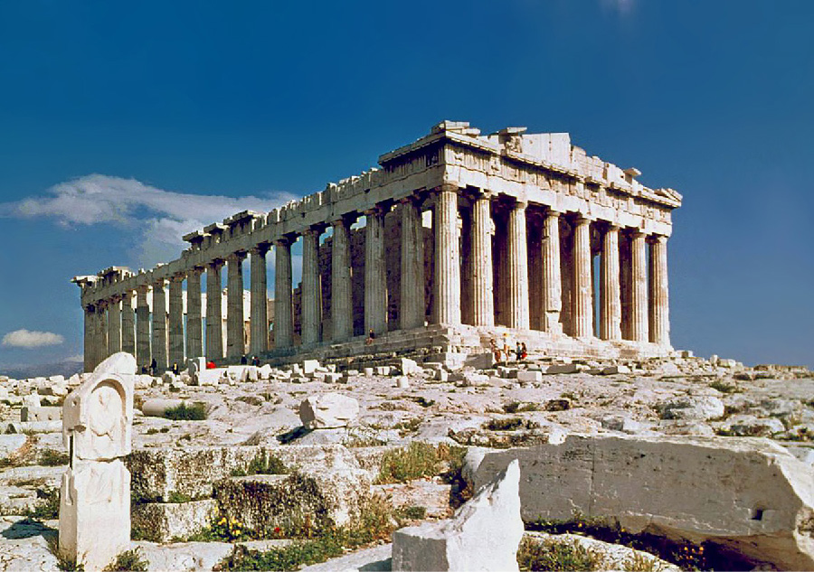

# 아테네 — 파르테논은 누구의 돈으로 지었을까

*아름다운 신전 곁에서 동맹과 권력을 생각하기*

Cities · Europe

> 출처 대조와 공개 게시 승인을 마친 이야기입니다. 실제 게시 여부는 사이트 배포 상태를 따릅니다.

*Steve Swayne / Flickr · OpenStax 수록 · Public Domain. 파르테논의 실제 유적 사진으로 건립 당시 전체 모습과는 다릅니다.*

[이미지 출처·제작 근거](https://raw.githubusercontent.com/openstax/osbooks-world-history/main/media/OSX_WorldHist_A06_02_Parth.jpg) · Public Domain

아테네의 아크로폴리스 위에는 지붕을 잃은 파르테논이 서 있다. 사진으로 보면 기둥과 하늘이 먼저 들어온다. 온전한 건물이 아닌데도 도시를 대표하는 모습이 될 만큼 인상이 강하다. 그런데 이 신전을 세우는 데 쓴 돈은 어디에서 왔을까.

건축의 아름다움과 돈의 출처는 서로 무관한 이야기가 아니다. 파르테논이 만들어진 시대의 아테네는 예술과 시민정치의 도시이면서 강력한 해상 세력의 중심이었다. 신전의 기둥 옆에 당시 동맹 도시들의 자리도 놓아 보면 익숙한 유적이 조금 달리 보인다.

## 1. 높은 언덕 위의 아테나 신전

파르테논은 기원전 5세기에 아테나를 기리기 위해 세워졌다. 아테나는 아테네와 특별한 관계를 가진 여신이었다. 도시의 높은 곳에 자리한 큰 신전은 종교 공간이면서 사람들이 자신들의 도시를 바라보는 상징이기도 했다.

오늘의 사진에서는 남아 있는 기둥과 건물의 뼈대를 볼 수 있다. 원래의 색과 장식, 지붕이 모두 그대로 남아 있는 것은 아니다. 지금 보이는 흰 돌의 인상만으로 고대인이 처음 만난 신전의 경험을 완전히 재현할 수는 없다.

## 2. 전쟁을 겪은 도시가 다시 세우기

페르시아와의 전쟁은 아테네에도 큰 손상을 남겼다. 교재는 이전 신전이 파괴된 뒤 아테네가 재건에 나섰다고 설명한다. 새 건축은 아름다운 물건을 추가하는 일만이 아니라 전쟁 뒤 도시의 힘과 정체성을 보여 주는 선택이었다.

전쟁의 기억과 재건의 의지가 큰 공사에 들어간 것이다. 그러나 누가 왜 지으려 했는지와 그것을 어떻게 마련했는지는 다른 질문이다. 좋은 목적을 내세운 건물도 자원과 노동을 모으는 구체적인 과정을 필요로 한다.

## 3. 아테네 혼자만의 방어가 아니었다

아테네는 다른 그리스 도시국가들과 해상 동맹을 이루었다. 바다를 통한 군사력과 재원이 중요한 관계였다. 여러 도시가 연결되었다는 점에서는 공동의 방어를 생각할 수 있지만 그 관계가 계속 동등하게 유지된 것은 아니었다.

교재는 아테네가 동맹에서 더 강한 통제력을 행사하게 되는 흐름을 설명한다. 함께 대비하기 위해 모은 힘이 한 도시의 영향력으로 집중될 수 있었던 것이다. 아테네의 번영을 도시 안쪽에서만 보면 그 바깥의 부담은 잘 보이지 않는다.

## 4. 신전에 들어간 동맹의 자금

파르테논 재건에는 동맹 도시들이 낸 공납 성격의 자금이 사용되었다. 교재는 이 일로 다른 도시국가들의 불만이 커졌다고 설명한다. 오늘날 세계의 관광객이 감탄하는 건물이 당시의 모든 관계자에게 같은 기쁨이었던 것은 아니다.

어느 도시의 자랑은 다른 도시에게 자신들의 자원이 다른 곳에 쓰이는 장면일 수도 있다. 건물의 예술적 가치가 사라지는 것은 아니지만 그 가치만으로 자금 사용의 정치가 끝나지는 않는다. 한 건물을 놓고도 서로 다른 시선이 생기는 이유다.

## 5. 시민의 도시 안에도 경계가 있었다

아테네는 민주정의 역사에서 중요한 도시다. 그러나 당시의 정치 참여는 오늘날 성인 전체의 보통선거와 같지 않았다. 여성과 노예, 거주 외국인 등은 시민 남성과 같은 정치적 자리를 갖지 못했다.

따라서 민주정이라는 이름을 현대의 완성된 기준으로 그대로 읽을 수는 없다. 동시에 모든 것이 지금과 다르다는 이유로 그 제도의 의미를 지워 버릴 필요도 없다. 무엇을 가능하게 했으며 누구를 바깥에 두었는지 나누어 보는 편이 도시를 더 정확하게 이해하게 한다.

## 6. 기둥 사이에서 도시의 자신감을 읽기

사진에서 기둥들이 반복되는 간격과 위쪽의 수평선을 따라가 보자. 손상된 건물에서도 전체의 질서가 느껴진다. 이 인상만으로 정밀한 비례나 옛 설계 의도를 모두 확정할 수는 없지만 눈으로 감상할 수 있는 출발점은 된다.

큰 신전을 올려다보는 경험에는 규모의 효과가 있다. 사람은 자신보다 큰 구조물 앞에서 도시의 자원과 기술을 체감하게 된다. 파르테논의 비용을 생각한 뒤 다시 기둥을 보면 그 인상 뒤의 여러 공동체와 노동도 함께 떠올릴 수 있다.

## 7. 동맹의 긴장은 결국 다른 역사로 이어졌다

아테네가 지닌 해상 세력과 스파르타를 중심으로 한 육상 세력의 경쟁은 그리스 세계를 갈라놓았다. 교재는 펠로폰네소스 전쟁을 이런 관계 속에서 설명한다. 다만 신전 하나의 건축이 전쟁 전체를 일으켰다고 말할 수는 없다.

도시들 사이의 갈등에는 권력과 안보, 동맹의 변화가 함께 있었다. 파르테논의 자금 문제는 그 큰 관계를 가까이에서 생각하게 하는 사례다. 작은 사건과 긴 전쟁 사이의 인과를 무리하게 한 줄로 연결하지 않아도 충분히 의미가 있다.

## 8. 아름답다는 감상 다음의 질문

함께 실은 것은 파르테논의 실제 유적 사진이다. 지금 남은 모습과 고대의 완성 모습은 구별하면서 기둥과 언덕의 인상을 볼 수 있다. 현재의 관람 동선이나 보존 상태를 실시간으로 안내하는 자료는 아니다.

파르테논을 좋아하면서 그 비용을 물을 수 있다. 예술을 감상하는 일과 권력의 작동을 알아보는 일은 서로를 없애지 않는다. 아테네의 높은 언덕은 훌륭한 건축이 어떻게 만들어졌고 그 뒤에 누구의 자원이 있었는지 생각할 때 더 깊은 풍경이 된다.

## 이야기의 바탕이 된 자료

- [OpenStax World History — 아테네와 파르테논](https://raw.githubusercontent.com/openstax/osbooks-world-history/main/modules/m00133/index.cnxml) · 확인일 2026-10-31
  - 확인 내용: 아테나 신전과 아크로폴리스 재건 / 델로스 동맹의 공납·아테네의 영향력·민주정의 배제

---

[같은 소주제의 이야기](README.md) · [전체 서가](../../README.md)
