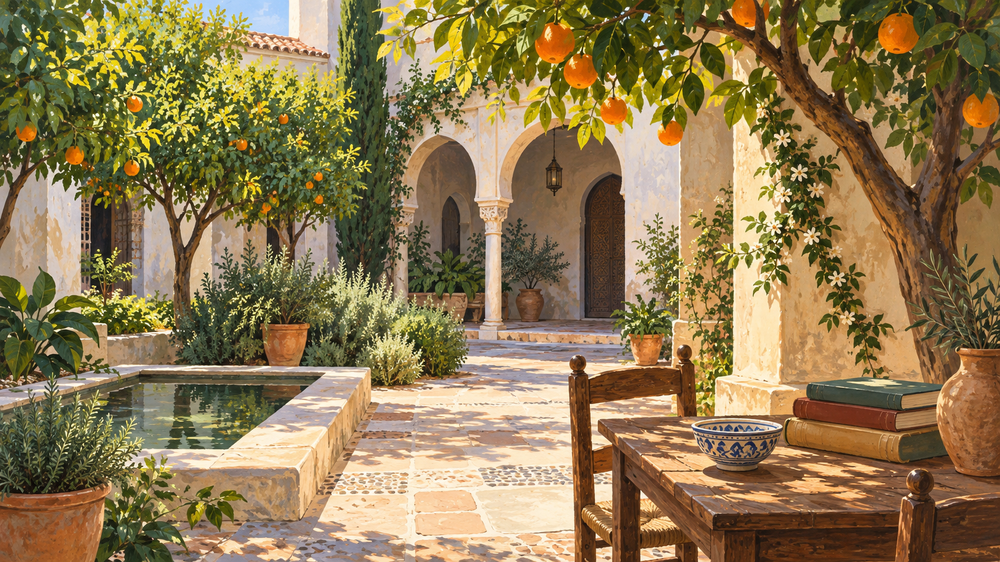

# 코르도바 — 오렌지나무 뒤에서 지중해를 만나다

*도시의 풍경은 먼 곳에서 온 연결로 자라기도 한다*

Cities · Europe

> 출처 대조와 공개 게시 승인을 마친 이야기입니다. 실제 게시 여부는 사이트 배포 상태를 따릅니다.

*KnowledgeWalk 제작 AI 삽화 · 코르도바의 특정 정원·현존 나무·중세 주택을 고증해 복원한 자료가 아닌 분위기 삽화.*

스페인 남부의 코르도바를 떠올리면 햇빛과 그늘, 나무가 있는 뜰의 풍경이 잘 어울린다. 이런 이미지는 그저 따뜻한 날씨의 결과처럼 느껴질 수 있다. 하지만 한 도시에서 무엇을 기르고 어떤 말을 나누었는지는 먼 지역과의 연결에도 영향을 받는다.

중세 코르도바는 지중해의 여러 곳과 이어진 도시였다. 교재는 이곳이 오렌지와 라임, 레몬을 기르는 곳으로도 알려졌다고 설명한다. 과일 이름 세 개에서 시작하면 왕조의 연표와는 조금 다른 길로 도시의 역사를 걸어 볼 수 있다.

## 1. 지중해는 도시를 가르는 바다만은 아니었다

8세기 이베리아반도의 알안달루스에서는 우마이야 가문의 통치가 자리 잡았다. 압드 알라흐만 1세는 코르도바를 수도로 삼았다. 이 도시는 북아프리카와 중동 등 지중해 세계와 상업적·외교적 관계를 이어 갔다.

바다를 국경처럼만 생각하면 저편의 지역은 멀리 떨어진 다른 세계가 된다. 그러나 항해와 교역의 길을 그리면 도시를 연결하는 통로도 나타난다. 코르도바의 성장은 반도 안쪽의 사정만으로 설명되지 않았고, 바깥에서 오가는 물건과 사람이 중요한 역할을 했다.

## 2. 나무 한 그루도 이동의 역사를 갖는다

교재는 이런 연결을 통해 감귤류와 사탕수수, 면화 같은 농산물이 더 먼 곳에서 이베리아반도로 전해졌다고 설명한다. 오늘 풍경에 자연스럽게 들어 있는 작물도 언제나 같은 자리에서 재배되었던 것은 아닐 수 있다.

물론 현재 코르도바의 특정 나무가 중세의 어느 품종을 직접 이어 왔다고 이 자료만으로 말할 수는 없다. 이번 이야기는 개별 수목의 족보가 아니라 작물과 재배 문화의 이동을 다룬다. 익숙한 과일도 교역의 역사와 함께 보면 도시의 풍경을 다르게 읽게 한다.

## 3. 물건이 오가면 사람도 모인다

10세기 코르도바가 번성할 때에는 교역과 함께 장인과 상인, 학자와 이주민이 모였다. 도시가 크다는 것은 건물이 많다는 뜻만이 아니다. 서로 다른 기술과 경험을 가진 사람이 가까운 공간에서 만날 수 있다는 의미도 있다.

장인의 물건에는 재료가 필요하고 상인에게는 거래할 상대가 필요하다. 글을 배우고 가르치는 활동에도 생활을 유지할 환경이 있어야 한다. 이런 활동이 한 도시에 겹칠 때 도시는 단순히 인구가 모인 장소보다 복잡한 관계의 공간이 된다.

## 4. 배움의 도시라는 명성은 어디에서 왔을까

코르도바는 교역뿐 아니라 학문과 예술의 중심으로도 성장했다. 교재는 콘스탄티노폴리스와 바그다드에 견줄 만한 도시로 소개한다. 이는 세 도시가 모든 점에서 같았다는 말보다 당시의 넓은 교류 속에서 코르도바의 위상을 이해하는 표현이다.

배움은 도시를 드나드는 길과 무관하지 않았다. 물건과 함께 책과 지식, 가르치는 사람이 이동할 수 있었기 때문이다. 그렇다고 상업이 활발하면 저절로 모두가 교육을 누린다고 생각해서는 안 된다. 연결은 가능성을 넓혀 주지만 그 기회를 누리는 조건까지 같게 만들지는 않는다.

## 5. 서로 다른 종교가 함께 있었다는 말

알안달루스에는 여러 종교와 민족이 함께 살아가며 만들어 낸 문화가 있었다. 이 사실은 중요하지만 언제나 평등하고 갈등 없는 사회였다는 뜻으로 바꿀 수는 없다. 공존과 권력의 차이, 정치적 경쟁은 같은 시대에 함께 존재할 수 있다.

교재도 관용을 보이는 통치가 있었던 한편 다른 신앙의 지배자들과 전쟁이 이어졌다고 설명한다. 함께 살았다는 한 문장을 낭만적인 풍경으로만 만들면 당시 주민의 다른 조건을 놓친다. 도시의 성취를 알아보는 일과 그 안의 긴장을 인정하는 일은 함께 할 수 있다.

## 6. 전성기가 영원한 설계도는 아니다

코르도바를 중심으로 한 정치적 통합은 계속 유지되지 않았다. 지배층 내부의 갈등과 분열이 생겼고 알안달루스에는 여러 후계 국가가 등장했다. 문화와 교역이 번성했다는 사실만으로 정치적 안정까지 자동으로 보장되지는 않았던 것이다.

이후의 관계도 단순히 종교가 같은 사람끼리 한편을 이룬 모습만은 아니었다. 교재는 무슬림 국가들끼리 다투고 기독교 세력과 동맹을 맺기도 했다고 설명한다. 도시의 역사는 아름다운 전성기와 갑작스러운 종말 두 장면보다 많은 선택으로 이루어져 있었다.

## 7. 뜰의 그림은 어떤 역할을 할까

함께 실은 이미지는 감귤나무와 그늘진 뜰을 표현한 AI 삽화다. 코르도바의 특정 정원이나 중세 주택을 정확히 복원한 자료는 아니다. 이 그림을 근거로 당시 집의 배치와 생활 도구를 확정할 수는 없다.

대신 나무와 그늘, 사람들이 쉬어 갈 수 있는 작은 공간을 떠올리는 입구로 볼 수 있다. 실제로 확인한 작물의 이동과 도시의 성장은 근거자료에서 읽고, 그림은 글로 들어가는 분위기를 돕는다. 자료와 상상의 역할을 나누면 풍경을 편하게 감상할 수 있다.

## 8. 도시의 취향도 길을 따라 자란다

오렌지 한 알만으로 코르도바의 역사를 모두 설명할 수는 없다. 다만 먼 곳에서 온 작물이 도시의 익숙한 풍경이 될 수 있다는 점은 보여 준다. 상인과 장인, 학자가 드나든 길도 비슷하게 도시의 성격을 바꾸었다.

다음에 어느 도시의 특별한 먹을거리나 나무를 만나면 원래부터 거기 있었는지 궁금해해 보자. 그 질문은 뜻밖에 바다와 다른 지역의 사람들로 이어질 수 있다. 코르도바의 감귤 이야기는 한 도시 안의 풍경에 넓은 세계가 들어오는 방식이다.

## 이야기의 바탕이 된 자료

- [OpenStax World History — 알안달루스와 코르도바](https://raw.githubusercontent.com/openstax/osbooks-world-history/main/modules/m00118/index.cnxml) · 확인일 2026-10-30
  - 확인 내용: 압드 알라흐만 1세의 수도·지중해 교역·장인과 학자의 이동 / 감귤류·사탕수수·면화의 전래와 코르도바의 오렌지·라임·레몬 재배 / 다종교 문화와 갈등의 병존·칼리프국의 분열; 현존하는 개별 나무나 정원의 계보를 주장하지 않음

---

[같은 소주제의 이야기](README.md) · [전체 서가](../../README.md)
