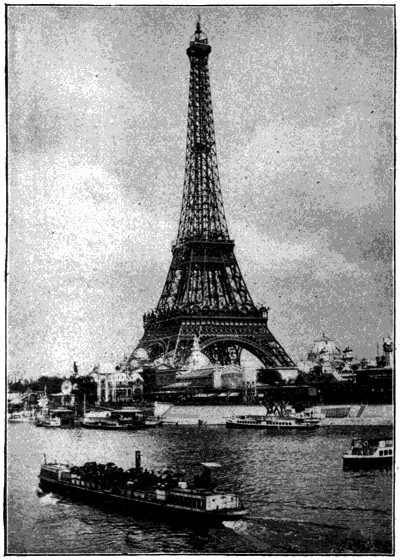

# 에펠탑 — 박람회의 철골은 어떻게 파리의 얼굴이 되었을까

*1889년 만국박람회와 철 구조가 만든 새로운 도시 풍경*

Cities · Europe

> 출처 대조와 공개 게시 승인을 마친 이야기입니다. 실제 게시 여부는 사이트 배포 상태를 따릅니다.

*E. W. Byrn, The Progress of Invention in the Nineteenth Century (1900), Fig. 238 · Public Domain. 현재 모습이 아닌 역사 이미지.*

[이미지 출처·제작 근거](https://raw.githubusercontent.com/GITenberg/The-Progress-of-Invention-in-the-Nineteenth-Century._41538/master/41538-h/images/illo366.jpg) · Public Domain

파리의 풍경을 그리라고 하면 많은 사람이 에펠탑부터 그린다. 돌로 쌓은 대성당이나 왕궁과 달리 속이 훤히 보이는 철의 구조물인데도, 도시 전체를 떠올리게 하는 표지가 되었다. 익숙함 때문에 오히려 놓치기 쉬운 질문이 있다. 왜 이런 탑을 세웠을까.

에펠탑의 출발점은 1889년 파리 만국박람회였다. 오래된 도시가 새로운 산업 기술을 세계에 보여 주는 무대에 거대한 철탑이 등장했다. 오늘의 기념사진을 잠시 내려놓고, 당시 사람들이 아직 낯설었던 철의 높이를 올려다보는 장면에서 이야기를 시작해 보자.

## 01. 박람회는 물건만 진열하는 행사가 아니었다

19세기 만국박람회는 각국의 제품과 기계, 새로운 기술을 한자리에 모았다. 전시품은 산업의 성과였고 개최 도시도 거대한 전시장의 일부가 되었다. 관람객은 물건을 구경하면서 그 물건을 만들 수 있는 국가와 사회의 능력까지 보게 되었다.

이런 무대에서 탑의 높이는 말없이 강한 인상을 남긴다. 설명서를 모두 읽지 않아도 눈앞의 규모가 먼저 다가오기 때문이다. 에펠탑은 단순히 전망을 위한 시설만이 아니라, 철로 어디까지 만들 수 있는지를 보여 주는 하나의 거대한 전시물이기도 했다.

## 02. 벽 대신 뼈대를 드러낸 건축

전통적인 기념 건축을 떠올리면 두꺼운 돌벽과 그 표면의 장식이 먼저 보인다. 에펠탑에서는 다르다. 여러 철 부재를 엮은 격자 구조가 드러나 있고 그 사이로 하늘이 보인다. 멀리서 보면 하나의 윤곽이지만 가까이에서는 수많은 가는 선이 힘을 나누는 모습이다.

이것이 장식이 전혀 없다는 뜻은 아니다. 다만 아름다움을 느끼게 하는 중심이 돌 표면의 이야기에서 구조의 반복과 곡선으로 옮겨 간다. 건물이 무엇으로 서 있는지 보여 주는 태도 자체가 미감이 된다. 철탑은 기술과 예술을 서로 완전히 나눌 수 없게 만든다.

## 03. 네 개의 다리가 하나의 꼭대기로 모인다

탑은 아래쪽의 넓게 벌어진 네 다리에서 시작해 위로 갈수록 가늘어진다. 네 개의 독립된 지지부가 높은 곳에서 하나의 형상으로 모인다. 꼭대기만 올려다보면 놓치기 쉬운 부분이지만, 아래의 폭과 위의 높이는 함께 보아야 한다.

1900년에 나온 발명·기술사 책은 이 탑을 철 구조가 가진 가능성을 보여 준 성과로 소개했다. 당시의 기록에서 중요한 것은 오늘의 관광 순위가 아니라 공학적 성취였다. 에펠탑을 동시대 사람들이 어떤 새로움으로 읽었는지 알려 주는 대목이다.

## 04. 수많은 작은 접합이 거대한 높이를 만든다

에펠탑을 이루는 것은 하나로 부어 만든 거대한 철 덩어리가 아니다. 여러 부재가 연결되면서 전체가 된다. 철판과 부재를 잇는 리벳도 이 구조의 일부였다. 멀리서 보이지 않는 작은 접합이 큰 형태를 가능하게 했다는 사실은 높은 건물을 보는 눈을 바꾼다.

높이는 종종 한 사람의 야심으로 설명되지만, 실제 건설에는 계산과 제작, 조립의 질서가 필요하다. 큰 윤곽을 설계하는 일과 작은 부품이 맞아 들어가게 하는 일 사이에는 긴 거리가 있다. 탑의 가벼워 보이는 인상 뒤에는 반복되는 정밀한 작업이 있었다.

## 05. 높이 올라가면 도시를 읽는 방향도 바뀐다

높은 전망대는 익숙한 거리의 경험을 바꾼다. 지상에서는 건물 사이를 걷지만 위에서는 길과 강, 건물의 배치를 하나의 모습으로 본다. 탑은 구경할 대상이면서 도시를 새롭게 구경하게 하는 도구이기도 하다. 보이는 것과 보는 자리가 한 건축물 안에서 만난다.

초기의 탑에도 계단과 승강 장치가 마련되었다. 관람객을 올려 보내는 문제는 탑을 세우는 문제와 별개가 아니다. 높은 구조물을 안전하게 이용할 수 있어야 전망이 공공의 경험이 된다. 높이의 역사에는 그 높이에 접근하는 기술의 역사도 포함된다.

## 06. 장식의 이름들에서 과학의 자부심을 읽다

초기 에펠탑을 소개한 기술사 기록에는 아래층 둘레에 프랑스의 저명한 인물들 이름을 크게 새겼다는 설명도 나온다. 이름을 기념하는 방식이 왕과 장군의 동상에만 한정되지 않는다는 점이 흥미롭다. 탑의 재료뿐 아니라 그 표면의 이름도 한 시대의 자부심을 드러낸다.

과학과 기술의 성취를 국가의 이야기로 엮는 것이다. 그렇다고 탑을 프랑스만의 독립된 발명 정신으로 설명할 필요는 없다. 산업 기술은 여러 지역의 경험이 쌓이며 발전했다. 기념물은 그 넓은 흐름 가운데 무엇을 자기 도시의 기억으로 내세우는지 보여 준다.

## 07. 익숙한 상징도 처음에는 새로운 물건이었다

지금은 에펠탑 없는 파리를 상상하기 어렵지만, 그 모습이 도시의 풍경과 함께 태어난 것은 아니다. 새로운 행사를 위해 새로운 재료의 가능성을 내세운 구조물이 들어왔고, 시간이 흐르면서 도시를 대표하는 표지가 되었다. 오래된 것처럼 보이는 상징에도 시작의 순간이 있다.

초기의 그림이나 사진을 현재의 모습과 비교할 때에는 촬영 시기를 확인하는 것이 좋다. 주변 건물과 강 위의 배까지 보면 탑 하나만 오래 남은 것이 아니라 그것을 바라보는 도시의 환경도 계속 달라졌음을 발견할 수 있다.

다음에 에펠탑 사진을 볼 때에는 꼭대기만 보지 말고 네 다리와 격자, 그 사이로 비치는 하늘을 함께 보자. 파리의 낭만이라는 말 뒤에서 산업 시대의 계산과 노동이 드러난다. 그 두 모습을 동시에 읽을 때 이 철탑은 더욱 흥미로운 건축물이 된다.

## 이야기의 바탕이 된 자료

- [E. W. Byrn, The Progress of Invention in the Nineteenth Century (1900), Civil Engineering](https://raw.githubusercontent.com/GITenberg/The-Progress-of-Invention-in-the-Nineteenth-Century._41538/master/41538-0.txt) · 확인일 2026-11-05
  - 확인 내용: 1889년 박람회, 네 격자 지지부·철 부재와 리벳, 계단·승강기·초기 기념 명문; 당시의 높이·세계 순위를 현재 사실로 사용하지 않음

---

[같은 소주제의 이야기](README.md) · [전체 서가](../../README.md)
