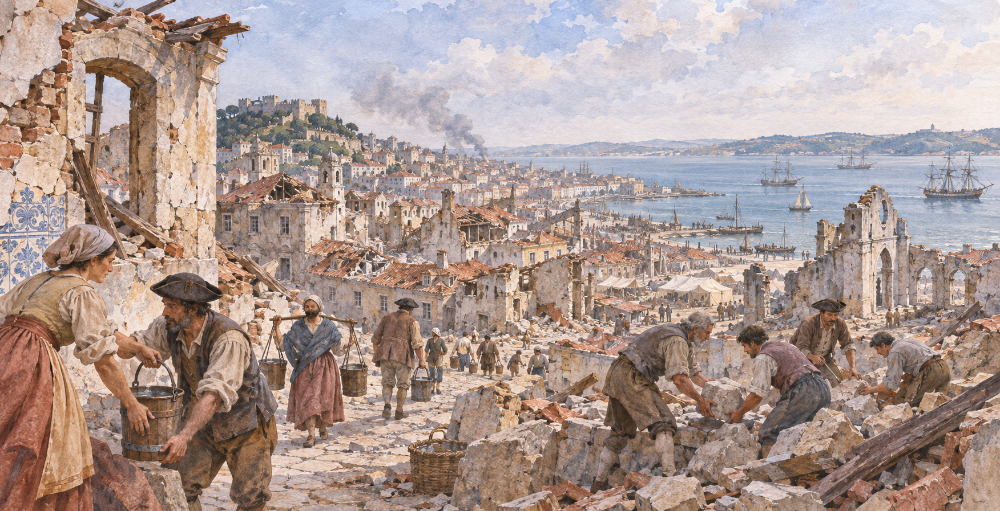

# 리스본 1755 — 무너진 도시의 길은 어떻게 다시 그려졌을까

*테주강의 항구와 재난의 기록, 광장과 거리의 재건*

Cities · Europe

> 출처 대조와 공개 게시 승인을 마친 이야기입니다. 실제 게시 여부는 사이트 배포 상태를 따릅니다.

*AI 관련 장면 삽화 · 작품과 장소를 떠올리기 위한 상상 그림이며 실제 사진·배우 초상·정확한 복원이나 설계도가 아닙니다.*

도시가 큰 재난을 겪으면 건물만 사라지는 것은 아니다. 사람들이 오가던 길과 일하던 장소, 익숙한 중심도 함께 흔들린다. 1755년 리스본의 지진은 유럽에 큰 충격을 남겼다. 여기서는 피해 규모의 숫자를 경쟁하듯 나열하기보다, 재난이 남긴 기록과 이후의 거리 계획을 함께 살펴본다.

## 01. 강을 향해 열려 있던 항구 도시

리스본은 테주강과 연결된 항구 도시였다. 물가에는 배와 교역, 왕실의 공간이 모였다. 강은 아름다운 전망인 동시에 사람과 물건이 드나드는 통로였다. 도시의 중심을 이해하려면 건물의 목록만이 아니라 강과 길이 어떻게 만났는지 보아야 한다.

재난 이전의 궁전과 좁은 길들이 있던 자리는 이후 크게 바뀌었다. 오늘 넓고 정돈되어 보이는 공간을 처음부터 늘 그랬던 것으로 생각하면 변화의 의미를 놓친다. 도시는 오래되었어도 그 안의 길과 광장은 특정한 사건 뒤에 새로 만들어질 수 있다.

## 02. 흔들림 뒤에도 위험은 이어졌다

1755년의 지진에 관한 기록에는 무너지는 건물과 화재, 강과 바다 쪽의 위험이 함께 등장한다. 지진이 멈춘 순간 재난이 끝나는 것은 아니었다. 사람들은 한 위험을 피해 이동하다 다른 위험과 마주할 수 있었다.

다만 당시의 시와 여행 기록에 실린 모든 묘사를 정확한 측정 결과로 받아들여서는 안 된다. 공포를 전달하는 문학적인 과장과 관찰된 사실이 섞일 수 있다. 오래된 자료의 사망자 수나 극적인 장면을 그대로 확정하기보다 자료가 만들어진 목적도 살펴야 한다.

## 03. 멀리서 쓰인 시에도 도시가 나타났다

같은 해 런던에서 출판된 익명의 지진 시는 리스본의 파괴를 먼 곳의 독자에게 전했다. 아름답고 풍요롭던 도시와 폐허가 된 도시가 대비된다. 글은 현장의 측량도가 아니라 상실을 느끼게 하는 장치로 사건을 배열한다.

이런 자료는 무엇이 일어났는지뿐 아니라 다른 지역 사람들이 그 사건을 어떻게 받아들였는지도 알려 준다. 재난이 한 도시의 경계 안에만 머물지 않고 출판과 종교적 해석을 통해 퍼진 것이다. 물리적인 충격과 소식이 만든 충격은 서로 다른 경로로 이동했다.

## 04. 1760년에도 재건은 아직 먼 일이었다

마틴 흄의 『포르투갈 여행』에는 스트래스모어의 1760년 관찰이 인용되어 있다. 그 기록에서 새 도시의 완성은 아직 먼 전망이었고, 계획된 방식대로 지어진 건물도 많지 않았다. 재난 연도와 재건의 완료를 하나의 순간으로 묶을 수 없는 이유다.

지도 위의 계획은 빨리 그릴 수 있지만 실제로 집과 공공시설을 세우는 데에는 시간과 자원이 든다. 임시로 살아야 하는 사람들의 시간도 그 사이에 놓인다. 완성된 거리의 질서만 감상하면 계획과 결과 사이에 있었던 긴 과정이 사라지기 쉽다.

인용문에 담긴 판단도 하나의 목소리다. 기록자는 계획의 규모를 칭찬하면서 건축의 생김새에는 비판적인 말을 남긴다. 같은 재건 안에서도 거리의 배치와 건물의 외관을 따로 평가한 것이다. 여행자가 새 도시를 어떻게 보았는지 알 수 있는 구체적인 차이다.

오늘의 독자는 그 평가를 그대로 따라야 할 필요는 없다. 당시 아직 공사가 진행 중이었다는 조건을 먼저 확인하고, 그가 기대한 아름다움이 무엇이었는지 생각할 수 있다. 과거의 의견은 사실 확인의 자료이면서 다른 시대의 취향을 보여 주는 기록이기도 하다.

## 05. 강에 열린 광장과 직선의 거리

인용된 계획에는 강을 향해 열린 광장, 일정한 모습의 건물, 서로 직각으로 만나는 거리들이 등장한다. 이전의 촘촘한 길을 그대로 되살리는 대신 새로운 중심을 만드는 구상이었다. 광장과 큰길은 서로 따로 놓인 장식이 아니라 연결된 구조다.

강에서 도시 안으로 들어오는 시선과 이동을 생각하면 그 구성이 더 잘 보인다. 광장은 사람을 모으고 길은 다른 공간으로 이끈다. 재건은 개별 건물을 수리하는 일만이 아니라 사람들이 도시를 이용할 방식을 다시 배치하는 일이었다.

## 06. 정돈된 모습이 모든 경험을 말해 주지는 않는다

흄이 나중에 본 리스본은 앞선 계획과 연결되는 모습이었다. 하지만 여행자가 정돈된 거리에서 느낀 인상만으로 재건의 모든 효과를 평가할 수는 없다. 새로운 배치는 누군가에게 편리하고 누군가에게 낯선 환경이었을 수 있다.

계획자는 도시를 넓게 보지만 주민은 집과 가게, 매일 걷는 길에서 변화를 경험한다. 같은 재건을 서로 다른 크기로 보는 셈이다. 좋은 도시 계획이 무엇인지 묻기 위해서는 외관의 통일성에 더해 그 안에서 살아야 하는 사람들의 조건도 생각해야 한다.

## 07. 오늘의 길에서 이전의 도시를 상상하기

리스본의 곧은 길과 광장을 볼 때에는 왜 이 형태가 되었을까 하고 물어보자. 현재의 모습은 지형만으로 결정되지 않았다. 재난과 재건의 판단, 여러 해의 공사가 겹쳐 있다. 오래된 도시에서도 변화의 흔적은 현재의 질서 속에 남아 있다.

1755년을 거대한 파괴의 장면으로만 기억하면 그 뒤의 시간이 지워진다. 반대로 아름답게 재건되었다는 말만 남기면 상실이 가려진다. 직선의 길도 사건을 기억하는 자료가 될 수 있다는 점이 흥미롭다. 두 시간을 함께 읽을 때 도시는 재난 사진의 배경도 계획의 도면도 아닌, 손실을 안고 다시 생활을 이어 간 장소로 보인다.

## 이야기의 바탕이 된 자료

- [Martin Hume, Through Portugal](https://raw.githubusercontent.com/GITenberg/Through-Portugal_55034/master/55034-0.txt) · 확인일 2026-11-06
  - 확인 내용: 1755년 이전 강변 궁전·스트래스모어 1760년 관찰의 인용·재건 진행 중·광장/아케이드/직각 거리 계획·후대 여행자의 평가
- [Anonymous, A Poem on the Earthquake at Lisbon (1755)](https://raw.githubusercontent.com/GITenberg/A-poem-on-the-earthquake-at-Lisbon_67011/master/67011-0.txt) · 확인일 2026-11-06
  - 확인 내용: 같은 해 런던 출판·무너짐/화재/강물·아름다움과 폐허의 대비. 시적 묘사를 측량 자료나 피해 통계로 사용하지 않음

---

[같은 소주제의 이야기](README.md) · [전체 서가](../../README.md)
