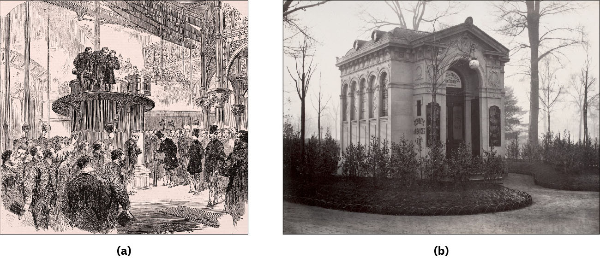

# 런던 — 지독한 냄새가 도시의 밑바닥을 바꾸다

*1858년 템스강에서 하수도와 펌프장으로 이어지는 이야기*

Cities · Europe

> 출처 대조와 공개 게시 승인을 마친 이야기입니다. 실제 게시 여부는 사이트 배포 상태를 따릅니다.

*The Illustrated London News의 1865년 크로스네스 개장식 도판 및 State Library of Victoria의 파리 공중화장실 역사 사진 / Wikimedia Commons · OpenStax 수록 · 개별 자료 Public Domain. 서로 다른 도시의 시설입니다. 원본 합성 파일 그대로 사용했습니다.*

[이미지 출처·제작 근거](https://raw.githubusercontent.com/openstax/osbooks-world-history/main/media/OSX_WorldHist_B10_02_Sanitation.jpg) · Public Domain

런던의 국회의사당 창문에 소독제를 적신 커튼이 걸렸다. 1858년 여름, 템스강에서 올라오는 냄새를 막기 위한 조치였다. 강변의 웅장한 건물도 악취 앞에서는 창문 하나 마음대로 열기 어려웠다.

이 사건은 ‘대악취’라는 이름으로 남았다. 그러나 문제는 냄새만이 아니었다. 도시가 마신 물과 버린 물이 어디에서 다시 만나는가, 그동안 땅속에 숨겨 두었던 질문이 강 위로 떠올랐다.

## 1. 편리한 변기가 강의 문제로 돌아왔다

집에서 물을 내려 오물을 보낼 수 있다면 생활은 훨씬 편해진다. 하지만 집 밖으로 사라졌다는 것이 도시에서도 사라졌다는 뜻은 아니다. 배수로의 끝이 강이라면 집 안의 깨끗함이 강물의 부담으로 옮겨 갈 수 있다.

19세기 도시에서는 가정의 오수에 공장과 작업장의 폐기물까지 더해졌다. 강은 교통과 물 공급의 길인 동시에 버리는 물을 받는 곳이었다. 서로 충돌하는 쓰임이 같은 물길에 쌓이고 있었다.

## 2. 빠르게 커진 도시가 남긴 숙제

산업도시에는 일자리를 찾아 많은 사람이 들어왔다. 집과 길, 수도와 배수 시설이 그 속도를 따라가지 못했다. 인구가 모이는 것은 생산과 소비를 늘렸지만 먹고 씻고 배설하는 생활의 규모도 함께 키웠다.

처음에는 한 집의 관리처럼 보였던 일이 이웃과 강변 전체의 문제가 되었다. 내 집의 배수관만 고쳐도 그 뒤에서 다른 집의 물과 섞인다. 위생을 각 가정의 부지런함에만 맡기기 어려웠던 이유다.

## 3. 1858년, 정치가 피하기 어려워진 냄새

템스강의 악취는 의회의 일상을 직접 방해했다. 창가의 커튼을 적시는 임시방편으로 강 전체를 바꿀 수는 없었다. 강에 소독제를 붓는 대응도 오물을 계속 흘려보내는 구조를 해결하지 못했다.

대악취가 중요한 전환점으로 기억되는 까닭은 여기 있다. 오래 존재하던 문제가 권력을 가진 사람들의 생활에도 가까이 다가왔다. 도시의 배수는 뒤로 미뤄 둘 수 있는 땅속 일이 아니게 되었다.

## 4. 바잘제트가 연결한 것은 관만이 아니었다

토목기사 조지프 바잘제트는 런던의 하수도 재정비를 이끌었다. 1859년부터 이어진 대규모 공사는 흩어진 오수를 모아 보내는 체계를 만드는 일이었다. 짧은 배수관 하나를 더 놓는 것과는 규모가 달랐다.

물은 지형을 따라 흐르지만 도시가 원하는 방향으로 저절로 움직여 주지는 않는다. 관로와 높낮이, 펌프장이 하나의 체계로 맞물려야 했다. 서로 다른 동네의 생활을 연결해 생각하는 설계가 필요했다.

## 5. 펌프장에도 개장식이 열렸다

함께 실은 역사 도판의 한쪽은 1865년 크로스네스 펌프장 개장식이다. 왕세자가 참석한 행사가 기계와 시설을 둘러싸고 열린다. 도시의 위생을 떠받치는 장치가 공적인 성취로 등장한 장면이다.

그림의 다른 쪽은 런던이 아니라 파리의 공중화장실 사진이다. 두 자료는 같은 장소를 보여 주지 않는다. 다만 오수를 옮기는 큰 시설과 일상에서 이용하는 작은 시설이 함께 필요했다는 점을 나란히 생각하게 한다.

## 6. 오염을 옮기는 일과 없애는 일

새 하수도는 오수를 모아 도심 밖으로 보내는 데 중요한 역할을 했다. 그러나 배출 지점을 바꾸는 것과 물을 충분히 처리하는 것은 서로 다른 문제다. 시설이 생겼다고 그날부터 강의 모든 문제가 끝난 것은 아니다.

후대에도 처리 방식과 펌프 시설은 계속 바뀌었다. 이 과정을 한 번의 완벽한 발명으로 보면 뒤에 이어진 일을 놓치게 된다. 큰 공사는 해결의 끝이면서 동시에 유지와 개선을 시작하는 약속이었다.

## 7. 냄새와 질병은 같은 설명이 아니었다

당시 사람들은 악취와 질병의 관계를 오늘날과 같은 방식으로 이해하지 않았다. 지독한 냄새를 없애려는 동기와 오염된 물이 병을 옮기는 과정을 밝히는 연구는 구별할 필요가 있다.

그렇더라도 생활의 오염원을 분리하고 안전한 물을 확보하는 시설은 중요했다. 모든 이론이 완성된 뒤에야 공사를 시작한 것이 아니다. 눈앞의 불편, 관찰과 연구, 행정의 판단이 서로 다른 속도로 움직였다.

## 8. 한 동네만 깨끗해서는 부족했다

강은 행정 구역의 선을 보고 멈추지 않는다. 위쪽에서 흘려보낸 것이 아래쪽 사람의 생활에 영향을 준다. 하수도를 연결하는 공사는 이런 관계를 시설로 다루는 일이었다. 내 집 문앞을 쓸고 끝낼 수 있는 청소와 규모가 달랐다.

시설이 작동한 뒤에도 무엇이 들어오고 어디로 나가는지 살펴야 한다. 관을 묻은 사실만으로 도시는 관리의 부담에서 벗어나지 못한다. 보이지 않는 시설일수록 문제가 생기기 전에는 그 중요성을 잊기 쉽다.

대악취를 돌아볼 때 한 번의 여름과 긴 공사 기간을 함께 보는 이유도 여기 있다. 강한 불편이 결정을 재촉할 수는 있지만 그 결정을 오래 작동하게 만드는 것은 여러 시설과 사람을 이어 주는 지속적인 일이다.

## 9. 강변 풍경 아래에 있는 도시

오늘날 도시를 볼 때는 다리와 의사당, 강변의 산책로가 먼저 눈에 들어온다. 하지만 그 풍경을 편하게 누리는 일은 보이지 않는 시설에 기대고 있다. 물을 내린 뒤의 긴 길도 도시의 일부다.

1858년의 이야기는 냄새나는 옛날이라는 웃음으로만 끝나지 않는다. 내 시야에서 사라진 것을 누가 어디에서 받아 주는지 묻는다. 커튼으로 막으려던 강의 문제는 결국 도시 전체의 연결 방식을 바꾸게 했다.

## 이야기의 바탕이 된 자료

- [OpenStax World History — Life in the Industrial City](https://raw.githubusercontent.com/openstax/osbooks-world-history/main/modules/m00003/index.cnxml) · 확인일 2026-10-31
  - 확인 내용: 1858년 런던 대악취·석회 소독 커튼·바잘제트 하수도와 후속 처리 / 풀먼 마을의 주거·시설과 검사·1894년 임금 삭감과 집세 갈등 / 도시의 백화점·진열과 휴게 공간·소비와 일자리·봉마르셰/워너메이커 역사 도판

---

[같은 소주제의 이야기](README.md) · [전체 서가](../../README.md)
