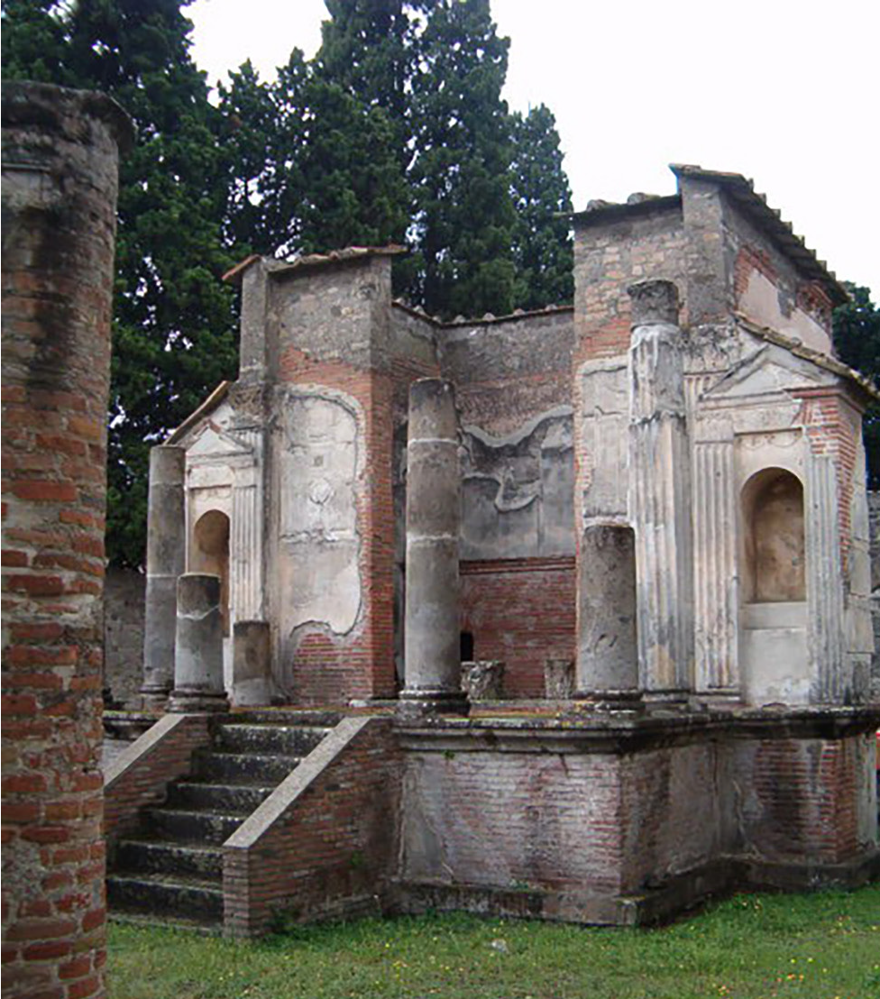

# 폼페이 — 이집트의 여신은 어떻게 이곳에 왔을까

*극장 뒤 작은 신전에서 만나는 로마 도시의 다른 얼굴*

Cities · Europe

> 출처 대조와 공개 게시 승인을 마친 이야기입니다. 실제 게시 여부는 사이트 배포 상태를 따릅니다.

*Istvánka / Wikimedia Commons · OpenStax 수록 · Public Domain. 발굴된 이시스 신전의 실제 사진이며 고대의 완전한 모습을 복원한 그림은 아닙니다.*

[이미지 출처·제작 근거](https://raw.githubusercontent.com/openstax/osbooks-world-history/main/media/OSX_WorldHist_A07_04_Temple.png) · Public Domain

폼페이라고 하면 화산이 터지던 마지막 날을 떠올리기 쉽다. 그러나 유적 안에는 그날 이전의 오랜 생활도 남아 있다. 사람들은 장사를 하고 공연을 보고 신에게 기도했다. 도시를 재난의 장면 하나로만 기억하면 그들이 평소 무엇을 믿었는지는 잘 보이지 않는다.

작은 이시스 신전은 이런 일상으로 들어가는 입구가 된다. 이집트에서 온 여신을 로마의 이탈리아 도시에서 만난다는 사실부터 흥미롭다. 신전의 규모와 극장 뒤라는 위치를 살피면 낯선 신앙이 도시 안에서 차지한 자리가 조금씩 드러난다.

## 1. 익숙한 로마 신들만 있었던 것은 아니다

로마제국에는 여러 지역의 종교가 함께 존재했다. 이시스 숭배는 이집트에서 시작해 기원전 1세기 무렵 로마제국 서부에서도 퍼졌다. 사람이 이동하고 서로 다른 지역이 연결되면 물건뿐 아니라 기도하는 방식도 전해질 수 있다.

이시스는 신자들에게 큰 힘을 지닌 여신으로 받아들여졌다. 로마 소설 《황금 당나귀》에도 주인공을 구하는 존재로 등장한다. 소설 속 장면을 실제 사건으로 볼 수는 없지만, 당시 사람들이 이 여신을 어떤 능력과 연결했는지 살펴볼 수 있는 자료다.

## 2. 신전은 도시 밖의 외딴 장소가 아니었다

폼페이의 이시스 신전은 도시 극장 바로 뒤에 있었다. 다른 공공 건물과 멀리 떨어진 공간이 아니었다. 이 위치는 새로운 신앙의 장소도 도시의 평범한 이동과 만날 수 있었음을 보여 준다.

그렇다고 공연을 본 사람이 모두 이시스 신자가 되었다는 뜻은 아니다. 인접한 건물들이 어떤 일상 속에 놓여 있었는지 생각해 보는 것이다. 유적을 한 채씩 따로 볼 때보다 주변의 극장과 길을 함께 떠올리면 신전은 고립된 기념물이 아니라 도시의 한 장소가 된다.

## 3. 작은 뜰과 몇 계단 위의 입구

사진에는 뜰 안쪽의 신전 정면이 보인다. 계단 위에 기둥이 받치는 입구가 놓여 있고 주변으로 낮은 공간이 이어진다. 큰 제국의 종교 건축이라고 해서 언제나 거대한 규모만을 기대할 필요는 없다.

교재는 이 신전의 비교적 작은 크기와 내부 구성이 이시스 신앙의 입문 의례와 관련된 공간임을 설명한다. 사진에서 확인할 수 있는 것은 남은 건축의 모습이다. 과거에 이곳을 드나든 사람의 수와 특정 의례의 진행을 사진만으로 정할 수는 없다.

## 4. 79년 이전에 이미 한 번 고쳤다

이 신전은 아우구스투스 시대에 세워졌고, 62년 폼페이의 지진 뒤 재건되었다고 교재는 설명한다. 그로부터 17년 뒤 베수비오 화산의 분화가 일어났다. 도시의 마지막 재난 이전에도 건물을 다시 세우는 시간이 있었던 것이다.

유적을 보면 처음 세웠을 때부터 그대로 멈춘 물건처럼 느끼기 쉽다. 그러나 사람이 사는 도시는 손상되고 고쳐진다. 신전이 재건되었다는 사실은 누군가 그 장소를 계속 사용하려 했음을 알려 준다. 남은 벽 뒤에는 유지하고 다시 마련한 생활이 들어 있다.

## 5. 겉모습과 안쪽의 활동은 달랐다

교재가 설명하는 옛 신전에는 이시스와 오시리스의 상, 신화를 그린 벽화가 있었다. 입문한 신자들이 모이는 공간과 사제의 거처, 제단과 지하의 의례 공간도 소개된다. 입구 하나만 보고 전체의 역할을 다 알 수는 없는 배치다.

다만 현재 사진에 그 모든 장식과 내부 시설이 완전한 모습으로 보인다는 뜻은 아니다. 자료가 설명하는 과거 구성과 눈앞에 남은 유적을 구별해야 한다. 이 차이를 알면 보이지 않는 부분을 마음대로 채우기보다 무엇을 더 확인할지 질문할 수 있다.

## 6. 비밀 의례라는 말에서 멈추지 않기

이시스 신앙은 입문 절차와 신자 집단의 활동을 가진 이른바 신비 종교의 하나로 설명된다. 이름 때문에 환상 소설의 비밀 조직을 떠올릴 수 있지만, 그것만으로 당시 종교 생활을 이해할 수는 없다. 실제로는 사람들이 신과 구원, 공동체를 만나는 방식의 하나였다.

여러 종교가 있었다는 사실을 곧바로 아무 갈등도 없었다는 말로 바꿀 수도 없다. 로마제국에서 각 종교가 전통 의례와 맺은 관계는 달랐다. 작은 신전은 도시의 다양성을 보여 주지만, 제국의 모든 신앙이 같은 조건에 있었다는 증명은 아니다.

## 7. 재난의 도시에서 생활의 도시로

폼페이는 79년의 분화 때문에 특별한 고고학 자료를 남겼다. 하지만 그곳의 주민을 마지막 순간만으로 설명할 필요는 없다. 공연장 가까이 신전을 두고 건물을 고치며 생활을 이어 가던 사람들이 있었다.

이시스 신전을 바라보면 재난보다 앞선 질문이 생긴다. 이 도시 사람들은 누구와 함께 기도했고 어떤 이야기에 위안을 얻었을까. 정확히 알 수 없는 개인의 마음을 창작하지 않아도, 공간과 자료를 통해 당시 생활의 여러 선택을 생각할 수 있다.

## 8. 작은 건물 하나가 넓혀 주는 지도

함께 실은 것은 발굴된 이시스 신전의 실제 사진이다. 이집트 신앙이 이탈리아 도시 안에 자리했던 건축의 흔적을 보여 준다. 여신의 이동 경로를 한 사람의 여행으로 복원한 자료는 아니지만 지중해 세계의 연결을 느끼게 한다.

다음에 로마 유적을 만나면 이름난 황제와 큰 경기장 곁의 작은 공간도 보아 두자. 제국의 도시에는 여러 지역에서 온 믿음과 생활이 들어 있었다. 폼페이의 작은 신전은 도시가 무엇으로 이루어지는지 생각하게 하는 조용한 이야기다.

## 이야기의 바탕이 된 자료

- [OpenStax World History — 로마 세계의 이시스 신앙과 폼페이 신전](https://raw.githubusercontent.com/openstax/osbooks-world-history/main/modules/m00141/index.cnxml) · 확인일 2026-10-31
  - 확인 내용: 이시스 신앙의 이집트 기원과 로마 세계 전파 / 폼페이 신전의 건립·62년 지진 이후 재건·공간 구성

---

[같은 소주제의 이야기](README.md) · [전체 서가](../../README.md)
