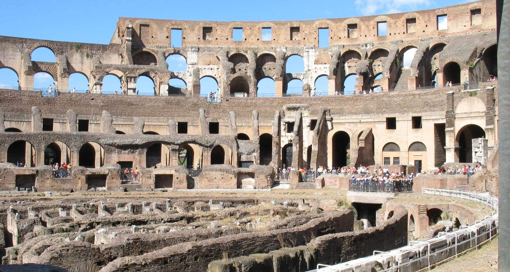

# 콜로세움에서는 무대만큼 관중석도 크다

*로마의 돌 건물에서 사람들이 모이던 자리를 보기*

Cities · Europe

> 자료 대조를 마친 검토용 이야기입니다. 공개 게시 승인은 아직 받지 않았습니다.

*“Colosseum” by Rennett Stowe/flickr, CC BY 2.0 · OpenStax 수록본. 원본 전체 사진을 자르지 않고 사용했습니다.*

[이미지 출처·제작 근거](https://raw.githubusercontent.com/openstax/osbooks-introduction-anthropology/main/media/ANTHRO_Figure_16_Intro_001_Splash.jpg) · CC BY 2.0

로마의 콜로세움 사진을 보면 돌로 이어진 둥근 벽과 여러 층의 공간이 먼저 눈에 들어온다. 너무 유명한 건물이라 이름만 확인하고 지나치기 쉽다. 이번에는 가운데의 무대보다 그 주변의 관중석을 먼저 보자.

이 건물은 비어 있는 돌 구조물로 시작한 것이 아니다. 사람들이 모여 무언가를 함께 보던 장소였다. 사진 속 빈 공간에 관중을 떠올리면 건물의 크기가 다른 방식으로 느껴진다.

## 보는 사람들을 위한 건물

OpenStax 교재는 고대 로마의 이곳에 수만 명이 모여 경기를 보았다고 소개한다. 콜로세움의 이야기는 무대 위에서 무엇이 일어났는지뿐 아니라, 그 장면을 보기 위해 얼마나 많은 사람이 모였는지와도 관련된다.

한 사람이 그림 앞에 서는 것과 커다란 관중석에서 군중과 함께 관람하는 경험은 다르다. 같은 장면을 향해 시선이 모이도록 공간을 마련한다는 것이 이 건물을 보는 또 하나의 실마리다.

## 오늘의 경기장과 나란히 떠올리기

교재는 콜로세움이 고대 사회에서 맡았던 역할을 오늘날의 큰 스포츠 경기장과 비교한다. 단순히 구경거리를 제공하는 데 그치지 않고 사람들이 소속감과 정체성을 느끼는 자리가 될 수 있다는 관점이다.

그렇다고 당시의 경기와 오늘날의 스포츠가 똑같았다는 뜻은 아니다. 교재는 검투사와 동물이 등장하는 폭력적인 구경거리도 설명한다. 모여 보는 공간이라는 닮은 점과, 그 안의 서로 다른 내용을 나누어 볼 필요가 있다.

## 비어 있어도 남아 있는 자리

함께 실은 것은 콜로세움 내부의 실제 사진이다. 오늘 남은 모습을 고대의 완전한 모습으로 바꾸어 그리지는 않았다. 현재 보이는 자리와 사라진 부분을 있는 그대로 만나기 위해서다.

유명한 유적 앞에서는 언제 지었는지와 얼마나 큰지를 먼저 묻게 된다. 그 옆에 누가 어디에서 무엇을 보았을까라는 질문도 놓아 보자. 로마의 돌 건물은 관중이 떠난 뒤에도 사람들이 모였던 자리를 남겨 놓고 있다.

## 이야기의 바탕이 된 자료

- [OpenStax — Introduction to Anthropology: Introduction](https://raw.githubusercontent.com/openstax/osbooks-introduction-anthropology/main/modules/m00095/index.cnxml) · 확인일 2026-10-29
  - 확인 내용: 콜로세움 내부 실제 사진과 로마 소재 / 수만 관중·검투사와 동물이 등장하는 경기라는 본문 / 현대 경기장과 비교한 사회적 소속감·정체성의 관점

---

[같은 소주제의 이야기](README.md) · [전체 서가](../../README.md)
