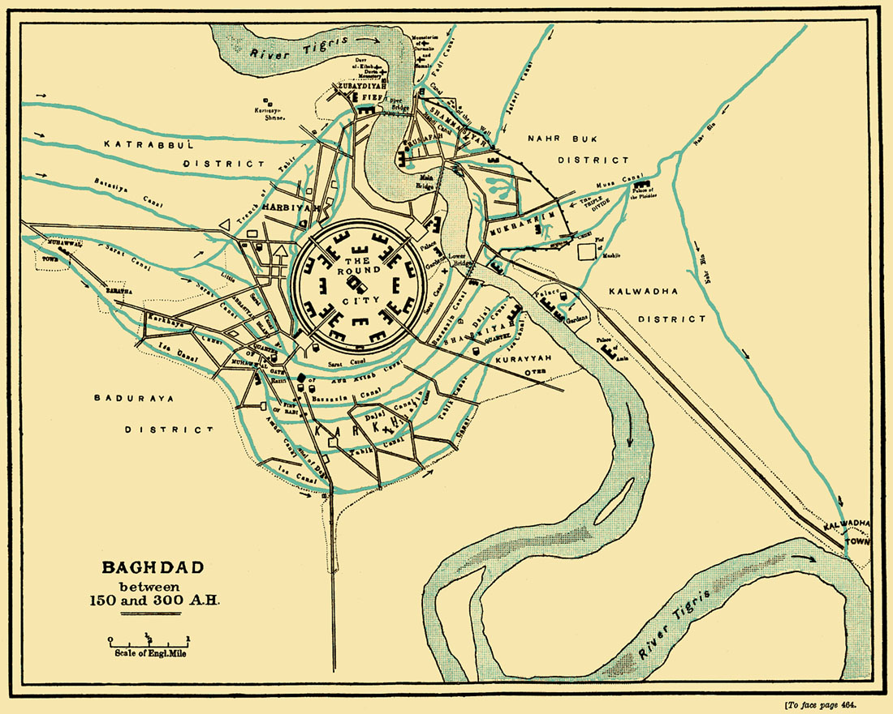

# 바그다드 — 둥근 도시 바깥으로 이야기가 자라다

*궁전에서 시작한 원과 강을 따라 번진 생활*

Cities · Middle East

> 출처 대조와 공개 게시 승인을 마친 이야기입니다. 실제 게시 여부는 사이트 배포 상태를 따릅니다.

*OpenStax 수록 “Baghdad 150 to 300 AH” · www.muhammadanism.org / Wikimedia Commons · Public Domain 표기. 중세 현장 지도나 현재의 지도는 아닙니다.*

[이미지 출처·제작 근거](https://raw.githubusercontent.com/openstax/osbooks-world-history/main/media/OSX_WorldHist_A11_03_M-Baghdad.jpg) · Public Domain

도시 지도를 펼쳤는데 한가운데 커다란 원이 보인다면 어떨까. 도로가 우연히 둥글어진 정도가 아니다. 성벽과 중심 공간을 원으로 계획한 도시다. 오늘날 이라크의 수도 바그다드에는 바로 이런 출발점이 있었다.

함께 실은 지도에서 먼저 둥근 부분을 찾아보자. 그다음에는 시선을 조금 옆으로 옮겨 강과 수로, 원 바깥의 길을 따라가면 된다. 두 번 보는 사이에 이야기가 달라진다. 권력자가 그린 수도의 모양과 사람들이 살아가며 넓힌 도시가 한 장 안에 들어 있기 때문이다.

## 1. 새 왕조는 수도의 자리부터 바꾸었다

8세기에 등장한 아바스 왕조는 다마스쿠스에서 더 동쪽으로 정치의 무게중심을 옮겼다. 새 수도 바그다드는 티그리스강을 낀 메소포타미아에 자리 잡았다. 비옥한 농경지와 물길을 이용할 수 있고 동쪽 지역과의 관계도 강화할 수 있는 곳이었다.

수도 이전은 궁전의 주소만 바꾸는 일이 아니다. 관료와 군인, 장인과 상인도 새로운 중심을 향해 움직인다. 왕조가 어디를 중요하게 여기는지 도시의 위치가 보여 주는 셈이다. 바그다드의 성장은 이런 정치적 선택과 주변의 생산·교역 조건이 만난 결과였다.

## 2. 궁전 가까이에 산다는 의미

둥근 중심부 안에서는 칼리프의 궁전에 가까운 자리가 특별한 위신을 가졌다. 같은 도시의 주민이라도 권력의 중심에 얼마나 가까운지가 중요했다. 원은 보기 좋은 무늬이면서, 중심과 주변을 눈에 띄게 구분하는 배치이기도 했다.

그렇다고 동그라미 안에 바그다드의 모든 삶이 들어 있었던 것은 아니다. 지도에서도 강가의 여러 구역과 길이 원을 벗어나 이어진다. 처음 계획한 중심부를 도시 전체와 혼동하지 않으면, 잘 정돈된 설계도와 실제 도시가 어떻게 다른지 훨씬 쉽게 이해할 수 있다.

## 3. 강을 따라 사람이 늘어나면

아바스 왕조가 부유해지고 영향력이 커지면서 바그다드는 교역과 문화의 중요한 중심으로 성장했다. 시가지는 강을 따라 퍼지고 주변 농경지 쪽으로도 넓어졌다. 성벽 안의 중심이 분명해도 생활의 경계까지 같은 모양으로 멈추지는 않았다.

강은 지도에서 도시를 장식하는 파란 선이 아니다. 사람과 물자를 옮기는 통로이자 주변의 생산과 도시의 소비를 잇는 조건이었다. 어느 길이 강에 닿는지, 물길 옆으로 구역이 어떻게 붙어 있는지 살피면 궁전만 볼 때는 놓쳤던 도시의 움직임이 보인다.

## 4. 물건과 함께 지식도 도착했다

바그다드에는 여러 언어를 쓰고 서로 다른 전통을 배운 사람들이 모였다. 아바스 지배층의 후원을 받아 그리스어와 페르시아어 등으로 전해지던 저술을 아랍어로 옮기는 작업도 활발해졌다. 학문에 대한 관심은 궁정의 권위와 행정, 실제 지식의 필요와도 이어져 있었다.

이 과정에는 그리스어와 시리아어를 모국어로 쓰는 비무슬림 학자들도 참여했다. 서로 다른 배경의 사람이 함께 일했다는 점이 중요하다. 번역은 한 사람이 사전을 펼치는 장면만으로 설명되지 않는다. 원고를 구하고 언어를 이해하고 작업을 후원하는 관계가 있어야 책 한 권이 새로운 독자에게 갈 수 있다.

## 5. 오래된 책을 그대로 옮기기만 했을까

번역한 내용은 언제나 손대지 말아야 하는 완성품으로 취급된 것은 아니었다. 학자들은 과거의 과학 저술을 읽으며 내용을 바로잡거나 보충하기도 했다. 앞선 시대의 지식을 존중하는 일과 지금의 질문을 덧붙이는 일이 함께 이루어진 것이다.

제지 기술의 확산도 이런 배경에서 중요했다. 책을 만드는 비용을 낮출 수 있는 재료와 기술은 지식을 옮기는 일의 조건을 바꾸었다. 물론 그 시대 사람 모두가 책을 읽었다는 뜻은 아니다. 글을 읽는 사람은 제한적이었지만, 책이 만들어지고 유통될 가능성이 넓어지는 변화는 도시의 성격을 바꾸었다.

## 6. 지도를 사진처럼 읽지 않는 법

여기 실은 것은 중세인이 바로 그 자리에서 그린 현장 기록이 아니라, 교재가 1880년대 지도로 소개한 후대의 자료다. 제목에는 이슬람력 150년에서 300년 사이의 바그다드가 표시되어 있다. 과거 도시의 배치를 이해하도록 구성한 그림이지 특정 하루의 항공사진이 아니다.

그래서 건물 하나하나의 실제 높이나 거리를 이 그림만으로 확정할 수는 없다. 대신 둥근 중심, 티그리스강, 바깥으로 이어지는 길의 관계를 읽기에 좋다. 제작 시기와 그려진 시대를 나누어 보는 간단한 습관만으로도 옛 지도는 훨씬 흥미로운 읽을거리가 된다.

## 7. 도시를 완성하는 것은 원 밖의 생활

바그다드 이야기를 떠올릴 때 멋진 원 하나만 기억해도 출발은 충분하다. 다만 거기서 강과 시장, 책과 번역자의 자리로 조금 더 걸어가 보자. 수도의 권위를 표현한 모양 곁에서 수많은 사람이 다른 이유로 도시를 키우고 있었다.

한 도시는 설계자의 의도대로만 남아 있지 않는다. 물건을 실어 나르는 길과 새로운 말로 읽히는 책이 그 안에 계속 다른 관계를 만든다. 지도 한가운데의 동그라미가 재미있는 까닭은, 결국 그 선만으로는 다 담을 수 없는 바그다드의 생활을 생각하게 하기 때문이다.

## 이야기의 바탕이 된 자료

- [OpenStax World History — 아바스 왕조와 바그다드](https://raw.githubusercontent.com/openstax/osbooks-world-history/main/modules/m00094/index.cnxml) · 확인일 2026-10-30
  - 확인 내용: 8세기 수도의 동쪽 이동·티그리스강과 농경지·둥근 중심부와 외곽 성장 / 번역 운동·여러 종교와 언어의 학자·제지 기술; 1880년대 후대 지도라는 캡션

---

[같은 소주제의 이야기](README.md) · [전체 서가](../../README.md)
