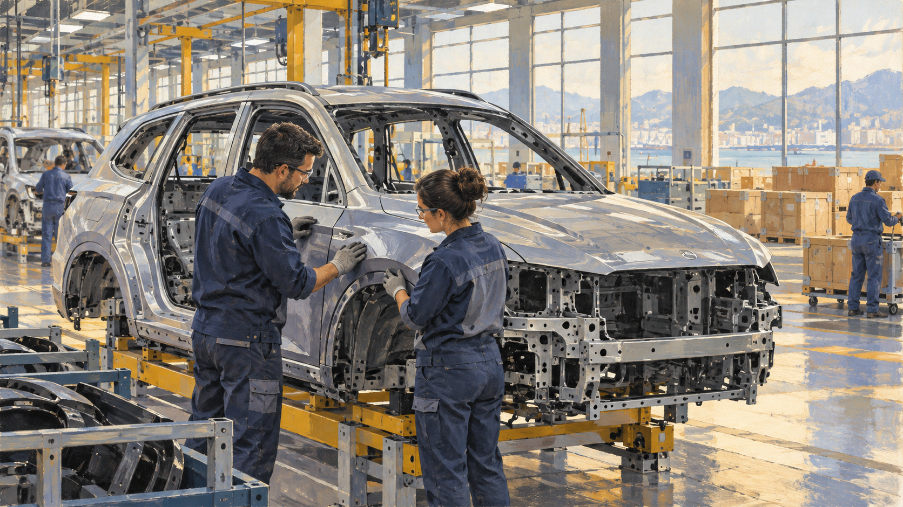

# BMW — 독일 자동차를 미국에서 만들면

*브랜드의 고향과 공장의 주소는 왜 다를까*

Companies · Automotive

> 자료 대조를 마친 검토용 이야기입니다. 공개 게시 승인은 아직 받지 않았습니다.

*AI 관련 삽화 · 국제 생산을 떠올리는 일반적인 자동차 작업 장면입니다. BMW의 실제 공장이나 특정 차종을 묘사한 자료는 아닙니다.*

자동차를 보며 독일 브랜드라고 말한다. 그런데 그 차를 만든 공장은 미국에 있을 수 있다. 이름을 익숙하게 알고 있을수록 처음에는 뜻밖처럼 느껴진다. 브랜드의 고향과 조립된 장소는 왜 같은 주소가 아닐까.

BMW의 미국 생산은 경영학 교재가 해외 직접투자를 설명하는 사례 가운데 하나다. 자동차가 국경을 넘는다는 것은 완성된 차를 배에 싣는 일만이 아니다. 기업이 공장을 다른 나라에 세우는 방식으로 생산의 지도를 바꾸기도 한다.

## 1. 상표는 한 나라와 연결되어 보인다

브랜드에는 역사와 디자인, 사람들이 쌓아 온 이미지가 붙는다. BMW를 독일 자동차 회사라고 부르는 말에는 그런 배경이 들어 있다. 하지만 그 표현이 모든 제품의 부품과 작업이 한 나라 안에서 이루어진다는 뜻은 아니다.

완성차의 생산지와 설계·기업의 본거지, 부품을 공급받는 곳은 서로 다른 질문이다. 자동차 한 대의 국적이라는 표현은 일상적으로 편리하지만 그 안에 여러 종류의 연결을 묶어 놓기도 한다. 무엇을 알고 싶은지 나누어 보면 답도 더 분명해진다.

## 2. 교재가 소개한 사우스캐롤라이나 공장

교재는 미국 사우스캐롤라이나주 스파턴버그의 BMW 공장에서 SUV가 생산되는 사례를 설명한다. 당시 X3와 X5 같은 모델을 들었다. 이는 그 시기의 사례이며 현재 모든 모델의 생산지를 정리한 목록은 아니다.

중요한 점은 외국 기업이 완성차를 수출만 하는 대신 현지에서 생산 시설을 운영했다는 것이다. 소비자는 독일 회사의 브랜드를 선택하면서 미국에서 조립된 제품을 살 수 있다. 처음의 모순은 서로 다른 주소를 같은 종류의 정보로 보았을 때 생긴 셈이다.

## 3. 고객 가까이에서 만든다는 선택

기업이 해외 공장을 세우는 이유 가운데 하나는 고객에게 더 가까워지는 것이다. 제품을 멀리서 완성해 보내는 방식과 현지에서 만드는 방식은 물류와 일정의 조건이 다르다. 커다란 자동차를 어떻게 이동시킬지도 비용과 연결된다.

물론 공장이 가깝다고 모든 부품까지 가까운 곳에서 오거나 모든 배송이 빨라지는 것은 아니다. 생산지의 이동은 공급망 전체의 관계를 다시 짜는 문제다. 한 구간을 줄이면서 다른 구간의 이동이 생길 수도 있다. 현지 생산이라는 말 뒤의 구체적인 연결을 보아야 한다.

## 4. 관세와 시장의 규칙도 영향을 준다

교재는 현지 생산이 수입품에 부과되는 관세나 무역 장벽과 관련될 수 있다고 설명한다. 물건을 판매할 시장에 공장을 두면 완성품 수입과 다른 조건을 만날 수 있기 때문이다. 기업의 입지 선택은 기술 문제만이 아니다.

다만 이 설명을 현재의 특정 관세율이나 정책에 바로 적용할 수는 없다. 제도는 시기와 나라, 품목에 따라 달라진다. 이번 원고는 어떤 정치적 결정이 최신으로 내려졌는지 알려 주기보다, 공장 주소를 정할 때 제도도 고려한다는 원리를 읽는 글이다.

## 5. 건물만 세운다고 차가 나오지는 않는다

생산 시설에는 설비뿐 아니라 기술을 가진 사람과 공급자, 관리의 관계가 필요하다. 현지의 전문성과 비용 조건도 해외 직접투자의 이유가 될 수 있다고 교재는 설명한다. 기업은 땅 위에 공장 건물 한 채만 옮기는 것이 아니다.

생산 기준과 훈련, 부품의 품질과 작업의 연결을 마련해야 한다. 이 부분은 원리를 설명하는 것이며 특정 BMW 공장의 현재 교육 과정을 취재한 기록은 아니다. 같은 상표의 제품을 여러 장소에서 만든다는 목표에는 그런 기준을 이어 가는 과제가 생긴다.

## 6. 만든 장소와 품질을 곧바로 같게 볼 수 있을까

생산 국가만으로 모든 제품의 품질을 정하면 중요한 차이를 놓칠 수 있다. 어떤 설계와 기준을 적용하고 어떤 부품을 쓰며 어떻게 확인했는지가 함께 관여한다. 좋은 제품을 만든다는 약속은 국기의 모양만으로 실행되지 않는다.

이것은 어느 나라 공장이 더 낫다는 비교가 아니다. 브랜드의 이미지와 실제 생산의 조건을 나누어 읽자는 뜻이다. 기업이 해외에서 생산해도 고객은 익숙한 상표에 기대를 갖는다. 그 기대와 현장의 결과를 연결하는 일이 기업의 책임으로 남는다.

## 7. 한 지역에는 새로운 관계가 생긴다

큰 생산 시설은 노동과 공급, 운송의 관계를 주변에 만든다. 회사가 시장 가까이 갔다는 설명과 현지 사회가 공장을 맞이한 경험은 다른 각도에서 볼 수 있다. 무엇이 이익이고 어떤 준비가 필요한지는 참여자에 따라 다르다.

이번 글은 스파턴버그 지역의 현재 고용 수나 경제 효과를 계산하지 않는다. 그런 평가는 별도의 지역 자료가 필요하다. 대신 해외 직접투자를 기업의 결정으로만 끝내지 않고 그곳에서 함께 일하는 사람과 업체의 관계로도 바라볼 수 있다.

## 8. 자동차의 주소를 하나 더 묻기

함께 실은 AI 삽화는 작업자들이 자동차의 일부를 확인하는 공장 분위기다. 실제 BMW 모델과 미국 공장의 설비를 복원한 사진이 아니다. 자동차가 어떤 장소의 생산과 연결되는지 떠올리기 위한 이미지다.

이제 독일 브랜드라는 말과 미국에서 만들었다는 말이 서로 다르게 답하고 있다는 것을 알 수 있다. 하나는 기업과 브랜드의 배경을, 다른 하나는 생산의 장소를 가리킨다. 자동차 한 대를 볼 때 주소를 하나만 묻지 않으면, 세계의 산업이 연결되는 방식도 조금 더 구체적으로 보인다.

## 이야기의 바탕이 된 자료

- [OpenStax Principles of Management — BMW와 해외 직접 투자](https://raw.githubusercontent.com/openstax/osbooks-principles-of-management-bundle/main/modules/m70638/index.cnxml) · 확인일 2026-10-31
  - 확인 내용: 스파턴버그 생산의 교재 사례 / 고객 접근·국경의 장벽·현지 생산과 국제적 연결

---

[같은 소주제의 이야기](README.md) · [전체 서가](../../README.md)
