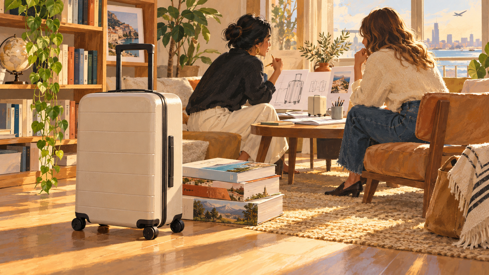

# 어웨이 — 여행가방보다 여행 책이 먼저 도착했다

*고장 난 가방에서 제품과 이야기를 함께 만들기까지*

Companies · Fashion

> 출처 대조와 공개 게시 승인을 마친 이야기입니다. 실제 게시 여부는 사이트 배포 상태를 따릅니다.

*KnowledgeWalk 제작 AI 삽화 · 어웨이 실제 창립자·제품·책 표지를 복원한 자료가 아닌 제품 기획의 분위기 삽화.*

여행을 떠났는데 가방이 고장 난다. 바퀴나 손잡이 때문에 짐을 옮기는 일이 갑자기 힘들어지면, 평소에는 별생각 없던 여행가방의 중요성이 드러난다. 제니퍼 루비오에게는 이런 불편이 새로운 사업을 생각하는 계기가 되었다.

루비오는 스테퍼니 코리와 함께 어웨이라는 여행가방 회사를 준비했다. 그런데 초기 고객 중에는 가방보다 먼저 여행 이야기를 담은 책을 받은 사람들이 있었다. 아직 보내 줄 제품이 없을 때 무엇으로 기대를 만들 것인가라는 질문에서 나온 선택이었다.

## 1. 저렴하거나 아주 비싸거나

OpenStax 경영학 교재는 두 사람이 2015년에 가방 시장을 조사하기 시작했다고 설명한다. 당시 루비오는 저렴하지만 품질이 아쉬운 제품과 높은 품질이지만 비싼 제품 사이에 여지가 있다고 보았다. 이것은 창업자가 발견한 시장의 기회이지 모든 가방의 객관적인 등급표는 아니다.

두 사람은 가격의 이유를 제품 자체에서만 찾지 않았다. 전문점과 백화점 등을 거치는 유통 구조가 최종 가격에 어떤 영향을 미치는지도 살폈다. 소비자에게 직접 판매하면 다른 가격대의 제품을 제안할 수 있겠다는 구상이 여기서 나왔다.

## 2. 내 가방의 불편이 모두의 불편일까

창업 계기가 생겼다고 바로 제품을 만들지는 않았다. 두 사람은 수백 명에게 기존 가방에서 무엇이 좋고 무엇이 가장 성가신지 물었다. 자신의 여행 경험을 출발점으로 삼되 다른 사람의 필요도 알아보려 한 것이다.

이 차이는 생각보다 중요하다. 나에게 답답한 점이 많은 고객에게도 중요한 문제인지 확인해야 하기 때문이다. 어떤 바퀴를 쓸지, 무게와 외형을 어떻게 맞출지 같은 결정은 고객의 말을 실제 물건의 선택으로 옮기는 과정이었다. 인터뷰는 제품을 대신 만들어 주지 않지만 결정의 근거가 될 수 있다.

## 3. 서로 다른 경험을 가진 두 사람

루비오는 브랜드와 마케팅 쪽, 코리는 운영과 공급망 쪽의 경험을 갖고 있었다. 두 사람 모두 전자상거래 기업에서 일한 경험도 있었다. 같은 제품을 보면서 무엇을 고객에게 말할지와 어떻게 만들어 전달할지를 다른 각도에서 생각할 수 있었다.

가방을 만드는 회사라고 디자인만 잘하면 되는 것은 아니다. 생산할 곳을 찾고 비용을 마련하며 고객을 만나야 한다. 서로 다른 능력을 함께 쓰는 일은 창업자의 개인적인 영감만큼 중요했다. 눈에 보이는 물건 하나의 뒤에는 여러 종류의 판단이 필요하다.

## 4. 서류로 좋아 보이는 공장을 직접 가 보기

두 사람은 제조 파트너도 조사했다. 단단한 폴리카보네이트 외장을 만드는 후보 업체들이 아시아에 많았고, 여러 곳을 비교한 뒤 직접 방문했다. 자료에서 좋은 인상을 주는 업체가 현장에서도 반드시 같은 것은 아니었다고 교재는 설명한다.

결국 중국의 제조 파트너와 협력했으며 관계를 유지하는 데도 시간을 들였다. 제품을 외부 공장에서 만든다고 창업자의 일이 끝나는 것은 아니다. 어떤 기준을 공유하고 문제가 생길 때 어떻게 소통할지도 사업의 일부다. 브랜드의 겉모습과 생산의 조건이 여기서 연결된다.

## 5. 그런데 연말에 가방을 보낼 수 없었다

2015년 말에는 첫 제품이 준비되는 중이었지만 연말 선물 시기에 맞추어 가방을 공급하기 어려웠다. 아직 없는 물건을 이미 있는 것처럼 말할 수는 없다. 두 사람은 예약 구매와 함께 제공할 다른 형태의 경험을 생각했다.

그 결과가 여행을 주제로 한 책이었다. 여러 창작자에게 여행 경험을 인터뷰해 《The Places We Return To》라는 하드커버 책을 만들었다. 교재에 따르면 40명의 이야기를 담았다. 여행가방을 바로 펼칠 수 없는 고객에게 여행이라는 주제의 읽을거리를 먼저 건넨 셈이다.

## 6. 책과 교환권을 묶은 첫 만남

당시 제안은 가방 자체를 즉시 받는 방식이 아니었다. 2015년 11월부터 향후 가방을 받을 수 있는 기프트카드를 구입하면 여행 책을 함께 받았고, 가방으로 교환할 시점은 2016년 2월로 안내되었다. 물건과 약속의 시간을 구분해 설명한 방식이다.

책은 가방의 바퀴 성능을 증명하는 시험 성적서는 아니다. 대신 브랜드가 어떤 여행을 이야기하고 싶은지 보여 주고, 제품을 기다리는 동안 관심을 이어 주었다. 사람들에게 말을 거는 방식과 실제로 배송해야 하는 의무는 각각 존재했다.

## 7. 이야기가 제품을 대신하지는 않는다

이 사례를 스토리텔링만 잘하면 물건 없이도 성공한다는 공식으로 읽으면 중요한 부분이 빠진다. 그전에 고객 조사와 시제품 개발, 제조 파트너 선택이 있었다. 책이 관심을 만들더라도 나중에 받을 가방이 고객의 기대에 맞아야 관계가 이어질 수 있다.

교재는 초기 책 1,200부가 모두 판매되었다고 소개한다. 이는 당시 출발을 설명하는 수치이며 오늘날 회사의 전체 성과를 뜻하지 않는다. 이번 글도 2015~2016년 초기 사례를 읽는 것으로, 현재 제품의 가격이나 기능, 배송 조건을 안내하지 않는다.

## 8. 가방을 팔면서 무엇을 함께 말할까

함께 실은 AI 삽화는 가방과 여행 책, 제품을 의논하는 사람의 모습을 담았다. 실제 창립자의 초상이나 초기 가방과 책의 정확한 디자인을 재현한 자료는 아니다. 물건을 만들기 전후에 어떤 생각이 오갔을지 떠올리는 분위기 그림이다.

어웨이의 초기 이야기는 좋은 제품과 좋은 이야기가 경쟁해야 하는 것이 아님을 보여 준다. 가방은 여행의 짐을 담고 책은 여행의 기억을 담았다. 둘을 연결한 선택이 흥미로운 이유는 물건 하나를 팔기 위해서도 사람의 불편과 기대, 기다리는 시간까지 생각해야 했기 때문이다.

## 이야기의 바탕이 된 자료

- [OpenStax Principles of Management — 어웨이 창업 초기의 결정](https://raw.githubusercontent.com/openstax/osbooks-principles-of-management-bundle/main/modules/m70608/index.cnxml) · 확인일 2026-10-30
  - 확인 내용: 2015년 고객 조사·소비자 직접 판매 구상·두 창업자의 경험과 역할 / 시제품·제조 후보 현장 조사·중국 파트너 선택 / 40명 여행 인터뷰 책·2015년 11월 교환권 판매/2016년 2월 교환 안내·초기 1200부; 현재 사양과 가격으로 제시하지 않음

---

[같은 소주제의 이야기](README.md) · [전체 서가](../../README.md)
