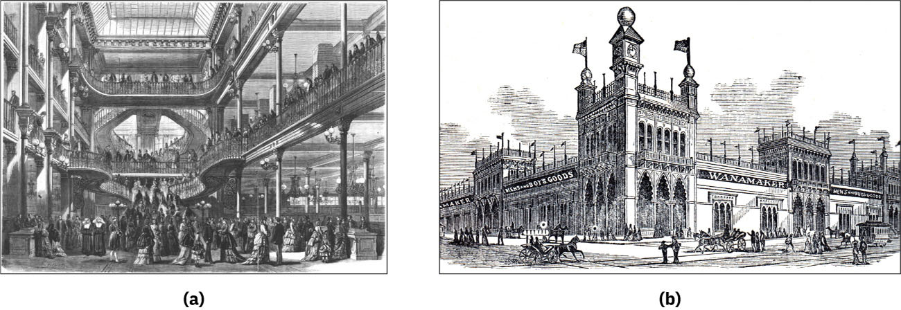

# 백화점 — 사지 않아도 구경하러 들어가는 가게

*봉마르셰와 도시의 쇼핑이 바꾼 하루*

Companies · Fashion

> 출처 대조와 공개 게시 승인을 마친 이야기입니다. 실제 게시 여부는 사이트 배포 상태를 따릅니다.

*L’illustration의 Le Bon Marché 도판 및 The Illustrated History of the Centennial Exposition / The Cooper Collections of US History의 John Wanamaker’s Clothing House 도판 · Wikimedia Commons / OpenStax · 개별 자료 Public Domain. 왼쪽 파리 내부·오른쪽 필라델피아 외관이며 한 건물의 두 장면이 아닙니다. 원본 파일 그대로 사용했습니다.*

[이미지 출처·제작 근거](https://raw.githubusercontent.com/openstax/osbooks-world-history/main/media/OSX_WorldHist_B10_02_BonMarche.jpg) · Public Domain

물건을 사러 간 것도 아닌데 쇼윈도 앞에서 발걸음이 멈춘다. 안으로 들어가 몇 층을 둘러보고 아무것도 사지 않은 채 나오기도 한다. 오늘날에는 자연스러운 이 구경이 한때는 새로운 도시의 즐거움이었다.

19세기 산업도시에 커다란 백화점들이 등장했다. 파리의 봉마르셰, 런던의 셀프리지스, 뉴욕의 메이시스 같은 가게는 물건을 모아 팔면서 사람들이 시간을 보내는 방식도 바꾸었다.

## 1. 한 건물에 모인 여러 가지 욕망

옷과 생활용품을 여러 곳에서 찾아다니는 대신 큰 가게에서 함께 볼 수 있게 되었다. 대량으로 생산되는 상품과 커진 도시의 소비가 만난 결과였다. 쇼핑의 대상은 늘어났고 구경의 경로도 길어졌다.

이 변화는 커다란 건물 하나만으로 생기지 않았다. 상품을 충분히 공급할 생산과 운송, 가게까지 데려다줄 교통이 필요했다. 백화점의 진열대 뒤에는 도시 전체의 움직임이 연결되어 있었다.

## 2. 진열장은 거리로 말을 걸었다

보기 좋게 놓인 상품은 지나가는 사람에게 먼저 말을 걸었다. 옷감이나 소품을 당장 살 필요가 없어도 색과 모양을 보고 싶어졌다. 상점의 창은 안과 밖을 가르는 유리이면서 새로운 취향을 보여 주는 무대였다.

백화점은 방문객에게 무엇이 유행하는지도 알려 주었다. 사람들은 물건을 사는 것만 아니라 지금 다른 사람들이 무엇을 원하는지 배웠다. 구매하지 않은 날에도 마음속의 목록은 조금씩 바뀔 수 있었다.

## 3. 구경이 하나의 외출이 되었다

거리와 가게를 둘러보는 시간은 도시의 여가에 들어왔다. 극장이나 공원처럼 백화점도 외출의 목적지가 되었다. 비교적 적은 비용으로 새로운 물건과 화려한 공간을 접할 수 있다는 점도 매력이었다.

그렇다고 누구나 똑같이 물건을 살 수 있었던 것은 아니다. 구경할 수 있는 자유와 구매할 수 있는 형편 사이에는 차이가 있었다. 창문은 사람들을 끌어들이는 동시에 각자의 주머니 사정을 떠올리게 했다.

## 4. 잠시 쉬어 가는 공간의 의미

가게는 고객이 오래 머물 수 있도록 휴식 공간과 차를 마실 곳을 마련했다. 물건을 고르는 동안 쉬어 갈 수 있다면 쇼핑은 급히 용건을 마치는 일이 아니라 반나절의 활동이 될 수 있었다.

이런 공간은 중산층 여성의 도시 생활과 특히 밀접했다. 가정의 소비를 맡은 여성들이 외출해 물건을 비교하고 잠시 쉬는 장소가 되었다. 다만 당시 여성 모두의 생활을 한 가지 쇼핑 경험으로 묶을 수는 없다.

## 5. 진열대의 이쪽과 저쪽

같은 백화점에서도 누군가는 손님으로, 누군가는 직원으로 하루를 보냈다. 도시의 젊은 여성들에게 판매와 접객은 일자리의 한 길이 되었다. 소비문화가 커지면서 그것을 유지하는 노동도 늘었다.

깨끗하고 밝은 매장이 곧 노동의 모든 어려움을 없앴다는 뜻은 아니다. 손님에게 편안한 공간을 만들려면 다른 누군가는 서서 일하고 상품을 정리해야 했다. 구경의 즐거움은 그 수고와 함께 만들어졌다.

## 6. 도판 속의 봉마르셰와 워너메이커

함께 실은 그림은 두 상점을 나란히 보여 준다. 한쪽은 파리의 봉마르셰, 다른 쪽은 필라델피아의 워너메이커다. 같은 건물의 서로 다른 층이나 시기를 그린 자료가 아니다.

도판은 상점이 얼마나 넓고 볼거리가 많은 곳으로 제시되었는지 살피게 한다. 이런 이미지는 건물의 실제 모습뿐 아니라 그곳이 어떤 장소로 기억되기를 바랐는지도 보여 준다. 손님의 경험 전체를 담은 사진은 아니다.

## 7. 물건보다 넓어진 경쟁

백화점의 경쟁은 상품 하나의 품질과 값만으로 설명하기 어려워졌다. 찾아오기 쉬운가, 둘러보는 동안 즐거운가, 쉬어 갈 곳이 있는가도 방문의 이유가 되었다. 가게 전체가 경험을 제공하기 시작했다.

그렇지만 이 변화를 특정 상점 한 곳의 발명으로만 볼 수는 없다. 여러 도시의 사업자와 소비자, 직원이 각기 다른 방식으로 새로운 관행을 만들었다. 도시는 서로를 참고하며 쇼핑의 풍경을 바꾸었다.

## 8. 도판에서 빠져 있는 하루

매장을 그린 오래된 그림에는 공간을 돋보이게 하는 선택이 들어 있다. 넓이와 장식, 모여든 손님은 잘 보이지만 물건을 옮기고 정리한 시간은 잘 드러나지 않는다. 화려한 상점의 인상과 그곳의 하루 전체를 구별하며 볼 필요가 있다.

그림 속 모든 방문객의 소득과 구매 내역도 알 수 없다. 많은 사람이 모였다는 모습만으로 누구나 풍요로웠다고 판단하기는 어렵다. 같은 상품을 앞에 두고도 누군가는 선물을, 누군가는 필요한 생활비를 생각했을 수 있다.

이런 점을 살피면 옛 상점 그림이 더 재미있어진다. 건축의 장식만 세는 대신 누가 어디에 서 있고 어떤 활동이 중심에 놓였는지 보게 된다. 소비의 역사는 멋진 진열을 바라보는 사람들의 서로 다른 생활과 이어진다.

## 9. 빈손으로 나와도 남는 것

백화점에서 아무것도 사지 않았다고 아무 일도 없었던 것은 아니다. 본 물건과 새로 알게 된 취향, 갖고 싶은 생활의 모습이 남는다. 쇼핑의 역사는 구매 영수증만으로 다 담기지 않는다.

쇼윈도 앞에서 잠깐 멈추는 오늘의 발걸음에도 그 역사가 이어진다. 가게는 물건을 파는 곳에서 사람들이 원하는 삶을 둘러보는 곳으로 넓어졌다. 그 변화의 한가운데에, 사지 않아도 들어가는 방문객이 있었다.

## 이야기의 바탕이 된 자료

- [OpenStax World History — Life in the Industrial City](https://raw.githubusercontent.com/openstax/osbooks-world-history/main/modules/m00003/index.cnxml) · 확인일 2026-10-31
  - 확인 내용: 1858년 런던 대악취·석회 소독 커튼·바잘제트 하수도와 후속 처리 / 풀먼 마을의 주거·시설과 검사·1894년 임금 삭감과 집세 갈등 / 도시의 백화점·진열과 휴게 공간·소비와 일자리·봉마르셰/워너메이커 역사 도판

---

[같은 소주제의 이야기](README.md) · [전체 서가](../../README.md)
