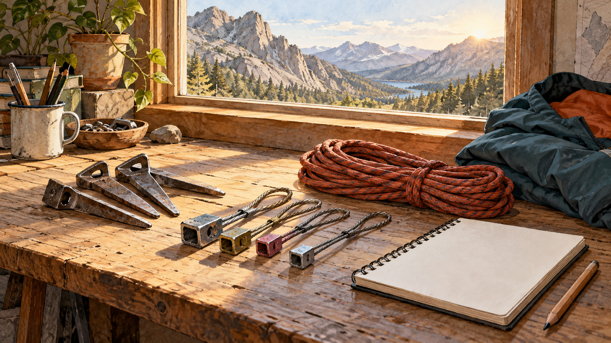

# 파타고니아 — 잘 팔리는 장비를 왜 바꾸려 했을까

*바위를 좋아하는 사람이 바위에 남긴 흔적을 보게 되다*

Companies · Fashion

> 출처 대조와 공개 게시 승인을 마친 이야기입니다. 실제 게시 여부는 사이트 배포 상태를 따릅니다.

*KnowledgeWalk 제작 AI 삽화 · 실제 역사적 제품의 정밀한 재현이나 안전·설치 안내가 아닌 장비를 다시 생각하는 분위기 삽화.*

좋아하는 일을 계속하기 위해 작은 도구를 만들어 판다. 그 도구가 잘 팔리기 시작하면 보통은 기뻐할 일이다. 그런데 더 많은 사람이 사용할수록 자신이 좋아하는 장소가 손상된다면 어떨까. 제품이 성공하고 있다는 사실이 마음 편한 소식만은 아니게 된다.

파타고니아의 창립자 이본 쉬나드의 이야기에는 이런 장면이 있다. 야외 의류 브랜드로 익숙하지만 그 출발을 거슬러 올라가면 옷보다 먼저 바위와 등반 장비를 만난다. 이 사례가 흥미로운 까닭은 환경을 아끼자는 말이 실제로 무엇을 팔지에 관한 선택으로 이어졌기 때문이다.

## 1. 옷을 만들기 전에 바위에 올랐다

쉬나드는 처음부터 패션 기업을 세우겠다는 계획만으로 움직인 사람이 아니었다. 등반을 좋아했고 그 생활을 이어 가는 과정에서 강철 피톤을 만들어 팔았다. 피톤은 바위 틈에 박아 쓰는 금속 장비다. 기능을 이해하는 데는 이 정도 설명이면 충분하다.

그 사업은 성장해 쉬나드 이큅먼트가 되었다. 교재는 미국의 중요한 등반 장비 공급업체로 발전했다고 설명한다. 자신이 직접 사용하는 도구를 잘 만들 수 있다는 능력이 사업으로 이어진 것이다. 고객이 원하는 것을 이해하는 경험과 제작 기술이 가까이 있었다.

## 2. 인기가 커지자 다른 결과가 보였다

등반하는 사람이 늘고 피톤 사용도 많아지면서 바위에 손상이 생겼다. 반복해서 장비를 박아 넣는 행동이 자연환경에 흔적을 남겼기 때문이다. 산과 바위를 좋아해 시작한 일이 그 대상을 해칠 수 있다는 모순이 드러났다.

제품을 팔았다는 단계에서만 계산하면 이 결과가 잘 보이지 않는다. 그러나 물건은 매장을 떠난 뒤에도 사용된다. 어떤 방식으로 쓰이고 무엇을 바꾸는지까지 살피면 기업의 책임 범위가 넓어진다. 쉬나드가 마주한 질문도 생산한 수량 바깥에 있었다.

## 3. 판매를 늘리는 대신 도구를 바꾸는 선택

그는 피톤에 대한 의존을 줄이고 바위에 미치는 부담이 더 적은 알루미늄 초크를 판매하는 방향으로 움직였다. 여기서 초크는 손에 바르는 가루를 뜻하지 않고 등반용 금속 장비를 가리킨다. 작은 이름 차이가 전혀 다른 물건을 떠올리게 할 수 있다.

이 글은 장비 설치법이나 안전 성능을 비교하는 안내가 아니다. 중요한 것은 이미 팔리는 제품이 있어도 다른 방식을 찾았다는 점이다. 이익이 생기는 기존 활동의 일부를 스스로 바꾸려는 선택은 환경을 걱정한다는 선언보다 훨씬 구체적인 경영의 문제가 된다.

## 4. 장비 곁에서 의류 사업이 자랐다

쉬나드는 야외 활동에 쓰는 의류도 실험했다. 교재는 의류 부문이 장비 부문보다 커지면서 파타고니아 의류 브랜드로 이어졌다고 설명한다. 오늘의 유명한 모습이 처음 사업의 전부는 아니었던 셈이다.

옷은 등반 장비와 다른 제품이지만 야외에서 무엇이 필요한지 경험한 사람이라는 배경은 이어진다. 동시에 의류에는 원재료와 염색, 생산과 유통이라는 새로운 질문이 생긴다. 자연을 좋아하는 창립자의 마음만으로 옷 한 벌의 환경 부담까지 자동으로 해결되는 것은 아니다.

## 5. 소재를 고르는 일도 기업의 말이 된다

교재는 파타고니아가 재활용 원료와 염료, 에너지 사용에 관심을 두었고 면 제품의 원료를 유기농 면으로 바꾸었다고 소개한다. 이는 모든 옷의 모든 소재가 유기농이라는 뜻은 아니다. 무엇에 적용된 선택인지 구분해야 한다.

한 벌의 옷에는 여러 단계가 들어 있다. 소재가 달라졌다는 사실과 전체 생산이 어느 정도 영향을 줄였는지는 별도의 질문이다. 구체적인 선택을 살피면서도 완전히 무해한 제품이라는 이미지로 넓히지 않는 편이 기업의 노력을 평가하는 데도 도움이 된다.

## 6. 회사 바깥의 존재도 영향을 받는다

비즈니스 윤리에서 이해관계자는 주주나 고객만을 뜻하지 않는다. 직원과 공급자, 지역사회, 환경처럼 기업의 결정으로 영향을 받는 대상까지 생각한다. 피톤의 사례에서는 매출을 만드는 고객과 바위가 서로 다른 방식으로 제품의 결과를 경험했다.

이 관점은 기업을 나쁘거나 착하다는 두 칸으로 나누기 위한 장치만은 아니다. 어떤 선택에서 누가 이익을 얻고 누가 부담을 지는지 구체적으로 질문하게 한다. 환경 활동을 하는 회사도 제품을 만들고 판매하며 자원을 사용한다는 사실과 함께 읽을 수 있다.

## 7. 좋은 이야기와 지속적인 확인은 다르다

회사의 창업 이야기는 가치관을 이해하는 데 유용하다. 그렇다고 그 일화 하나로 현재의 모든 상품과 공급망을 평가할 수는 없다. 이번 원고는 교재가 소개한 장비 전환과 환경적 선택의 사례에 초점을 맞췄다. 현재 경영진이나 개별 제품의 인증을 안내하지 않는다.

오히려 좋은 출발 이야기를 알수록 이후에도 같은 질문을 계속할 수 있다. 무엇을 만들고 어떤 자원을 쓰는지, 줄이겠다고 한 부담은 실제로 어떻게 달라졌는지 확인하는 것이다. 창립자의 결단은 답변의 끝보다 기업을 읽는 질문의 출발점이 될 수 있다.

## 8. 좋아하는 장소를 지키는 사업의 어려움

함께 실은 AI 삽화에는 피톤과 다른 금속 장비, 밧줄과 야외 의류가 놓여 있다. 실제 역사적 제품을 정밀하게 복원했거나 장비 사용을 가르치는 그림은 아니다. 어떤 물건을 계속 만들 것인지 다시 생각하는 작업대의 분위기를 표현했다.

파타고니아의 출발은 자연을 좋아하면 사업도 저절로 친환경적이 된다는 이야기가 아니다. 좋아하는 장소에 자기 제품이 남기는 결과를 보았고, 그 때문에 사업의 일부를 바꾸려 했다는 이야기다. 잘 팔리는 도구를 바라보다가 그 도구가 닿는 바위를 보게 된 순간이 오래 남는다.

## 이야기의 바탕이 된 자료

- [OpenStax Business Ethics — 이본 쉬나드와 등반 장비의 선택](https://raw.githubusercontent.com/openstax/osbooks-business-ethics/main/modules/m66993/index.cnxml) · 확인일 2026-10-30
  - 확인 내용: 등반 생활·강철 피톤 사업과 바위 손상·알루미늄 초크로의 방향 전환 / 장비 사업에서 의류의 성장·재활용 소재와 유기농 면 선택의 사례 / 시점 문제가 있는 경영진 정보와 모든 상품에 대한 환경 무해성 주장은 채택하지 않음
- [OpenStax Business Ethics — 기업과 이해관계자](https://raw.githubusercontent.com/openstax/osbooks-business-ethics/main/modules/m66941/index.cnxml) · 확인일 2026-10-30
  - 확인 내용: 고객·직원·공급자·지역사회·환경 등 기업 결정의 영향을 받는 대상

---

[같은 소주제의 이야기](README.md) · [전체 서가](../../README.md)
