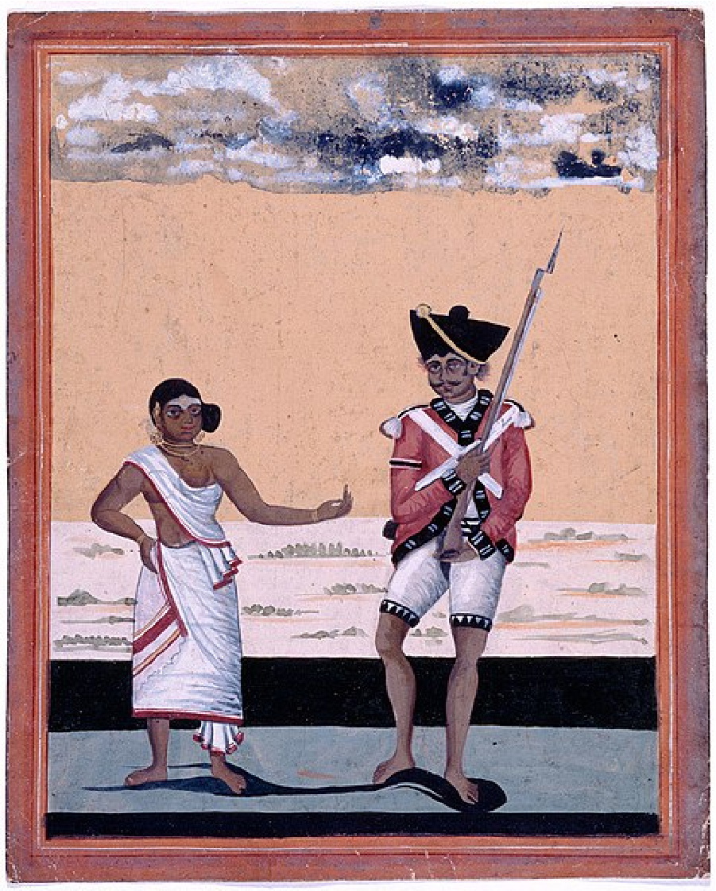

# 동인도회사 — 장사하러 간 회사는 왜 세금을 걷었을까

*1600년의 무역 허가에서 벵골의 징세권과 식민 통치까지*

Companies · Finance

> 자료 대조를 마친 검토용 이야기입니다. 공개 게시 승인은 아직 받지 않았습니다.

*작가 미상의 군 관련 수채화, “Sepoy of Madras Native Infantry and his wife”, 약 1810년 · National Army Museum / Wikimedia Commons · OpenStax · Public Domain. 1757년 전투의 특정 인물이나 모든 세포이를 대표하는 초상으로 단정하지 않았습니다.*

[이미지 출처·제작 근거](https://raw.githubusercontent.com/openstax/osbooks-world-history/main/media/OSX_WorldHist_B06_03_SepoyWife.jpg) · Public Domain

회사라면 물건을 팔고 이익을 남기는 곳을 떠올리기 쉽다. 그런데 군대를 거느리고 사람들에게 세금을 걷는 회사가 있었다. 영국 동인도회사는 인도양 무역을 위해 출발했지만 훗날 넓은 지역을 지배하는 권력으로 바뀌었다.

그 변화를 사업이 잘되어 규모가 커졌다는 말로만 설명하기는 어렵다. 물건값을 협상하는 힘과 사람의 생활을 결정하는 힘 사이에서 무슨 일이 일어났는지 살펴볼 필요가 있다.

## 1. 무역을 위한 공동 투자

1600년 잉글랜드에서 허가를 받은 동인도회사는 먼 바다의 무역을 목적으로 했다. 여러 투자자의 돈을 모아 선박과 거래를 준비했다. 오랜 항해와 손실의 위험을 한 사람이 모두 감당하기 어려운 사업이었다.

처음 중요한 물품은 향신료였다. 하지만 수익의 조건은 계속 달라졌다. 회사는 인도의 직물 같은 상품에 관심을 넓혀 갔다. 어떤 물건이 잘 팔리는지에 따라 거래를 바꾸는 모습은 상업 회사라는 출발을 보여 준다.

## 2. 거래 상대는 이미 풍부한 사회였다

인도는 빈 땅이나 단순한 원료 창고가 아니었다. 숙련된 직물 생산자와 상인, 여러 통치 세력이 있었다. 회사는 그들이 만든 생산과 교역의 세계에 들어가 허가와 물건을 얻어야 했다.

외국의 회사가 왔다고 곧바로 모든 관계를 지배할 수 있었던 것은 아니다. 현지의 이해관계와 정치적 경쟁을 알아야 했다. 무역의 길이 권력의 길로 바뀌는 데에는 기존 질서와의 협상과 충돌이 함께 있었다.

## 3. 유럽의 전쟁이 인도에서도 이어졌다

18세기 영국과 프랑스의 경쟁은 유럽에만 머물지 않았다. 인도에서도 서로 다른 세력과 관계를 맺고 군사적으로 충돌했다. 상업의 이익과 국가 간 경쟁, 현지의 권력 다툼이 겹쳤다.

1757년 벵골에서 회사군이 거둔 승리는 영향력을 넓히는 중요한 계기가 되었다. 이를 유럽인이 일방적으로 인도를 정복한 단순한 장면으로 줄이면 현지 병사와 정치 세력의 역할이 가려진다. 회사의 힘은 그런 관계 속에서 커졌다.

## 4. 1765년, 세금을 거둘 권리

1765년 회사는 벵골에서 세금을 거둘 권리를 얻었다. 물건을 사고팔아 남기는 이익 외에 지역의 조세 수입을 확보하게 된 것이다. 무역의 성공 여부와는 다른 방식으로 많은 사람의 생활에 관여할 수 있었다.

징세권은 행정적인 직함 하나가 아니었다. 돈을 어떻게 확보하고 누구에게 무엇을 요구할지 결정하는 힘이었다. 회사의 군사력과 재정은 서로를 떠받쳤고, 투자자의 기대와 주민의 부담이 같은 체계에 묶이기 시작했다.

## 5. 회사의 군복을 입은 인도인들

회사의 군대에는 세포이라고 부른 인도인 병사들이 있었다. 이들은 영국인 장교들과 함께 지역을 지키고 통치를 강제하는 일에 동원되었다. 그림에 실은 것은 약 1810년 마드라스 보병대 병사와 아내의 수채화다.

그림 속 인물이 1757년 전투의 특정 참가자라고 단정할 수는 없다. 다만 회사의 권력이 인도인의 노동과 복무에도 의지했다는 사실을 떠올리게 한다. 거대한 회사라는 이름 아래 실제로 복무하고 살아간 사람들이 있었다.

## 6. 현지 통치자를 남겨 두는 방식

회사는 모든 곳을 같은 방식으로 직접 다스리지 않았다. 기존 지배자와 협력하고 그 권위를 인정하는 대신 세금과 병력, 정책의 협조를 얻기도 했다. 현지의 제도를 활용하는 간접 통치였다.

이런 방식은 주민에게 식민 지배가 없었다는 뜻이 아니다. 겉으로 익숙한 통치자가 남아 있어도 중요한 결정은 회사의 이해에 맞춰질 수 있었다. 누구의 이름으로 명령하는지와 누가 결정의 힘을 가지는지는 함께 살펴야 한다.

## 7. 판매 전략과 공적 책임의 충돌

이익을 늘리려는 회사의 목표와 주민의 생활을 안정시키는 통치의 책임은 쉽게 일치하지 않는다. 같은 수입도 투자자에게는 성과이지만 그것을 낸 사람에게는 부담이다. 군대와 행정을 유지할 비용도 계속 필요했다.

회사는 인도에서 생산한 아편을 중국의 차와 연결하는 무역에도 관여했다. 단순히 인기 상품을 바꿨다고 끝낼 수 없는 선택이었다. 상업의 수익이 다른 사회에 남기는 피해까지 묻기 시작하면 회사의 이야기는 훨씬 넓어진다.

## 8. 1857년의 봉기와 통치의 이관

1857년 회사 소속 병사들의 봉기를 비롯해 큰 저항이 일어났다. 진압 뒤 1858년 회사가 맡던 통치 권한은 영국 왕실 쪽으로 넘어갔다. 회사 통치의 방식은 끝났지만 인도의 식민 지배가 함께 끝난 것은 아니었다.

권력의 주체가 바뀐 사실과 주민이 자치를 얻은 사실을 구분해야 한다. 회사의 법적 존속과 통치 권한의 종료도 같은 날짜의 사건으로 단순화할 수 없다. 이 글은 회사가 다스리는 체제가 바뀐 지점에 초점을 맞춘다.

## 9. 회사의 크기보다 권한을 묻기

동인도회사의 역사는 커다란 기업의 성공담만으로 읽기 어렵다. 공동 투자와 무역에서 출발한 조직이 무엇을 할 권리를 얻었는지, 그 힘을 누가 통제했는지 묻게 한다. 판매량보다 군대와 세금이 중요한 질문으로 나타난다.

우리가 회사라고 부르는 조직도 시대와 제도에 따라 전혀 다른 권한을 가질 수 있었다. 항구에서 시작한 장사의 길을 따라가다 보면 돈을 버는 일과 타인의 삶을 다스리는 일의 경계가 얼마나 중요했는지 보인다.

## 이야기의 바탕이 된 자료

- [OpenStax World History — The Rise of a Global Economy](https://raw.githubusercontent.com/openstax/osbooks-world-history/main/modules/m00077/index.cnxml) · 확인일 2026-10-31
  - 확인 내용: 1600년 동인도회사·향신료에서 직물 및 아편 무역으로 변화 / 1757년 벵골·1765년 징세권·간접 통치와 현지 병사 / 약 1810년 마드라스 보병대 병사와 아내의 수채화
- [OpenStax World History — Colonial Empires](https://raw.githubusercontent.com/openstax/osbooks-world-history/main/modules/m00070/index.cnxml) · 확인일 2026-10-31
  - 확인 내용: 1857년 봉기·1858년 회사 통치권의 왕실 이관. 회사 법인 해산 연도와 동일시하지 않음

---

[같은 소주제의 이야기](README.md) · [전체 서가](../../README.md)
