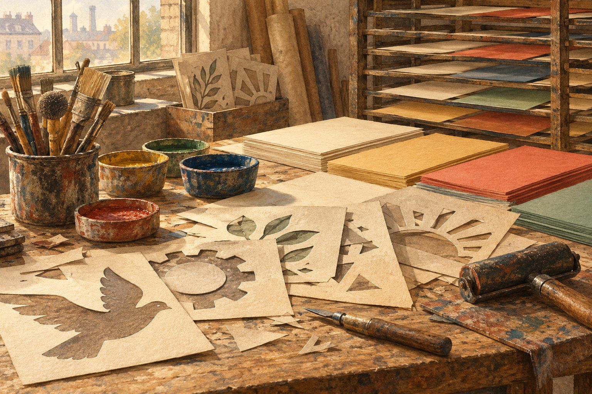

# 포스터를 한 장씩 붓으로 칠하던 작업장

*모스크바의 벽까지 이어진 종이와 틀*

Companies · Media

> 자료 대조를 마친 검토용 이야기입니다. 공개 게시 승인은 아직 받지 않았습니다.

*KnowledgeWalk 제작 · AI 설명용 삽화. 실제 사물의 정확한 구조·규격·역사적 장면을 재현한 자료가 아닙니다.*

같은 포스터를 여러 장 만든다고 하면 인쇄기를 먼저 생각한다. 그런데 제2차 세계대전기의 소련 타스 포스터 중에는 잘라 만든 틀을 대고 한 장씩 색을 칠한 것들이 있었다.

시카고 미술관은 모스크바의 작업장에서 이런 포스터를 제작한 과정을 소개한다. 그림을 그리는 일과 여러 사람에게 같은 이미지를 보내는 일이 한 작업장 안에서 만났다.

## 한 번의 그림에서 여러 장으로

타스는 당시 소련의 중앙 통신 기관이었다. 전쟁 소식을 살피던 화가와 삽화가, 시인과 작가들이 포스터 제작에 참여했다. 전황을 전달하는 동시에 사람들을 설득하고 사기를 북돋우려는 선전 매체이기도 했다.

디자인이 정해지면 그것을 바탕으로 손으로 자른 스텐실을 만들었다. 스텐실은 색을 넣을 부분이 뚫린 틀이라고 생각하면 된다. 같은 틀을 반복해 대면 비슷한 모양을 여러 종이에 옮길 수 있다.

## 큰 종이는 여러 조각을 모아서

미술관의 설명에 따르면 작업자들은 틀을 사용해 색 부분을 칠하고 더 다듬었다. 완성한 종이 조각들은 글이 적힌 패널과 타스 번호를 더해 붙였다. 거대한 한 장처럼 보이는 이미지에도 이어 붙이는 과정이 있었다.

그래서 포스터는 화가 혼자 그림 한 점을 끝내는 일과는 다른 제작 체계를 가졌다. 틀을 자르는 일, 칠하는 일, 조각을 맞추는 일이 연결되며 여러 장의 결과물이 나왔다.

## 사람이 지나는 자리로 보내기

이렇게 만든 포스터는 모스크바의 상점과 공장, 공공 건물 등으로 보내졌다. 감상하려고 찾아오는 전시장만이 아니라 사람들이 지나는 생활 공간을 만나는 매체였다.

여기서는 특정 포스터를 모사하지 않고 제작 과정을 떠올리는 삽화를 함께 실었다. 그림이 무엇을 주장했는지와 함께 어떻게 만들어져 어디로 갔는지도 물어볼 수 있다. 종이 한 장의 이야기가 작업장의 손과 도시의 벽까지 넓어지는 순간이다.

## 이야기의 바탕이 된 자료

- [시카고 미술관 — Countdown to TASS](https://raw.githubusercontent.com/art-institute-of-chicago/api-data/main/json/articles/55.json) · 확인일 2026-10-28
  - 확인 내용: 소련 중앙 통신기관 타스와 전쟁기 포스터 / 화가·삽화가·시인·작가 참여와 전황·선전 목적 / 손으로 자른 스텐실·채색·종이 조각과 글 패널·번호의 결합 / 모스크바 상점·공장·공공 건물 배포

---

[같은 소주제의 이야기](README.md) · [전체 서가](../../README.md)
