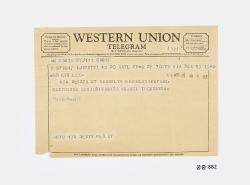

# 전보 한 장에는 종이가 한 번 더 붙어 있다

*회사 이름 아래에 놓인 짧은 소식*

Companies · Media

> 자료 대조를 마친 검토용 이야기입니다. 공개 게시 승인은 아직 받지 않았습니다.

*전보 (Western Union Telegram) · 국립고궁박물관 소장·제공. 전체 사진을 자르지 않고 사용했습니다.*

[이미지 출처와 소장품 안내](https://www.gogung.go.kr/gogung/pgm/psgudMng/view.do?menuNo=800065&psgudSn=438369) · 공공누리 제1유형(출처표시)

화면에 뜬 메시지는 손가락으로 누르면 열린다. 종이로 받은 소식이라면 보통 편지 봉투를 떠올릴 것이다. 그런데 이 오래된 전보는 또 다르다. 회사 이름이 인쇄된 종이에 메시지 종이가 한 번 더 붙어 있다.

국립고궁박물관이 소장한 웨스턴유니언 전보다. 날짜는 1959년 4월 13일이다. 한 장의 통신문에도 미리 만들어 둔 부분과 나중에 더해진 부분이 나뉘어 있다.

## 누구나 쓰는 틀과 한 번의 소식

사진 위쪽에는 WESTERN UNION이라는 회사 이름이 크게 보인다. 그 아래로 글자가 이어진다. 박물관 설명은 빈칸에 전보 내용이 적힌 종이가 붙어 있다고 알려 준다.

양식은 통신회사가 마련한 공통의 틀이고, 그 안의 소식은 각각 다르다. 오늘날 같은 메신저 화면으로 서로 다른 메시지를 주고받는 모습을 떠올릴 수도 있다. 화면 대신 종이가 남아 있다는 점에서 손에 잡히는 느낌은 사뭇 다르다.

## 받는 사람은 어디에 있었을까

박물관은 이 전보가 뉴욕 브루클린에 있던 이구에게 보낸 것으로 보인다고 설명한다. 여기서 장소와 이름은 한 줄의 주소 이상이다. 작은 종이를 특정한 사람의 생활과 이어 주는 단서가 된다.

다만 ‘보인다’는 판단을 확정된 발송 경위로 바꾸어 읽지는 말자. 이 자료는 수신자를 추정하고 있다. 누가 어떤 마음으로 보냈는지까지 대화를 만들어 붙일 필요는 없다. 날짜와 수신지, 남아 있는 형식만으로도 충분히 볼거리가 있다.

## 빠르게 전한 소식이 종이로 남다

이 전보는 줄리아 멀록이 일괄 기증한 자료에 포함된다. 개인이 간직하던 통신문이 박물관의 기록이 된 것이다. 회사의 인쇄 양식이 어느 사람에게는 자신의 소식을 담은 물건이기도 했다는 사실이 느껴진다.

다시 사진을 보면 회사 이름보다 덧붙인 종이 쪽에 눈이 갈 수 있다. 똑같은 양식을 단 한 번의 소식으로 바꾸는 부분이기 때문이다. 짧게 전달된 말도 물건으로 남으면, 소식을 주고받던 방식까지 함께 보여 준다.

## 이야기의 바탕이 된 자료

- [국립고궁박물관 — 전보 (Western Union Telegram)](https://www.gogung.go.kr/gogung/pgm/psgudMng/view.do?menuNo=800065&psgudSn=438369) · 확인일 2026-10-28
  - 확인 내용: 1959년 4월 13일 웨스턴유니언 전보 / 빈 양식에 메시지 종이를 붙인 형태 / 브루클린 이구 수신 추정 / 줄리아 멀록 일괄 기증 자료

---

[같은 소주제의 이야기](README.md) · [전체 서가](../../README.md)
