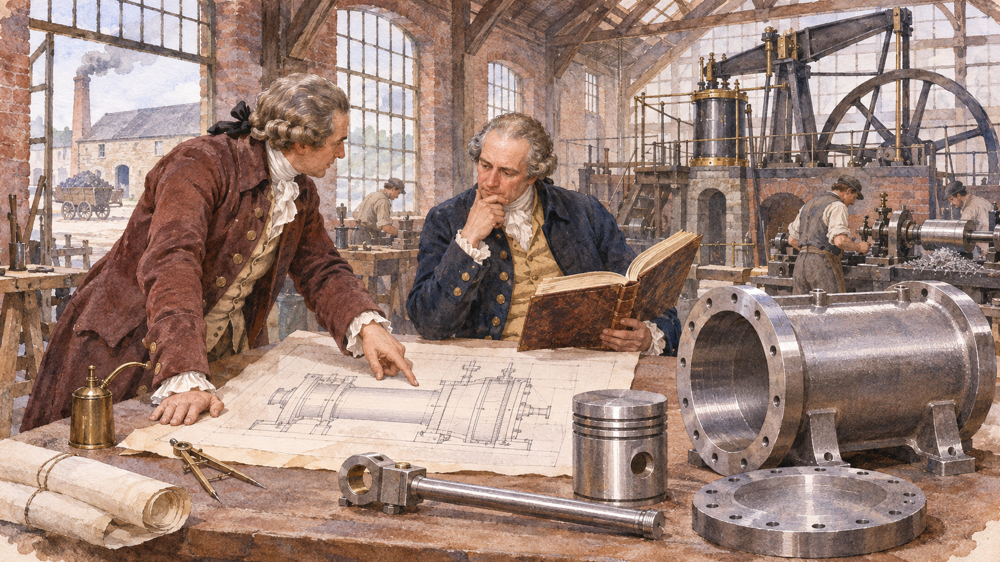

# 볼턴과 와트 — 절약한 석탄이 회사의 수입이 되다

*와트의 개선을 수입으로 바꾼 동업·특허·성능 계약*

기업과 산업 · 경영과 조직

> 자료 대조를 마친 검토용 이야기입니다. 공개 게시 승인은 아직 받지 않았습니다.

*AI 관련 장면 삽화 · 역사와 원리를 떠올리기 위한 상상 그림이며 실제 사진·인물 초상·정확한 복원이나 과학 설계도가 아닙니다.*

좋은 발명이 곧바로 좋은 사업이 되는 것은 아니다. 증기기관을 개선한 제임스 와트에게도 돈과 부품, 현장에서 기계를 설치할 사람이 필요했다. 매슈 볼턴과의 동업을 보면 발명의 역사가 설계도에서 끝나지 않는다는 사실이 드러난다. 여기서는 기관의 작동 원리보다 그것을 판매하고 유지한 사업의 구조를 살펴본다.

## 01. 발명 뒤에도 남아 있던 문제

와트는 기존 증기기관의 열 낭비를 줄이려 했다. 그러나 원리를 생각해 낸 것과 광산에서 매일 작동할 기계를 공급하는 것은 다른 단계였다. 실린더를 정밀하게 만들고 부품을 맞추며 고장에 대응해야 했다. 고객은 좋은 이론보다 실제로 물을 퍼낼 능력을 원했다.

연구와 시험에는 수입이 생기기 전부터 비용이 들었다. 발명가는 성능을 입증할 기회를 얻으려면 이미 자원을 가져야 하는 어려움에 부딪힌다. 동업자의 존재는 이런 간격을 메우는 방법이었다. 돈과 기술은 완성품을 만드는 서로 다른 조건이었다.

## 02. 볼턴이 제공한 것은 자금만이 아니었다

볼턴은 소호의 제조 사업을 운영하며 사람과 설비, 거래 관계를 가지고 있었다. 와트가 모든 업무를 혼자 맡는 대신 각자가 다른 강점을 제공할 수 있었다. 발명가와 사업가라는 구분도 실제 일을 연결하는 관계 속에서 의미가 생긴다.

동업은 역할을 정하는 일이다. 설계를 누가 하고 비용을 누가 부담하며 장부를 누가 관리하는지가 필요하다. 카네기의 와트 전기에는 이런 업무를 구체적으로 정하려는 편지와 협의가 나온다. 낭만적인 우정보다 먼저 지속할 수 있는 일의 배치가 있었다.

## 03. 특허의 시간도 사업의 조건이었다

1775년 특허 기간을 늘리는 법안은 사업의 중요한 전환점이었다. 이미 비용을 들인 쪽에는 회수할 시간이 필요했지만, 광산업자에게는 특허료 없이 기술을 쓰는 날이 늦어진 일이기도 했다. 같은 제도를 서로 다른 위치에서 바라본 것이다.

따라서 특허를 발명가에게 주어진 상으로만 보면 논쟁의 절반을 놓친다. 새로운 기술에 투자할 유인과 사용자가 부담할 비용이 함께 걸려 있었다. 카네기의 전기는 와트의 성취를 높이 평가하지만, 그 안에 기록된 반대 의견도 사업의 사회적 조건을 보여 준다.

## 04. 기계값보다 절약의 가치를 계산하다

볼턴과 와트의 보수는 기관이 절약하는 연료의 가치와 연결되었다. 종전 기관과 비교해 아낀 연료 비용의 3분의 1을 받는 방식이다. 고객은 물건을 샀다는 사실뿐 아니라 앞으로 운영비가 얼마나 달라지는지를 보게 된다.

이 방식에서는 성능을 말로 자랑하는 것만으로 충분하지 않다. 비교 기준과 측정, 어떤 절감을 회사의 성과로 볼지 정해야 한다. 발명품이 사업이 되면서 숫자의 의미가 늘어난다. 기계가 잘 움직인다는 관찰이 돈을 얼마 지급해야 하는가 하는 계약의 문제로 이어진다.

절감액에 따라 돈을 받는 계약은 이전에 무엇을 썼는지가 중요하다. 비교 대상이 바뀌면 같은 기관의 경제적 효과도 다르게 보일 수 있다. 성능은 기계 안의 고정된 숫자만이 아니라 고객의 조건과 비교해 계산되는 값이었다.

이런 구조에서는 기관을 설치한 뒤에도 관계가 계속된다. 처음 가격을 받고 끝나는 판매와 달리 얼마나 작동했고 무엇이 절약되었는지 알아야 한다. 사업의 수입이 장기적인 사용에 연결되면서, 설계자의 관심도 제작소 밖의 광산으로 이어졌다.

## 05. 먼 광산에서 계약을 지키게 하려면

설치 장소가 늘어나면 제조소 안에서 모든 일을 볼 수 없다. 현장의 기술자와 광산 관리인, 회사 사이에 정보가 오가야 한다. 기계의 상태를 알아내고 정비하며 약속한 조건을 확인하는 관계가 필요했다. 판매 이후의 일이 오히려 더 길 수 있었다.

연료를 아낀다는 방식으로 보수를 받으면 고객과 판매자의 이해가 일부 연결된다. 동시에 절감액의 계산을 둘러싼 다툼도 생길 수 있다. 전기에는 성능이 입증된 뒤에도 지급 조건을 놓고 갈등한 사례가 나온다. 좋은 기술이 계약의 갈등까지 없애 주지는 않았다.

## 06. 정밀한 부품은 발명가 혼자 만들 수 없다

기관의 성능은 도면의 아이디어뿐 아니라 제작의 정확도에 달려 있었다. 실린더와 움직이는 부분이 기대한 상태로 맞아야 했다. 발명가의 이름 뒤에는 금속을 가공하고 현장에서 조립한 사람들의 능력이 놓인다.

동업 회사는 그런 능력을 연결하는 조직이기도 했다. 공장 안의 제작과 바깥의 설치를 이어야 했고, 한번 해결한 문제를 다음 기관에도 적용해야 했다. 하나의 성공을 반복 가능한 공급으로 바꾸는 일이 기업의 몫이었다. 발명을 복제한다는 말에는 사람과 작업 순서를 준비하는 일도 들어 있다.

## 07. 무엇을 팔았는지 다시 묻기

볼턴과 와트는 철과 부품만 판 것이 아니다. 고객의 비용을 줄일 수 있다는 가능성과 그 가능성을 실현할 기술을 함께 제공했다. 물론 모든 결과가 계획대로 된 것은 아니며, 특허와 계산의 다툼도 사업의 일부였다.

이 사례는 발명가 한 사람의 번뜩임으로 산업의 변화를 모두 설명하기 어렵게 만든다. 설계와 자금, 제작과 현장 관리, 성능을 가격으로 바꾸는 계약이 필요했다. 증기기관의 역사를 기계 밖으로 넓히면, 절약한 석탄이 회사의 수입이 되는 과정에서 기업이라는 조직이 보인다.

## 이야기의 바탕이 된 자료

- [Andrew Carnegie, James Watt — Boulton Partnership / Removal to Birmingham](https://raw.githubusercontent.com/GITenberg/James-Watt_26131/master/26131-8.txt) · 확인일 2026-11-06
  - 확인 내용: 동업 역할·1775년 특허 연장과 반대·광산 기관 설치·연료 절감 가치의 일부를 받는 보수·제작과 설치의 연결. 위인전의 찬사와 사실을 구별

---

[같은 소주제의 이야기](README.md) · [전체 서가](../../README.md)
