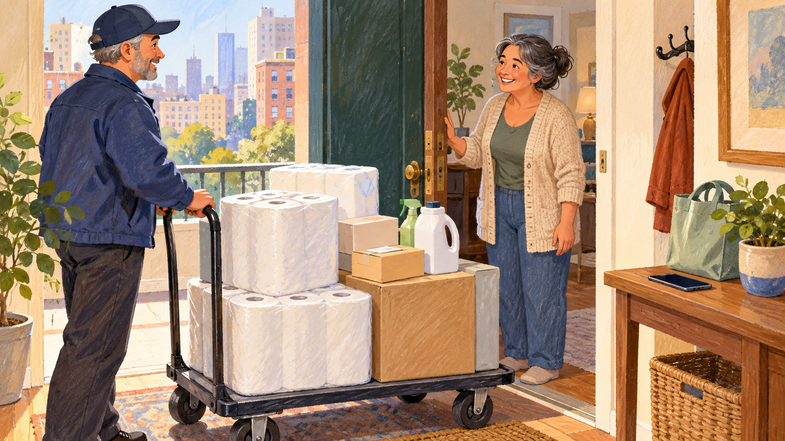

# 박스드 — 차 없이도 창고형 쇼핑을 할 수 있을까

*도시 생활의 작은 불편에서 시작한 2010년대의 사업 구상*

Companies · Technology

> 자료 대조를 마친 검토용 이야기입니다. 공개 게시 승인은 아직 받지 않았습니다.

*AI 관련 삽화 · 도시 주거지의 일반적인 생활용품 배송 장면입니다. 실제 박스드의 포장·직원·배송 방식을 재현하지 않았습니다.*

큰 묶음의 휴지나 생활용품은 낱개보다 저렴하게 느껴질 때가 있다. 문제는 사는 순간보다 집까지 가져오는 길이다. 차가 없고 매장이 멀다면 좋은 가격 앞에도 다른 비용이 생긴다. 물건의 값과 그것을 얻는 데 드는 수고는 같은 항목이 아니다.

미국 기업 박스드의 초기 구상은 이런 불편을 겨냥했다. 여기서는 경영 교재가 2016년 창업자 인터뷰 등을 바탕으로 소개한 당시의 사례를 읽는다. 현재의 서비스와 기업 상태를 안내하거나 이후의 경영 성과를 평가하는 글은 아니다.

## 1. 교외에서 도시로 옮기면 달라지는 쇼핑

교재에 따르면 창업자 치에 황은 교외에서 살 때 창고형 매장을 이용했지만 도시로 옮겨 차가 없어지자 같은 방식으로 장을 보기 어려워졌다. 가격을 아는 것과 실제로 그 가격에 물건을 살 수 있는 것은 달랐다. 생활 장소의 변화가 새로운 문제를 드러낸 것이다.

이 장면에는 특별한 첨단 제품의 발명이 등장하지 않는다. 이미 있던 상품과 매장이 있었다. 달라진 것은 이용자의 교통수단과 생활 방식이었다. 익숙한 물건도 어떤 사람에게 어떤 경로로 전달되는지를 바꾸면 사업의 질문이 새로 생길 수 있다.

## 2. 큰 묶음과 작은 휴대전화

박스드는 휴지와 에너지바 같은 대용량 상품을 앱으로 주문하고 집으로 받는 구상을 제시했다. 휴대전화 화면에서는 손가락으로 고르지만 화면 밖에서는 큰 부피의 물건이 이동해야 한다. 작은 주문 장치와 큰 물류가 연결되는 방식이다.

고객에게 편리해진 일이 사회 전체에서 사라지는 것은 아니다. 고객이 매장에 가서 물건을 나르는 수고의 일부가 기업의 보관과 포장, 배송으로 옮겨 간다. 온라인 사업을 화면의 이야기로만 보면 이 이동이 잘 보이지 않는다. 편리함 뒤에는 누군가의 구체적인 작업이 있다.

## 3. 싸다는 말에 들어가는 여러 계산

물건의 단가가 낮아도 모든 사람에게 같은 가치가 되는 것은 아니다. 집에 둘 공간과 필요한 양, 주문 조건을 함께 생각해야 한다. 혼자 사는 사람에게 큰 묶음은 보관의 부담일 수도 있다. 이번에는 특정 상품의 실제 가격을 비교하는 대신 선택에 들어가는 조건을 살펴보자.

창업자의 불편이 좋은 출발점이 될 수는 있지만 그것이 모든 고객의 필요를 대표하지는 않는다. 누구에게 문제를 풀어 주는지 범위를 정해야 한다. 도시의 차 없는 이용자라는 관찰이 의미 있었던 이유도 막연히 모두에게 좋다고 말하기보다 구체적인 생활 장면에서 시작했기 때문이다.

## 4. 앱 밖에서 마련해야 했던 것들

교재는 초기 성장 과정에서 자금을 마련하고 물류센터를 세우며 직원을 채용한 일을 소개한다. 공급자와의 관계를 넓히고 자체 상표 상품도 개발했다. 주문을 받는 기능 뒤에 물건을 확보하고 움직일 준비가 필요했던 것이다.

주문이 늘어나는 것과 주문을 제대로 처리할 수 있는 능력이 늘어나는 것은 다르다. 재고와 작업, 배송의 속도를 맞추어야 한다. 특히 큰 묶음의 생활용품은 화면에서는 같은 크기의 사진이어도 실제 공간에서는 부피가 크다. 디지털의 편리함은 물리적 조건과 따로 움직일 수 없다.

## 5. 비슷하게 싸고 편리하다면

교재가 인용한 당시 황의 설명에는 가치와 편리함, 브랜드의 중요성이 함께 나온다. 경쟁자들도 비슷한 가격과 배송을 제공하면 고객은 다른 기준으로 회사를 구별할 수 있다. 처음의 좋은 아이디어가 계속 독점적인 장점으로 남는 것은 아니다.

이 질문은 박스드에만 해당하지 않는다. 따라 하기 쉬운 기능과 오래 쌓아야 하는 신뢰는 서로 다른 자산이다. 한 번의 주문을 얻는 방법과 다시 선택받는 이유를 나누어 보아야 한다. 가격표가 비슷해진 다음에도 고객의 경험은 같은 모양일 필요가 없다.

## 6. 회사의 가치가 선택의 일부가 되다

교재는 당시 황이 직원 자녀의 대학 교육과 결혼 비용을 지원한 사례가 회사 이미지와 연결되었다고 소개한다. 일부 고객에게는 기업이 사람을 대하는 방식도 선택 기준이 될 수 있다는 설명이다. 상품의 가치와 기업이 내세우는 가치가 만나는 지점이다.

다만 과거 사례를 현재 모든 직원의 복지 규정으로 읽어서는 안 된다. 기업에 관한 좋은 이야기 한 가지가 재무와 운영 전체를 평가해 주는 것도 아니다. 어떤 시기의 어떤 행동을 근거로 하는지 나누어 보면 호감과 확인을 함께 유지할 수 있다.

## 7. 초기의 성장과 긴 성공은 다른 질문

경영 교재는 기업의 한 장면을 골라 특정 원리를 설명한다. 그 기업의 이후 역사를 전부 따라가는 자료는 아닐 수 있다. 박스드의 이 사례도 모바일 주문과 대용량 배송을 연결한 초기 전략을 이해하는 데 초점을 두어야 한다.

따라서 과거에 관심을 모았다는 사실을 현재까지 같은 성과가 이어졌다는 말로 바꾸지 않는다. 좋은 문제를 찾는 일과 장기간 사업을 유지하는 일에는 다른 조건도 필요하다. 사례가 보여 주는 통찰을 읽으면서 동시에 자료가 다루는 시간의 끝을 알아 두는 편이 정확하다.

## 8. 물건보다 가져오는 길을 바꾸기

함께 실은 AI 삽화는 도시의 집 앞에 생활용품이 도착하는 일반적인 장면이다. 실제 박스드의 포장과 배송 방식, 직원이나 고객을 재현한 자료는 아니다. 상품이 집까지 이동한다는 구상을 떠올리기 위한 그림이다.

이 초기 사례는 새로운 사업이 꼭 새로운 물건에서 시작하는 것은 아님을 보여 준다. 이미 있는 물건을 어떤 생활 조건의 사람에게 어떻게 전달할지도 질문이 된다. 창고형 쇼핑의 큰 묶음과 차 없는 도시인의 작은 집 사이에는 가격표만으로 보이지 않는 길이 있었다.

## 이야기의 바탕이 된 자료

- [OpenStax Principles of Management — 박스드의 2016년 초기 사업 사례](https://raw.githubusercontent.com/openstax/osbooks-principles-of-management-bundle/main/modules/m70650/index.cnxml) · 확인일 2026-10-31
  - 확인 내용: 차 없는 도시 생활과 창고형 구매의 불편 / 대용량 상품의 모바일 주문·물류센터·공급자·자체 상표 / 당시 직원 지원과 브랜드 이미지 사례. 현재 기업 상태의 근거가 아님

---

[같은 소주제의 이야기](README.md) · [전체 서가](../../README.md)
