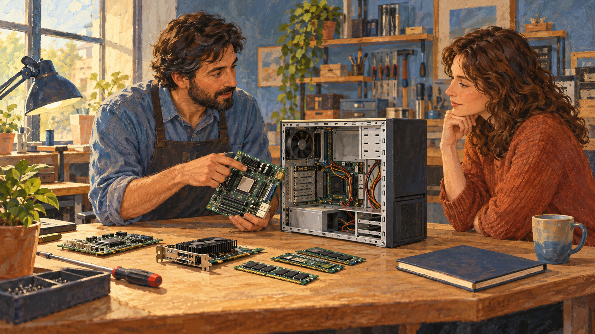

# 델 — 주문을 먼저 듣고 컴퓨터를 만들면

*선택란 뒤에서 이어지는 부품과 공급의 이야기*

Companies · Technology

> 자료 대조를 마친 검토용 이야기입니다. 공개 게시 승인은 아직 받지 않았습니다.

*AI 관련 삽화 · 주문에 맞춘 컴퓨터 구성의 개념을 표현했습니다. 마이클 델이나 실제 기숙사·제품을 재현한 그림은 아닙니다.*

컴퓨터를 고를 때 메모리를 얼마나 넣을지, 저장 공간은 어느 정도로 할지 선택하는 화면을 만난다. 클릭은 간단하다. 그러나 선택이 달라지면 안에 들어갈 부품도 달라져야 한다. 주문의 말이 실제 물건으로 바뀌는 과정이 있는 것이다.

델의 사업 이야기는 이런 연결에서 출발한다. 마이클 델의 초기 사례는 고객에게 맞춘 컴퓨터를 만들고 직접 전달하는 방식으로 경영 교재에 소개된다. 더 새로운 부품을 발명하는 것과 이미 있는 부품을 다른 방식으로 조합해 판매하는 것은 다른 종류의 혁신이다.

## 1. 기숙사에서 시작한 조립의 이야기

교재는 텍사스대학교 학생이던 마이클 델이 부품을 사서 원하는 컴퓨터를 직접 조립했고, 친구들이 자신들의 것도 만들어 달라고 했던 일화를 소개한다. 자신의 필요를 해결하던 활동이 다른 사람의 요청과 만난 것이다.

이 설명을 모든 성공을 예고한 완벽한 사업 계획으로 읽을 필요는 없다. 출발점에서 중요했던 것은 사람마다 원하는 구성이 다를 수 있다는 관찰이었다. 완성품을 고르는 고객만 있는 것이 아니라 원하는 부품의 조합을 말하는 고객도 있었다.

## 2. 같은 컴퓨터라는 말 안의 다른 요구

어떤 사람은 여러 프로그램을 동시에 쓰려 하고 다른 사람은 자료를 많이 보관하려 한다. 이런 가상 예를 떠올리면 메모리와 저장 장치의 선택이 왜 달라지는지 이해할 수 있다. 모두에게 가장 좋은 한 가지 사양을 정하기는 어렵다.

맞춤형 판매는 고객의 차이를 제품 구성에 반영하려는 방식이다. 하지만 고객이 말하는 모든 조합을 무한히 만들어 주는 것과는 다르다. 실제로 생산하고 제공할 수 있는 선택의 범위를 먼저 준비해야 한다. 선택란의 수에도 운영의 조건이 들어 있다.

## 3. 직접 판매하면 알게 되는 정보

제조 쪽이 고객의 주문을 직접 받으면 어떤 구성을 원하는지 더 가까이에서 파악할 수 있다. 여러 유통 단계를 거치며 완성품을 보내는 방식과 다른 정보의 흐름이 생긴다. 고객의 선택이 생산할 물건을 정하는 데 관여하는 것이다.

그렇다고 중간 유통을 줄였으니 필요한 일도 모두 사라지는 것은 아니다. 주문을 이해하고 제품을 안내하며 전달하는 일을 누군가는 해야 한다. 기존의 일을 없애는 부분과 기업 안으로 가져오는 부분을 함께 보아야 판매 방식의 변화를 이해할 수 있다.

## 4. 선택은 부품의 준비로 이어진다

교재는 델을 고객 사양에 맞추어 컴퓨터를 만드는 사례로 설명한다. 이를 가능하게 하려면 메모리와 저장 장치 등 필요한 부품을 마련하고 조립의 흐름을 맞추어야 한다. 주문 화면과 생산 현장의 정보가 떨어져 있으면 선택은 약속에만 머무를 수 있다.

예를 들어 특정 부품을 많이 원하는 시기에는 공급과 작업의 균형도 달라질 수 있다. 이것은 실제 어느 날의 델 공장 상황을 재현한 것이 아니라 원리를 생각하는 예다. 고객의 선택권은 그 뒤에서 여러 준비가 함께 움직일 때 실제 경험이 된다.

## 5. 한 회사의 이름 뒤에 여러 업체가 있다

제품의 이름은 델이지만 제조와 부품의 연결에는 다른 기업들도 참여한다. 교재는 계약 제조업체와의 협력을 설명한다. 하나의 상표가 붙은 물건이 한 회사 안의 모든 과정만으로 완성되는 것은 아니다.

따라서 제품을 만드는 일을 조립대 위의 작업으로만 볼 수 없다. 어떤 기준을 공급자와 공유하고 부품이 언제 들어오며 마지막 확인과 배송을 어떻게 이어 갈지도 중요하다. 맞춤형 판매는 개인의 선택을 강조하지만 실행은 오히려 많은 조직의 협력을 필요로 한다.

## 6. 맞춤이라는 말이 주는 기대

내게 맞는 컴퓨터를 고를 수 있다는 설명은 매력적이다. 하지만 무엇을 고르면 좋은지 모르는 고객에게는 선택이 많아지는 것 자체가 부담일 수 있다. 제품의 차이를 알아보기 쉽게 안내하는 일도 사업의 일부가 된다.

이것은 델의 현재 주문 화면을 평가한 내용은 아니다. 맞춤형 제품을 읽을 때 덧붙일 수 있는 질문이다. 고객이 차이를 이해하고 선택의 결과를 예상할 수 있어야 선택권이 편리함이 된다. 많은 항목과 좋은 안내는 같은 뜻이 아니다.

## 7. 모든 컴퓨터가 같은 방식으로 팔리는 것은 아니다

교재가 소개한 사례를 델의 모든 시대와 모든 판매 경로에 적용할 수는 없다. 이번 글은 맞춤형 조립과 직접 판매라는 구상이 갖는 의미에 초점을 맞춘다. 현재 모델의 사양과 납기, 제조 국가를 안내하는 자료는 아니다.

또 이런 방식이 모든 제품에 최선이라는 결론도 필요하지 않다. 고객이 구성을 바꿀 이유가 적거나 빠른 완성품 구매를 원한다면 다른 방식이 맞을 수 있다. 혁신은 언제나 같은 공식이 아니라 제품과 고객의 조건에 맞추어 판단할 문제다.

## 8. 컴퓨터 안쪽만 바꾼 혁신이 아니었다

함께 실은 AI 삽화는 부품을 보며 구성을 의논하는 작업대의 분위기다. 마이클 델의 실제 기숙사와 인물, 특정 제품이나 공장을 복원한 자료는 아니다. 선택과 조립이 만나는 장면을 떠올리는 그림이다.

델의 사례는 기술 기업의 변화가 새로운 칩을 만드는 데서만 시작하지 않는다는 점을 보여 준다. 고객이 원하는 것을 듣고 부품과 생산을 연결하는 방식도 바꿀 수 있었다. 작은 선택란을 누르는 순간 뒤에서 어떤 준비가 움직이는지 생각하면 익숙한 컴퓨터 구매도 다른 이야기로 보인다.

## 이야기의 바탕이 된 자료

- [OpenStax Principles of Management — 델의 직접 판매](https://raw.githubusercontent.com/openstax/osbooks-principles-of-management-bundle/main/modules/m70714/index.cnxml) · 확인일 2026-10-31
  - 확인 내용: 기숙사에서 시작한 컴퓨터 조립·고객 요청 / 제조자와 고객을 직접 연결하는 전략
- [OpenStax Introduction to Business — 델의 공급망](https://raw.githubusercontent.com/openstax/osbooks-introduction-business/main/modules/m67743/index.cnxml) · 확인일 2026-10-31
  - 확인 내용: 주문에 따른 구성 선택 / 부품 공급·계약 제조·조립과 배송의 조정

---

[같은 소주제의 이야기](README.md) · [전체 서가](../../README.md)
