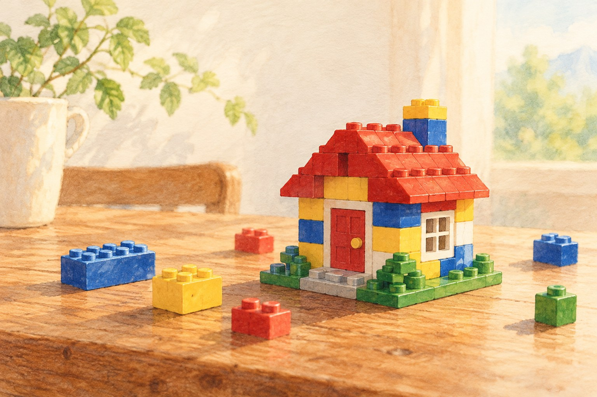

# 레고라는 이름은 원래 무슨 뜻일까

*작은 블록보다 먼저 있었던 ‘잘 놀자’라는 말*

Companies · Technology

> 출처 대조와 공개 게시 승인을 마친 이야기입니다. 실제 게시 여부는 사이트 배포 상태를 따릅니다.

*AI 설명용 삽화 · 특정 유물·제품·장소의 실제 모습을 재현한 사진이 아닙니다.*

레고 상자를 열면 먼저 설명서를 찾는 사람이 있다. 반대로 부품부터 쏟아 놓고 마음대로 쌓는 사람도 있다. 같은 블록을 받아도 노는 방법은 조금씩 다르다.

그런데 레고라는 이름 자체에도 놀이에 관한 말이 들어 있다. 덴마크어 ‘leg godt’에서 가져온 이름으로, 흔히 ‘잘 놀아라’ 또는 ‘잘 놀자’라는 뜻으로 풀이된다.

복잡한 우주선이나 커다란 성을 만들기 전에, 이름이 먼저 건네는 말은 의외로 간단했던 셈이다.

## 1. 블록보다 이름이 먼저였다

레고의 창업자 올레 키르크 크리스티안센은 덴마크 빌룬에서 목공 일을 하며 장난감을 만들었다. 초기의 제품은 오늘날 우리가 떠올리는 플라스틱 블록만으로 이루어진 세계와 달랐다. 나무 장난감이 있었다.

레고라는 이름은 오늘날의 플라스틱 블록 모양을 보고 그 특징에 맞추어 지은 것이 아니었다. 공식 연혁은 목재 장난감을 만들던 시기에 덴마크어 LEG GODT를 조합해 이름을 정했다고 설명한다. 놀이에 관한 이름을 먼저 갖고, 그 아래에서 장난감이 달라져 간 것이다.

이 사실을 알면 익숙한 이름이 조금 새롭게 들린다. 우리는 보통 레고를 보면 바로 블록을 떠올린다. 하지만 이름이 생겼을 때부터 지금의 모든 제품이 정해져 있었던 것은 아니다.

오랫동안 쓰인 이름에는 그런 시간이 접혀 있다. 오늘의 물건만 보고 과거까지 같은 모습이었을 것이라고 생각하면 놓치는 부분이다. 레고의 경우에는 이름이 장난감의 재료 변화보다 오래 남았다.

## 2. 정해진 모양이 끝이 아닌 장난감

지금의 레고를 떠올리면 서로 맞물리는 돌기와 구멍이 생각난다. 중요한 것은 블록 한 개의 모양만이 아니라, 여러 개가 연결된다는 점이다. 혼자 있을 때는 작은 부품이지만 다른 부품을 만나면 집도 되고 자동차도 된다.

물론 아무 조합이나 다 잘 맞는다는 뜻은 아니다. 제품에 따라 쓰는 방법과 호환 범위가 다르다. 그래도 많은 블록을 다시 떼고 새로 조립할 수 있다는 점은 이 놀이의 큰 특징이다.

설명서대로 완성하는 재미와, 완성한 것을 다시 바꾸는 재미가 함께 있다. 지붕을 떼어 다른 곳에 붙여 보거나 남은 부품으로 처음 계획에 없던 물건을 만들 수도 있다. 상자에 그려진 모습이 놀이의 유일한 결말은 아니다.

그래서 ‘잘 놀자’라는 이름은 꽤 넓게 들린다. 여기서 잘한다는 것을 누가 더 빨리 완성했는지로만 읽을 필요는 없다. 다만 이것은 이름을 오늘의 우리가 즐기는 방식이다. 창업자가 모든 사용자의 놀이를 미리 상상했다고 말하려는 것은 아니다.

## 3. 이름은 물건보다 오래 남을 수 있다

목재 장난감과 오늘날의 조립 블록은 재료와 사용 경험이 다르다. 그런데 놀이를 뜻하는 이름은 그 변화를 건너 이어졌다. 회사가 어떤 제품을 만들고 있는지와 브랜드가 어떤 말로 기억되는지는 꼭 같은 속도로 바뀌지 않는다. 이름의 유래는 기업의 출발점과 지금의 모습을 나란히 보게 한다.

이름을 뜻풀이하는 데서 멈추지 않고 실제 제품의 관계를 보면 더 재미있다. 돌기와 안쪽 튜브가 맞물리는 방식은 부품을 연결한 상태에서 형태를 유지하도록 돕는다. 완성한 뒤 다시 떼어 쓰는 경험도 이런 결합의 성질과 관계가 있다. 놀이에 관한 말과 물건을 다루는 손의 경험이 만나는 지점이다.

## 4. 완성 뒤에도 남는 선택

설명서를 따라 만든 모형은 하나의 해답이지만 부품의 가능한 쓰임을 모두 소진한 결과는 아니다. 모양을 바꿀 수 있다는 사실은 완성을 끝이 아니라 다음 선택의 출발점으로 만들 수 있다. 어른이 고른 정답과 다른 모양을 만들더라도 부품들이 어떤 방식으로 결합되는지 시험하는 경험은 남는다.

이것을 모든 제품의 공식 교육 효과라고 단정할 필요는 없다. 이름을 오늘의 놀이에 연결해 읽어 보는 관점이다. 잘 논다는 말이 빠르고 정확하게 복제한다는 뜻만은 아닐 수 있다는 생각을 돕는다. 같은 네 글자를 알고도 사람마다 다른 놀이의 장면을 떠올릴 수 있다는 점이 이 이름의 여유다.

## 5. 유명한 이름을 잠깐 낯설게 읽기

브랜드 이름을 너무 자주 보면 뜻을 생각하지 않게 된다. 간판처럼 알아보면 충분하기 때문이다. 그런데 가끔 그 이름을 처음 듣는 말처럼 풀어 보면 물건의 다른 면이 보인다.

레고는 덴마크의 작은 작업장에서 출발한 장난감 회사이면서, 지금은 여러 나라의 사람들이 각자의 방식으로 가지고 노는 이름이 되었다. 그 변화를 네 글자만 보고 짐작하기는 어렵다.

다음에 블록을 조립할 일이 생긴다면 이름을 한 번 떠올려 보자. 설명서의 마지막 장에 도착해야만 놀이가 완성되는 것은 아닐지도 모른다. 작은 부품 하나가 남아서 엉뚱한 물건을 만드는 순간도 충분히 재미있다.

회사 이름을 공부하러 시작한 이야기는 아니었는데, 이름을 풀고 나니 결국 다시 노는 이야기로 돌아왔다. 레고라는 말에는 처음부터 그 단서가 들어 있었다.

## 이야기의 바탕이 된 자료

- [LEGO History — The beginning of the LEGO Group](https://www.lego.com/en-us/history/articles/b-the-beginning-of-the-lego-group) · 확인일 2026-10-27
  - 확인 내용: 목재 장난감에서 출발한 사업 / LEG GODT와 Play Well이라는 이름의 뜻; 초안의 1934년 단정 삭제
- [LEGO History — Ole Kirk Kristiansen settles in Billund](https://www.lego.com/en-us/history/articles/ole-kirk-kristiansen-settles-in-billund) · 확인일 2026-10-27
  - 확인 내용: 창업자의 목공 일과 빌룬 정착
- [LEGO History — The stud and tube principle](https://www.lego.com/en-us/history/articles/d-the-stud-and-tube-principle) · 확인일 2026-10-27
  - 확인 내용: 돌기와 튜브의 맞물림, 블록 결합과 안정성

---

[같은 소주제의 이야기](README.md) · [전체 서가](../../README.md)
