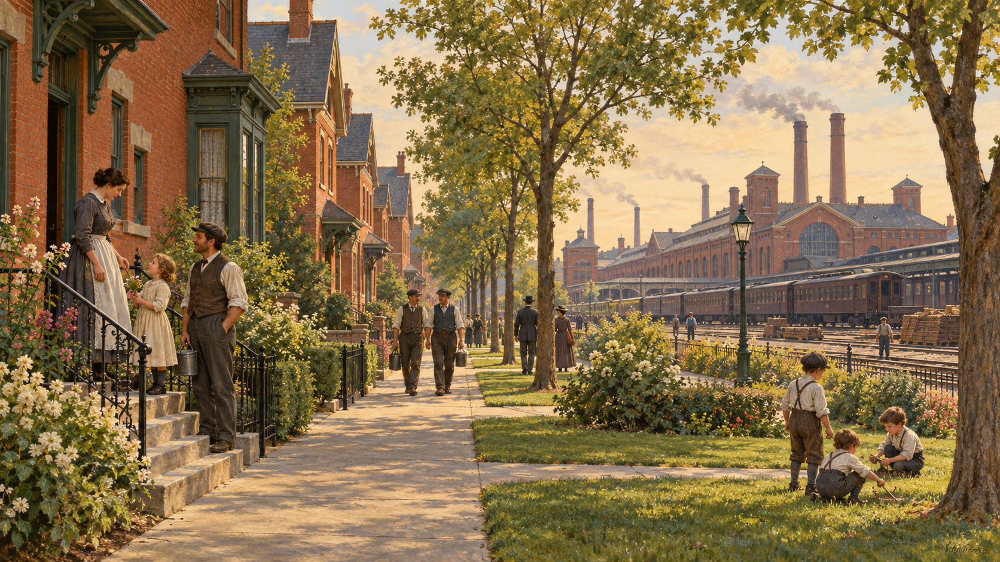

# 풀먼 — 회사가 집까지 마련해 주면 행복할까

*침대차 공장 옆의 모범 마을에서 1894년 파업까지*

Companies · Technology

> 자료 대조를 마친 검토용 이야기입니다. 공개 게시 승인은 아직 받지 않았습니다.

*AI 관련 장면 삽화 · 실제 풀먼 마을의 특정 거리나 주민을 고증한 복원은 아닙니다.*

공장 근처에 집이 있고, 집에는 수도와 가스등이 들어온다. 공원과 도서관, 극장도 마련되어 있다. 19세기 노동자에게 이런 동네는 꽤 매력적인 제안이었을 것이다. 그런데 집주인과 고용주가 같은 사람이라면 어떨까.

미국의 철도 침대차 제조업자 조지 풀먼은 노동자들을 위한 마을을 만들었다. 좋은 집을 짓는 구상은 분명한 장점이 있었다. 문제는 그곳에서 좋은 생활을 누릴 조건을 누가 결정하느냐였다.

## 1. 침대차를 만드는 사람들의 동네

풀먼은 시카고 남쪽의 공장 곁에 계획적인 주거지를 마련했다. 산업도시에 사람이 빠르게 모이던 시대였다. 노동자에게 일자리만큼 급한 것은 가족과 머물 집을 구하는 일이었다.

당시 도시의 노동자 주거는 비좁고 환기나 위생 상태가 나쁜 경우가 많았다. 이런 배경에서 정돈된 거리와 시설을 갖춘 회사 마을은 단순한 장식이 아니었다. 실제 생활의 부족한 부분을 채우는 제안이었다.

## 2. 집 밖에도 편리함이 이어졌다

마을에는 상점과 학교, 도서관과 극장, 교회가 있었다. 집의 수도와 가스등뿐 아니라 쓰레기 수거와 공원도 생활의 질을 바꾸는 요소였다. 공장 안의 생산과 공장 밖의 일상을 함께 설계한 셈이다.

노동자가 쉬고 배우며 가족과 지낼 환경을 마련하면 일도 잘하고 갈등도 줄어들 것이라는 기대가 있었다. 고용주에게는 복지와 생산성이 연결되어 있었다. 좋은 시설은 호의인 동시에 경영의 방법이었다.

## 3. 월급이 돌아오는 곳

노동자는 임금을 받아 집세를 내고 생활에 필요한 물건을 샀다. 그런데 그 집은 회사가 제공한 주택이었다. 회사는 사람을 고용하는 곳이면서 동시에 매달 주거비를 받는 쪽이기도 했다.

이 구조에서는 임금과 집세를 따로 보기 어렵다. 일터에서 받는 돈이 줄어도 살 곳의 비용이 그대로라면 생활은 빠르게 어려워진다. 같은 액수의 집세라도 일자리와 묶일 때 노동자에게 주는 압박은 달라진다.

## 4. 깨끗한 집과 사생활의 경계

집을 관리하는 방식에도 갈등의 씨앗이 있었다. 회사 측은 주택이 깨끗하게 유지되는지 검사했다. 노동자는 집을 자기 소유로 살 수 없었고, 일자리를 잃으면 가족의 거처도 위태로워졌다.

집을 잘 관리한다는 명분이 거주자의 생활을 살피는 권한으로 이어진 것이다. 고용주가 바라는 정돈된 동네와 주민이 원하는 사적인 공간은 꼭 같은 모습이 아니었다. 문을 닫은 뒤에도 회사의 영향은 남았다.

## 5. 무엇을 즐길지도 정해 준다면

풀먼은 도서관에 둘 책과 극장에서 공연할 작품의 선택에도 관여했다. 마을에 어떤 오락을 둘 것인지까지 회사가 판단했다. 교육과 휴식의 기회를 제공하면서 그 내용도 관리한 셈이다.

여기서 복지의 다른 질문이 나온다. 사람들에게 좋은 것을 마련해 주는 일과, 무엇이 좋은지 스스로 고르게 하는 일은 같지 않다. 시설이 훌륭하더라도 선택의 여지가 좁으면 불만이 생길 수 있었다.

## 6. 1894년, 두 장부가 엇갈렸다

경기 침체 속에서 풀먼은 노동자의 임금을 줄이고 일부를 해고했다. 그러나 집세는 그에 맞춰 낮추지 않았다. 일터의 사정이 어렵다는 설명이 가계의 주거비 부담을 줄여 주지는 않았다.

노동자들은 파업으로 맞섰다. 마을을 만들면 갈등을 예방할 수 있으리라는 기대와 달리, 회사가 일과 집을 함께 지배하는 구조가 갈등의 핵심이 되었다. 예쁜 거리만으로 봉합하기 어려운 문제였다.

## 7. 복지는 실패였다고만 할 수 있을까

이 사건을 보고 좋은 주택과 공원은 소용없었다고 결론낼 필요는 없다. 위생적인 집과 교육 시설의 가치는 분명하다. 다만 그것을 이용할 조건과 권한의 관계도 함께 살펴야 한다.

직장이 사라지는 순간 주거까지 흔들린다면 노동자가 협상할 여지는 줄어든다. 풀먼의 이야기는 혜택의 개수뿐 아니라 그 혜택이 누구의 결정에 달려 있는지 묻는다. 복지의 모양과 안정성은 별개의 질문이었다.

## 8. 좋은 집을 보여 주는 방식

계획된 거리와 가지런한 주택은 방문객이 쉽게 알아볼 수 있는 성과였다. 반면 집세를 내는 가계의 부담이나 검사받는 주민의 기분은 외관만 보아서는 알기 어렵다. 같은 마을이 보는 사람의 위치에 따라 다르게 보일 수 있었다.

고용주가 정해 준 생활을 직원이 고맙게 여길 수도, 간섭으로 느낄 수도 있다. 이 차이를 개인의 성격 문제로만 돌리면 누가 규칙을 바꿀 수 있었는지 보이지 않는다. 회사의 판단에 이의를 제기할 방법도 중요했다.

그래서 풀먼 마을의 시설 목록과 1894년의 갈등을 함께 읽어야 한다. 편의가 있었다는 사실과 갈등이 있었다는 사실은 함께 성립한다. 한쪽을 지워야만 다른 쪽을 이해할 수 있는 것은 아니다.

## 9. 모범 마을에서 남은 질문

풀먼은 당시의 다른 산업가들에게도 중요한 비교 대상이 되었다. 노동자를 위한 마을은 미국과 유럽의 여러 곳에서 만들어졌다. 산업의 성장은 공장 내부뿐 아니라 사람들이 사는 장소까지 바꾸고 있었다.

이 마을을 돌아보며 떠올릴 것은 집의 예쁜 외관만이 아니다. 잘 마련된 생활과 스스로 결정할 생활이 어떻게 함께 갈 수 있는가. 침대차 공장 옆의 동네는 그 오래된 질문을 눈에 보이는 거리로 남겼다.

## 이야기의 바탕이 된 자료

- [OpenStax World History — Life in the Industrial City](https://raw.githubusercontent.com/openstax/osbooks-world-history/main/modules/m00003/index.cnxml) · 확인일 2026-10-31
  - 확인 내용: 1858년 런던 대악취·석회 소독 커튼·바잘제트 하수도와 후속 처리 / 풀먼 마을의 주거·시설과 검사·1894년 임금 삭감과 집세 갈등 / 도시의 백화점·진열과 휴게 공간·소비와 일자리·봉마르셰/워너메이커 역사 도판

---

[같은 소주제의 이야기](README.md) · [전체 서가](../../README.md)
