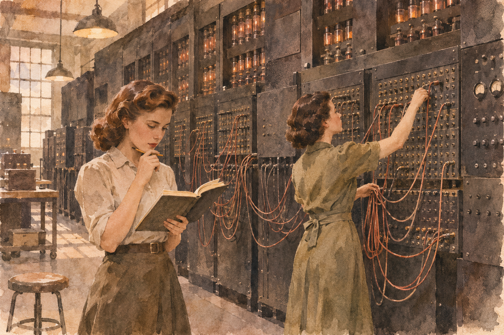

# 에니악 — 계산은 빨라졌는데 문제를 바꾸는 데는 시간이 걸렸다

*1946년 운용 설명서에서 만나는 컴퓨터 앞의 사람들*

컴퓨터와 디지털 · 컴퓨터의 역사

> 출처 대조와 공개 게시 승인을 마친 이야기입니다. 실제 게시 여부는 사이트 배포 상태를 따릅니다.

*AI 이야기 장면 삽화 · 역사적 상황을 떠올리기 위한 그림이며 특정 인물·기계·장소의 실제 사진이나 정확한 복원이 아닙니다.*

아주 빠르게 계산하는 기계가 있다. 그런데 이번 문제를 끝내고 다른 문제를 맡기려 하자 사람들이 다시 기계 앞에 모인다. 연결과 스위치를 살피고 숫자를 준비하며 결과가 제대로 나오는지 시험해야 한다. 계산이 빨라지는 것과 모든 준비가 사라지는 것은 같은 일이 아니었다.

초기 전자식 컴퓨터 에니악을 볼 때 거대한 크기와 속도부터 떠올리기 쉽다. 그러나 1946년의 운용 설명서를 읽으면 그 앞에서 일하던 사람들의 과제가 보인다. 숫자를 처리하는 장치만큼이나 그 장치를 일하게 만드는 순서가 중요했다.

## 01. 컴퓨터를 쓰는 방식이 지금과 달랐다

오늘은 프로그램을 열고 파일을 선택하는 동작으로 기계에 할 일을 줄 수 있다. 에니악의 초기 운용을 이 경험과 똑같이 상상하면 많은 부분을 놓친다. 여러 계산 장치가 어떻게 숫자를 주고받고 어떤 신호로 다음 일을 시작할지 정하는 작업이 훨씬 직접적으로 드러나 있었다.

여기서 참고하는 자료는 미국 육군의 감독 아래 펜실베이니아 대학교 무어 스쿨이 작성한 1946년 6월의 운용 설명서다. 에니악의 모든 시기와 개선을 한꺼번에 설명하는 자료로 쓰지는 않는다. 한 기계도 운용 방식이 달라질 수 있으므로 어느 때의 모습을 읽는지 먼저 정해야 한다.

## 02. 하나의 큰 상자 안에 여러 역할이 있었다

설명서의 목차에는 누산기와 고속 곱셈기, 함수표와 주 제어 장치, 읽고 출력하는 장치 등이 따로 등장한다. 누산기는 계산 중의 수를 보관하고 더하는 역할로 이해하면 된다. 익숙하지 않은 이름을 모두 외우지 않아도 기계 안에서 역할이 나뉘어 있었다는 점을 볼 수 있다.

사람이 긴 계산을 할 때도 중간 결과를 적어 두고 다음 단계에서 다시 사용한다. 기계에서도 어떤 숫자를 어디에 두고 언제 보내는지가 중요하다. 빠른 부품을 모았다고 원하는 답이 저절로 생기지는 않는다. 여러 역할이 알맞은 순서로 연결되어야 하나의 계산이 된다.

## 03. 문제를 계산의 순서로 풀어 놓기

일상 언어로 적은 문제는 기계가 바로 수행할 동작 목록과 다르다. 어떤 값을 먼저 읽고 무엇을 더하며 언제 반복을 멈출지 정해야 한다. 복잡한 문제를 작은 단계로 풀어 놓는 일은 전자 장치의 속도와 별개로 사람의 판단을 요구했다. 무엇을 계산할지 이해하는 작업이 먼저였다.

이런 과정을 오늘의 프로그래밍과 연결해 볼 수 있지만 도구와 방법까지 같았다고 생각해서는 안 된다. 초기 에니악에서는 설정과 연결이 눈앞의 하드웨어와 긴밀하게 이어졌다. 추상적인 계산 순서가 실제 장치의 동작으로 옮겨지는 과정이 기계 앞의 일로 나타났다.

## 04. 연결을 바꾸는 일도 계산의 일부

설명서는 장치 사이의 연결과 여러 스위치의 설정을 자세히 다룬다. 필요한 경로를 맞추고 신호가 기대한 방향으로 움직이는지 확인해야 했다. 그림이나 사진 속 복잡한 선을 단순한 장식처럼 보면 에니악을 사용하는 노동이 보이지 않는다. 선과 설정은 기계가 할 일을 구성하는 일부였다.

그렇다고 모든 계산의 모든 동작마다 사람이 선을 바꾸었다는 뜻은 아니다. 적절히 준비된 뒤에는 기계가 빠르게 연속 작업을 수행할 수 있었다. 준비 과정과 실행 과정을 구분해야 속도가 의미하는 바를 제대로 이해할 수 있다. 느린 준비와 빠른 계산이 같은 작업 안에 함께 존재했다.

## 05. 답을 얻는 것만큼 시험하는 일이 중요했다

설명서에는 장치를 확인하고 결과를 비교하는 절차가 등장한다. 기대한 값과 실제 출력이 맞는지 살피는 일은 부수적인 정리가 아니었다. 계산이 빠를수록 잘못된 설정도 빠르게 많은 결과를 만들어 낼 수 있다. 실행되었다는 사실과 올바르게 실행되었다는 사실은 다르다.

시험용 데이터를 사용하고 부분 결과를 점검하는 태도는 오늘의 컴퓨터 작업에도 낯설지 않다. 다만 현재의 도구를 과거에 그대로 투사하기보다 당시 사람들이 가진 수단으로 어떻게 신뢰를 만들었는지 보면 좋다. 기계의 믿을 만함은 속도만이 아니라 확인하는 절차에서도 만들어졌다.

## 06. 설명서 바깥으로 사라지기 쉬운 사람들

거대한 컴퓨터의 역사를 이름 있는 발명가 몇 명의 이야기로만 기억하면 장치를 설정하고 자료를 준비하고 이상을 찾아내던 여러 역할이 흐려진다. 운용 설명서는 개인의 생애를 모두 알려 주지는 않지만 해야 할 일이 얼마나 많았는지 보여 준다. 그 작업들을 누군가는 실제로 수행했다.

함께 실은 그림도 특정 인물의 실제 모습을 재현한 것은 아니다. 초기 컴퓨터 앞의 인간 노동을 떠올리기 위한 해석적 장면이다. 사진처럼 받아들이지 않으면서도 기계를 사람 없는 방으로 상상하지 않는 데 사용할 수 있다. 기술의 역사는 작동하는 장치와 그것을 다루는 손이 만나는 곳에 있다.

## 07. 계산의 속도 뒤에 준비의 시간을 보기

에니악을 만났을 때 중요한 숫자 몇 개를 외우는 대신 한 번의 작업을 상상해 보자. 문제를 이해하고 절차를 나누고 설정을 준비한 뒤 시험을 거쳐 결과를 얻는다. 기계가 숫자를 처리한 시간은 그 과정 전체의 한 부분이었다. 성능의 숫자만으로 사람의 시간이 모두 설명되지는 않는다.

오늘도 빠른 컴퓨터를 갖추었다고 해야 할 일이 스스로 정해지는 것은 아니다. 질문과 입력, 확인의 방식은 여전히 중요하다. 에니악의 오래된 설명서는 낡은 스위치의 사용법을 넘어 그 차이를 보게 한다. 더 빨리 계산하는 일과 무엇을 어떻게 계산할지 정하는 일은 서로 연결되지만 같은 일은 아니다.

## 이야기의 바탕이 된 자료

- [University of Pennsylvania, Moore School — Report on the ENIAC, Operating Manual, June 1, 1946](https://raw.githubusercontent.com/megatontech/ENIAC-Operating-Manual/master/ENIAC_Operating_Manual_Jun46_text.pdf) · 확인일 2026-11-05
  - 확인 내용: 표지의 발행 기관·육군 감독·1946년 6월 1일과 당시 운용 단계 / 누산기·곱셈기·함수표·제어·입출력 장치, 연결과 설정·반복 운용 / 시험·점검 및 결과 비교 절차. 후대의 저장 프로그램 방식이나 모든 시기의 운용으로 일반화하지 않음

---

[같은 소주제의 이야기](README.md) · [전체 서가](../../README.md)
