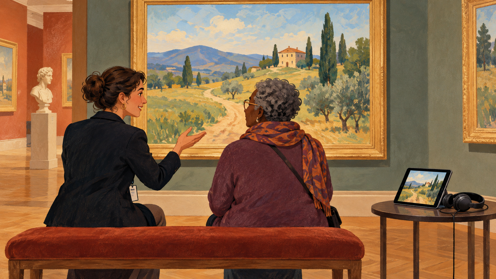

# 대체 텍스트 — 그림을 말로 전한다면

*보이지 않는 이미지에서 무엇이 빠지는지 묻기*

Computing · Internet

> 출처 대조와 공개 게시 승인을 마친 이야기입니다. 실제 게시 여부는 사이트 배포 상태를 따릅니다.

*AI 관련 삽화 · 가상의 그림을 함께 감상하며 설명하는 장면입니다. 실제 박물관 작품이나 현장 안내를 재현하지 않았습니다.*

인터넷에서 이미지를 기다리는데 빈자리에 짧은 문장만 보인 적이 있을 것이다. 파일이 오지 않았을 때 사진 대신 나타나는 말일 수 있다. 그런데 이 문장은 고장 난 화면을 위한 임시 안내에만 쓰이는 것이 아니다. 그림을 직접 볼 수 없는 사람에게도 내용을 전달한다.

웹에서는 이런 설명을 대체 텍스트라고 부른다. 중요한 질문은 그림에 무엇이 있는가에서 한 걸음 더 나아간다. 이 페이지에서 그 그림이 어떤 일을 하고 있으며, 보이지 않으면 어떤 정보가 사라지는가를 생각해야 한다.

## 1. 이미지를 보는 길은 하나만이 아니다

어떤 독자는 화면 읽기 프로그램으로 웹을 이용한다. 어떤 독자는 통신 환경 때문에 이미지가 늦게 오거나 표시되지 않는다. MDN은 대체 텍스트가 이런 상황에서 도움이 된다고 설명한다. 웹페이지의 독자가 모두 같은 화면을 같은 방식으로 만나는 것은 아니다.

따라서 대체 텍스트는 특정한 한 경우에만 덧붙이는 장식이 아니다. 내용에 접근하는 다른 길을 마련하는 일이다. 사진을 충분히 크게 넣었다고 모든 독자에게 정보가 전달된 것은 아닐 수 있다. 무엇을 보이게 했는지와 누가 그것을 받아들일 수 있는지는 함께 생각해야 한다.

## 2. 사진이라는 말만으로는 부족할 때

가상의 도시 산책 글에 다리 사진을 넣었다고 해 보자. 대체 텍스트가 사진 한 장이라고만 되어 있다면 독자는 어떤 다리인지, 무엇을 살펴보아야 하는지 알기 어렵다. 파일이 이미지라는 사실보다 이미지가 전달하는 내용이 더 필요할 수 있다.

그렇다고 보이는 모든 색과 돌의 수를 끝없이 적는 것도 항상 좋은 답은 아니다. 사진이 들어간 목적에 맞추어 중요한 정보를 간결하게 전해야 한다. 독자에게 도움이 되는 설명은 사물의 목록을 길게 나열하는 일과 다르다. 장면의 핵심을 고르는 편집이 들어간다.

## 3. 같은 그림에도 다른 설명이 어울린다

한 다리 사진이 여행기에서는 도시의 분위기를 전할 수 있다. 건축 해설에서는 아치의 형태를 설명하는 자료일 수 있다. 같은 파일이어도 페이지에서 맡은 역할이 다르면 빠져서는 안 되는 정보가 달라진다. 대체 텍스트는 이미지와 문맥을 함께 읽어야 하는 이유다.

이때 사진으로 확인하지 못한 사연을 설명에 보태면 안 된다. 눈에 보이는 구조와 자료로 확인한 사실을 구분해야 한다. 대체 텍스트도 독자가 내용을 받아들이는 통로이므로 정확성이 필요하다. 짧게 적는다고 근거의 기준이 가벼워지는 것은 아니다.

## 4. 장식이라면 조용히 지나가게 할 수도 있다

모든 이미지가 새로운 정보를 담는 것은 아니다. 문단 옆의 단순한 장식처럼 없어도 본문의 의미가 달라지지 않는 경우가 있다. MDN은 이런 이미지에 빈 대체 텍스트를 사용하는 방법을 설명한다. 화면 읽기 프로그램이 불필요한 설명을 반복하지 않도록 하기 위해서다.

여기서 비워 둔 값과 설명을 생각하지 않고 누락한 상태는 같지 않다. 전자는 역할을 판단한 결과다. 무엇이든 많이 읽어 주면 더 친절할 것처럼 보이지만 중요한 정보 사이에 쓸모없는 소리가 계속 끼면 이용이 어려워질 수 있다. 덜 말하는 선택도 독자를 위한 판단이 된다.

## 5. 그림이 버튼이나 링크라면

이미지를 눌러 다른 페이지로 이동하게 만들 수도 있다. 이때는 그림의 생김새만큼 그 링크의 목적을 아는 것이 중요하다. 예를 들어 집 모양 그림이 첫 화면으로 가는 기능이라면 독자는 집의 지붕 색보다 어디로 이동하는지 알고 싶을 수 있다.

MDN은 이미지 링크에도 접근 가능한 링크 설명이 필요하다고 설명한다. 그림의 묘사와 기능의 안내가 만나는 대목이다. 같은 작은 아이콘도 본문의 삽화인지 움직이는 길잡이인지에 따라 필요한 말이 달라진다. 의미는 파일 안에만 들어 있는 것이 아니다.

## 6. 긴 정보는 본문과 함께 전달하기

복잡한 도표나 중요한 설명을 그림 하나에만 담으면 짧은 대체 텍스트로 충분히 옮기기 어려울 수 있다. MDN은 필요한 정보를 모두가 읽는 본문에서도 제공하는 방식을 권한다. 이미지의 내용을 다른 경로로 전하는 것이 핵심이지 한 칸에 모든 문장을 밀어 넣는 것이 목적은 아니다.

본문이 이미 충분히 설명한 내용을 그대로 반복하면 오히려 지루하고 혼란스러울 수 있다. 무엇을 어디에서 전달했는지 함께 살피는 일이 필요하다. 그래서 대체 텍스트는 파일을 마지막에 올릴 때만 쓰는 항목보다 글과 그림을 함께 편집하는 과정에 가깝다.

## 7. 캡션과 대체 텍스트는 어디가 다를까

그림 아래의 캡션은 보통 모든 독자가 화면에서 읽는 설명이다. 작가와 연도, 출처와 맥락을 알려 줄 수도 있다. 대체 텍스트는 이미지를 직접 볼 수 없는 상황에서 그 역할을 대신할 정보를 제공한다. 목적이 일부 겹쳐도 언제나 같은 문장을 복사하는 것이 정답은 아니다.

함께 실은 AI 삽화는 가상의 그림을 두고 설명을 나누는 장면이다. 특정 박물관의 실제 작품이나 현장 안내를 재현한 자료는 아니다. 작품을 직접 보는 길과 말로 설명을 듣는 길이 함께 있을 수 있다는 생각을 표현했다.

## 8. 그림을 고르는 일 다음의 질문

이미지를 붙이는 순간 글은 더 풍부해질 수 있다. 그러나 그 이미지가 보이지 않는 독자에게도 중요한 내용이 남아 있는지 한 번 더 확인해야 한다. 그림을 고르는 일과 그림의 역할을 설명하는 일은 같은 편집의 다른 단계다.

다음에 사진을 넣을 때 잠깐 눈을 감고 이 그림이 빠지면 무엇을 놓치는지 생각해 보자. 답이 장식이라면 조용히 지나가게 할 수 있고, 답이 중요한 정보라면 그 내용을 다른 길로도 전해야 한다. 대체 텍스트는 웹의 작은 설명이 어떻게 더 많은 사람에게 읽을거리를 열어 주는지 보여 준다.

## 이야기의 바탕이 된 자료

- [MDN — HTML의 이미지와 대체 텍스트](https://raw.githubusercontent.com/mdn/content/main/files/en-us/learn_web_development/core/structuring_content/html_images/index.md) · 확인일 2026-10-31
  - 확인 내용: 이미지 미표시·화면 읽기 프로그램과 대체 텍스트 / 정보·장식·링크별 목적·빈 대체 텍스트 / 본문에서의 정보 제공·중복을 피하는 설명

---

[같은 소주제의 이야기](README.md) · [전체 서가](../../README.md)
