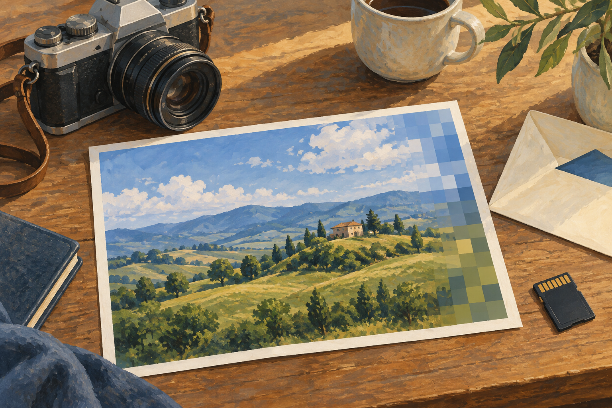

# 사진 파일은 어떻게 가벼워졌을까 — JPEG의 작은 타협

*덜 남기면서도 사진처럼 보이게 만드는 방법*

Computing · Software

> 자료 대조를 마친 검토용 이야기입니다. 공개 게시 승인은 아직 받지 않았습니다.

*KnowledgeWalk 제작 AI 삽화 · 실제 JPEG 압축 실험·품질 비교가 아닌 압축 개념의 분위기 삽화입니다.*

여행 사진 한 장을 보내려는데 파일이 너무 크다는 안내가 뜬다. 크기를 줄였더니 화면에서는 별 차이가 없어 보인다. 그런데 글씨가 있는 부분을 확대하면 가장자리가 조금 흐릿하다. 같은 이미지를 가볍게 만드는 일에도 어떤 정보는 남기고 어떤 정보는 덜 남길지의 선택이 숨어 있다.

JPEG는 디지털 사진에서 널리 만나는 이름이다. 사진을 작게 만드는 마술 상자라기보다, 사람의 눈이 무엇에 민감하고 어떤 차이는 덜 알아차리는지를 이용하는 여러 약속의 묶음이다. 복잡한 수식을 몰라도 그 타협의 성격은 이해할 수 있다.

## 1. 사진은 색을 가진 점들의 모임

화면 속 사진은 많은 화소, 곧 작은 점의 정보로 표현된다. 사진이 커지고 색의 정보를 자세히 남길수록 다루어야 할 데이터도 많아진다. 파일을 가볍게 만들려면 같은 정보를 더 효율적으로 적거나 정보의 일부를 덜 남기는 방법을 생각할 수 있다.

두 방법은 결과가 다르다. 원래 내용을 정확히 다시 만들 수 있게 줄이는 방식도 있고, 복원했을 때 처음과 완전히 같은 화소가 되지는 않는 방식도 있다. 일상에서 널리 쓰는 JPEG 사진 압축은 보통 뒤쪽에 해당한다. 이를 손실 압축이라고 부른다.

## 2. 눈은 모든 차이를 같은 정도로 볼까

사람의 시각은 밝기의 세부와 색의 세부를 똑같이 받아들이지 않는다. 일반적인 JPEG 처리에서는 이런 차이를 이용해 색 정보의 정밀도를 낮추기도 한다. 덜 민감하게 느끼는 부분을 줄여 전체 크기를 줄이는 것이다.

그렇다고 사진에서 별로 중요하지 않은 물건을 알아보고 지운다는 뜻은 아니다. 여행 사진의 주인공과 배경을 사람처럼 이해해 고르는 과정과는 다르다. 색과 밝기의 변화 같은 수치의 성질을 다룬다. 의미가 중요해 보이는 글씨도 압축 방식에 따라 선명함을 잃을 수 있다.

## 3. 작은 차이를 얼마나 남길 것인가

사진의 일정한 영역에서 색과 밝기가 변하는 모습을 다른 형태의 수치로 표현하고, 그중 일부를 덜 정밀하게 남기는 과정이 있다. 여기서 파일의 크기와 시각적 충실도 사이의 타협이 생긴다. 모든 계산을 따라가기보다 정보를 거칠게 기록할 수 있다는 점을 기억하면 된다.

예를 들어 비슷한 하늘색이 이어지는 넓은 부분과 검은 글씨의 날카로운 경계는 성질이 다르다. 압축에 잘 맞는 사진에서는 데이터를 많이 줄여도 변화가 눈에 잘 띄지 않을 수 있다. 반대로 작은 세부와 강한 경계가 많은 곳에서는 그 흔적이 더 쉽게 드러난다.

## 4. 왜 글씨 주위에 얼룩이 생길까

사진을 아주 작게 만들면 글자의 테두리나 물체의 가장자리 주변에 번지는 듯한 흔적이 보이기도 한다. 확대했을 때 작은 블록의 경계가 드러날 수도 있다. 압축 과정에서 덜 남긴 정보가 결과 화면에 나타나는 모습이다.

JPEG 구현 문서도 부드럽게 색과 밝기가 바뀌는 사진이 강점이고, 날카로운 선이나 갑자기 바뀌는 부분에서는 눈에 띄는 흔적을 피하기 위해 더 높은 품질이 필요할 수 있다고 설명한다. 선명한 도표와 작은 글씨가 중심인 화면은 풍경 사진과 다르게 다룰 이유가 있는 셈이다.

## 5. 품질 숫자는 학교 성적이 아니다

이미지를 저장할 때 품질을 숫자로 고르는 프로그램이 있다. 보통 더 높은 설정은 정보를 더 충실히 남기고 파일도 커지게 하지만, 서로 다른 프로그램의 같은 숫자가 완전히 같은 결과를 보장하는 것은 아니다. 그 숫자만 보고 모든 파일을 공통 기준으로 비교하기는 어렵다.

원래부터 작은 사진을 높은 품질로 저장한다고 촬영하지 않은 세부가 되살아나는 것도 아니다. 보관된 정보보다 더 많은 실제 내용을 자동으로 되찾을 수는 없다. 저장 설정은 남아 있는 자료를 어떻게 처리할지의 선택이지 이미 잃어버린 장면을 되돌리는 시간 여행이 아니다.

## 6. 파일 이름이 같아도 과정은 다를 수 있다

사진을 열어 내용을 바꾼 뒤 다시 손실 압축하면 이미 한 번 달라진 정보를 바탕으로 또 기록한다. 여러 차례의 재압축은 원본과의 차이를 더 만들 수 있다. 다만 파일을 그냥 복사하거나 옮긴다고 매번 사진이 흐려지는 것은 아니다. 다시 압축하는 과정이 있는지를 구별해야 한다.

JPEG라는 이름 아래에도 여러 기능과 변형이 있다. 구현 문서는 손실 없이 처리하는 기능도 설명한다. 따라서 이름만 보고 가능한 모든 처리 과정을 하나로 단정하기보다, 여기서는 흔히 쓰이는 손실 압축 사진의 경험을 이야기하고 있다는 범위를 기억하는 편이 좋다.

## 7. 사진이 쉽게 오간다는 변화

이미지가 너무 크면 저장할 공간과 보내는 시간이 많이 필요하다. 사진의 일부 정보를 덜 남기는 타협은 더 많은 사람이 사진을 주고받고 웹에서 볼 수 있게 하는 데 의미가 있었다. 정확히 같은 화소를 유지하는 목적과 일상에서 빠르게 보는 목적이 언제나 일치하는 것은 아니다.

반면 작은 글씨가 담긴 기록이나 정밀한 관찰 자료에서는 사소해 보이는 흔적도 문제가 될 수 있다. 어떤 형식이 언제나 최고라고 외우기보다 무엇을 보존해야 하는 사진인지 묻는 편이 이해에 도움이 된다. 좋은 압축은 목적과 맞는 타협일 때 좋은 결과가 된다.

## 8. 가벼운 사진 뒤에 남은 질문

함께 실은 그림은 사진과 압축의 관계를 떠올리게 하는 AI 삽화다. 가장자리의 색 조각은 실제 JPEG 실험 결과나 같은 원본의 품질 비교 자료가 아니다. 정확한 성능을 비교하는 도표처럼 읽을 필요는 없다.

다음에 작은 사진 파일을 열 때는 그 안의 풍경뿐 아니라 남겨진 정보와 덜 남겨진 정보도 생각해 보자. 화면에서 충분히 자연스러워 보인다는 것은 모든 정보가 그대로라는 뜻과 다르다. 디지털 기술의 흥미로운 부분은 종종 완벽하게 똑같은 것보다 상황에 맞게 충분히 좋은 것을 만드는 데 있다.

## 이야기의 바탕이 된 자료

- [libjpeg-turbo — Independent JPEG Group 구현 문서](https://raw.githubusercontent.com/libjpeg-turbo/libjpeg-turbo/main/README.ijg) · 확인일 2026-10-30
  - 확인 내용: 사진과 부드러운 색·밝기 변화에 적합한 압축 / 일반적인 손실 압축·날카로운 경계의 흔적·품질과 압축의 타협; 손실 없는 기능도 존재
- [MDN Web Docs — JPEG 용어 설명](https://raw.githubusercontent.com/mdn/content/main/files/en-us/glossary/jpeg/index.md) · 확인일 2026-10-30
  - 확인 내용: Joint Photographic Experts Group 명칭·손실 압축 / 색 세부와 밝기 세부에 대한 시각 민감도·색 정보 축소 및 변환·양자화

---

[같은 소주제의 이야기](README.md) · [전체 서가](../../README.md)
