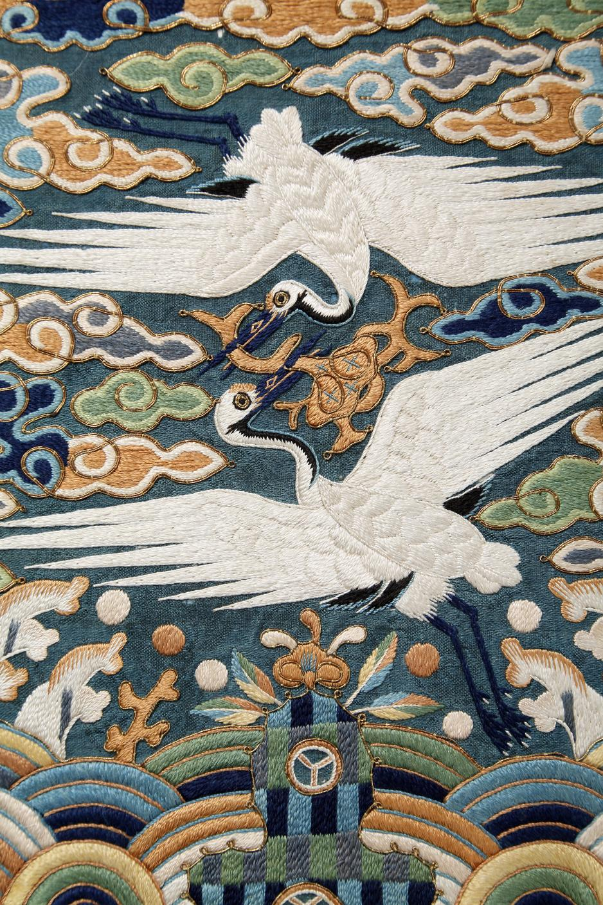

# 관복의 학 두 마리는 무엇을 알려줄까

*쌍학무늬 흉배를 가까이에서 보는 재미*

Life · Clothing

> 자료 대조를 마친 검토용 이야기입니다. 공개 게시 승인은 아직 받지 않았습니다.

*쌍학무늬 흉배, 궁중115 · 세부 사진 · 국립고궁박물관 소장·제공*

[이미지 출처와 소장품 안내](https://www.gogung.go.kr/gogung/pgm/psgudMng/view.do?menuNo=800065&psgudSn=376760) · 공공누리 제1유형(출처표시)

옛 관복을 보면 가슴께의 사각형 그림이 먼저 눈에 띌 때가 있다. 넓은 옷 한가운데에서 동물이 날거나 구름 사이를 움직인다.

국립고궁박물관의 「쌍학무늬 흉배」에는 두 마리 학이 위아래로 마주 보고 있다. 가까이 보면 흰 몸과 날개도 물감이 아니라 실로 만들어져 있다.

예쁜 그림을 옷에 붙인 것처럼 보이지만, 이 물건에는 착용자의 지위를 나타내는 역할도 있었다.

## 옷 위의 작은 표시

박물관은 이 흉배를 문관 당상관이 착용한 것으로 설명한다. 당상관은 관료의 높은 지위에 속하는 구분이다. 여기서는 세세한 품계표보다, 옷의 문양이 아무렇게나 정해지지는 않았다는 점을 알아두면 된다.

박물관의 궁중 자수 전시 설명에서도 신하들에게 관직과 등급에 따라 수실과 문양을 달리한 흉배를 내렸다고 소개한다. 장식과 사회적인 구분이 같은 물건 안에 있었다.

그렇다고 동물의 수만 외워 모든 시대의 관복을 맞히는 시험을 볼 필요는 없다. 지금 보는 한 점의 설명부터 읽으면 충분하다. 이 흉배에는 학 두 마리와 불로초를 문 모습이 수놓여 있다.

## 가까이 가면 실의 방향이 보인다

사진을 확대하면 흰 날개를 채운 실의 결을 볼 수 있다. 구름 가장자리에는 또 다른 빛깔과 질감이 이어진다. 멀리서는 하나의 그림이지만 가까이에서는 작은 실의 움직임으로 나뉜다.

궁중 자수는 전문 화원이 밑그림을 그리고 수방의 사람들이 이를 옮겨 수놓는 방식으로 제작되었다고 박물관은 설명한다. 그리는 일과 바느질하는 일이 한 물건에서 만난다.

이 과정에서 평면의 그림은 옷감 위의 질감을 얻는다. 빛을 받는 방향에 따라 실의 표면이 달라 보이는 것도 자수 사진을 보는 즐거움이다. 동물이 무엇인지 알아본 뒤에는 어떻게 만들어졌는지도 눈에 들어온다.

## 동물 한 마리에서 시작하는 옛옷 구경

복식 전시에는 낯선 옷 이름과 긴 설명이 붙어 있기 쉽다. 처음부터 모두 외우려 하면 관람이 공부처럼 느껴진다. 그럴 때는 마음에 드는 문양 하나부터 찾아보아도 좋다.

학의 날개가 어디까지 펼쳐져 있는지, 구름은 어떤 색인지, 같은 흰 부분도 실의 방향이 다른지 살펴보자. 알고 있는 동물이 낯선 옷을 보는 입구가 된다.

그다음 설명에서 누가 입던 것인지 확인하면 작은 그림의 두 역할이 함께 보인다. 한 사람의 자리를 알려주는 표시이면서, 여러 사람의 손이 지나간 섬세한 공예품이다.

다음에 관복 속 동물을 만나면 이름만 맞히고 지나치지 않아도 좋겠다. 실 한 가닥씩 가까이 보는 데에도 생각보다 긴 구경거리가 숨어 있다.

## 이야기의 바탕이 된 자료

- [국립고궁박물관 — 쌍학무늬 흉배(궁중115)](https://www.gogung.go.kr/gogung/pgm/psgudMng/view.do?menuNo=800065&psgudSn=376760) · 확인일 2026-10-27
  - 확인 내용: 문관 당상관 관복에 사용한 흉배 / 불로초를 물고 마주 보는 두 학의 자수 / 비단 바탕과 여러 색 실
- [국립고궁박물관 — 아름다운 궁중 자수](https://www.gogung.go.kr/gogung/bbs/BMSR00002/view.do?menuNo=800040&boardId=5359) · 확인일 2026-10-27
  - 확인 내용: 관복 흉배의 무늬와 계급의 관계 / 궁중 화원과 자수 장인의 분업

---

[시범 이야기 목록으로](README.md)
