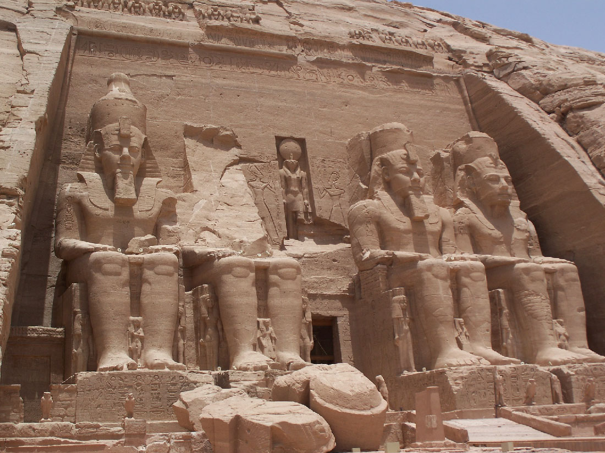

# 아부심벨 — 왕의 얼굴을 새긴 절벽을 왜 옮겼을까

*람세스 2세의 암굴 신전과 1968년 이전으로 읽는 권력과 보존*

Culture · Architecture

> 출처 대조와 공개 게시 승인을 마친 이야기입니다. 실제 게시 여부는 사이트 배포 상태를 따릅니다.

*Than217 / Wikimedia Commons · Public Domain. OpenStax 수록 원본 사진.*

[이미지 출처·제작 근거](https://raw.githubusercontent.com/openstax/osbooks-world-history/main/media/OSX_WorldHist_A04_02_AbuSimbel.jpg) · Public Domain

이집트 남쪽의 아부심벨에서는 네 개의 거대한 좌상이 정면을 바라본다. 같은 왕의 얼굴이 절벽을 채우고, 그 사이의 작은 입구가 신전 안쪽으로 이어진다. 사람의 몸보다 훨씬 큰 형상 앞에서 관람객은 크기가 어떻게 권력의 언어가 되는지 실감한다.

이곳에는 또 하나의 놀라운 시간이 겹쳐 있다. 고대에 바위를 파서 만든 신전이 현대에 원래의 자리에서 옮겨졌다는 사실이다. 왕이 자신을 기억하게 만들려 했던 장소를 후대의 사람들이 다시 지켜 낸 셈이다. 건설과 보존의 역사를 함께 따라가 보자.

## 01. 람세스 2세는 왜 자신의 모습을 크게 남겼을까

아부심벨의 두 신전은 기원전 13세기 이집트의 왕 람세스 2세와 관련된 건축이다. 특히 대신전의 정면에는 왕을 나타낸 거대한 좌상 네 개가 있다. 한 번만 보여 주어도 알아볼 인물을 반복하고 확대하는 방식 자체가 강한 인상을 준다.

왕의 형상은 오늘날의 개인 초상과 같은 목적으로만 만들어지지 않았다. 통치자의 위상과 신성한 질서를 드러내는 장소에 놓인다. 얼굴이 닮았는지보다 어떤 크기와 자세로 어디에 나타나는지가 중요하다. 이 조각들은 왕을 설명하는 문장보다 먼저 다가오는 권력의 표지다.

## 02. 이집트의 남쪽이라는 자리를 기억하기

아부심벨은 이집트 남쪽, 누비아 지역에 자리한다. 피라미드가 있는 북쪽의 풍경만 떠올리면 이 지리적 의미를 놓치기 쉽다. 고대 이집트의 역사는 나일강을 따라 멀리 이어졌고 남쪽 지역과의 관계도 중요했다. 거대한 왕의 얼굴은 그 관계 속의 장소에 세워졌다.

같은 조각도 수도 한가운데 놓인 경우와 먼 지역의 길목에 놓인 경우 의미가 다르다. 누가 이곳을 보고 어떤 권위를 느끼도록 했는지 묻게 되기 때문이다. 신전을 아름다운 돌 조각으로만 보지 않고 지도 속에 놓으면 건축이 통치의 공간을 만드는 방법이 드러난다.

## 03. 돌을 쌓는 대신 산 안으로 들어가다

대신전은 절벽의 바위를 파서 공간을 만든 암굴 신전이다. 정면의 문을 지나면 통로와 내부의 방들이 이어진다. 바깥에 세운 벽돌 건물처럼 생각하면 그 독특함이 잘 보이지 않는다. 내부 공간을 얻는 방식이 재료를 더하는 일과는 달랐다.

밖에서 보는 거대한 조각과 안으로 들어가는 좁은 길의 비례도 눈여겨볼 만하다. 왕의 얼굴이 지배하는 밝은 정면을 지나 내부로 움직이면 몸이 느끼는 크기와 빛이 달라진다. 아부심벨은 정면 사진뿐 아니라 안팎의 차이를 상상하며 읽어야 하는 건축이다.

## 04. 햇빛도 신전의 일부가 되다

대신전은 해마다 특정한 시기에 새벽의 햇빛이 안쪽까지 들어오도록 설계된 것으로 알려져 있다. 고정된 돌 공간에 움직이는 태양의 시간이 겹친다. 벽과 조각만으로 건축을 설명할 때 놓치기 쉬운 요소다. 빛이 들어오는 순간에는 같은 방도 다르게 보인다.

이를 현대의 정밀 기계와 똑같은 방식으로 해석할 필요는 없다. 중요한 것은 자연의 방향과 시간이 종교적 공간의 경험에 참여했다는 점이다. 고대의 건축가는 땅 위에 형태를 만드는 동시에 그 장소에서 빛이 어떻게 움직이는지 고려했다.

## 05. 댐이 가져온 물이 오래된 장소를 위협하다

20세기에 나일강에 큰 댐을 건설하면서 신전의 원래 자리가 물에 잠길 위험이 생겼다. 현대의 개발 사업이 고대 유산의 존속과 충돌한 것이다. 물을 다루어 현재의 필요를 해결하는 일과 물 때문에 과거의 장소를 잃는 일이 같은 사업 안에서 만났다.

이때 문제는 눈앞의 조각을 아깝게 여기는 데 그치지 않는다. 건축은 주변 지형과 빛, 방향을 포함한 장소이기 때문이다. 물건처럼 들어 다른 진열대에 올려놓을 수 있는지, 옮긴 뒤 무엇이 같고 무엇이 달라질지까지 생각해야 한다. 보존은 선택과 기술을 함께 요구한다.

## 06. 보존을 위해 원래의 자리에서 움직이다

아부심벨 신전은 이전 작업을 거쳐 1968년 새로운 자리에서 보존되었다. 오늘날 관람객이 만나는 풍경에는 이 현대의 구출 과정이 포함되어 있다. 지금도 오래된 돌이 남아 있다는 사실만 보면, 그것을 남기기 위해 장소를 바꿔야 했던 역사는 잘 보이지 않는다.

이전은 잃을 위기에 놓인 유산을 지킨 중요한 선택이지만 원래의 장소를 그대로 유지한 것과 동일하지는 않다. 그래서 보존의 성과와 변화의 사실을 함께 설명하는 편이 좋다. 과거의 돌을 남기는 일과 과거의 환경을 완전히 남기는 일 사이에는 차이가 있다.

## 07. 고대의 권력과 현대의 책임이 만나다

처음 이곳을 만든 사람들은 왕과 신을 기리며 오래 기억되기를 바랐을 것이다. 후대의 사람들은 그 왕의 통치를 받지 않으면서도 신전을 남길 가치가 있다고 판단했다. 특정 통치자를 위한 기념물이 더 넓은 사람들의 역사 유산으로 읽히게 된 것이다.

보존된 유산을 볼 때 이전의 사실을 설명하는 기록도 함께 읽는 것이 좋다. 완성된 모습만 감상하면 돌이 옮겨진 경위를 알기 어렵다. 무엇이 원래 남은 부분이며 무엇이 후대의 노력으로 유지되었는지 아는 일도 감상의 일부다.

아부심벨을 볼 때에는 네 개의 얼굴 뒤에 두 번의 거대한 일을 떠올려 보자. 바위를 파서 신전을 만든 일과, 사라질 위기의 신전을 옮겨 남긴 일이다. 이 장소는 인간이 무엇을 크게 만들고 무엇을 오래 지키려 하는지 서로 다른 시대의 답을 함께 보여 준다.

## 이야기의 바탕이 된 자료

- [OpenStax World History — Egypt’s New Kingdom](https://raw.githubusercontent.com/openstax/osbooks-world-history/main/modules/m00110/index.cnxml) · 확인일 2026-11-05
  - 확인 내용: 람세스 2세·기원전 13세기·누비아·거대 좌상 네 개·암굴 내부·연중 햇빛 유입·댐 침수 위험과 1968년 신전 이전

---

[같은 소주제의 이야기](README.md) · [전체 서가](../../README.md)
