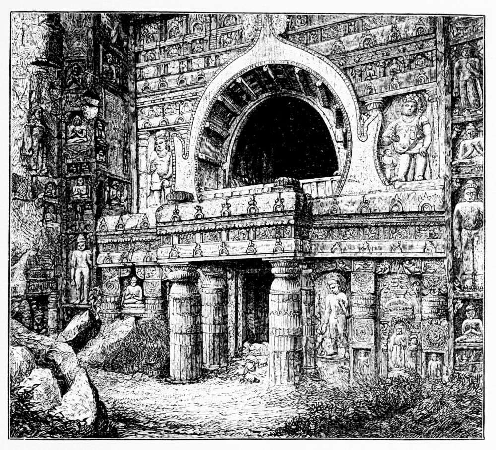

# 아잔타 석굴 — 바위를 파서 빛과 이야기를 담다

*차이티야와 비하라, 돌 속의 목조 형식과 벽화*

Culture · Architecture

> 자료 대조를 마친 검토용 이야기입니다. 공개 게시 승인은 아직 받지 않았습니다.

*James Fergusson, History of Indian and Eastern Architecture, Fig.60, Chaitya Cave No.19 at Ajunta, from a photograph · Public Domain. 실제 석굴의 역사 출판 도판.*

[이미지 출처·제작 근거](https://raw.githubusercontent.com/GITenberg/History-of-Indian-and-Eastern-Architecture_61178/master/61178-h/images/ill_pg_125_lg.jpg) · Public Domain · 저작권 만료 작품 및 역사 출판 자료

인도 아잔타 석굴은 바위를 뚫어 만든 불교 공간이지만, 동굴이라는 말만으로 떠올리기에는 너무 정교하다. 기둥과 천장, 예배의 장소와 생활의 방, 벽화와 조각이 함께 있다. 길게 이어진 석굴들을 하나의 건물로 묶기보다, 시대와 쓰임이 다른 공간들이 계곡을 따라 모인 장소로 읽어 보자.

## 01. 돌을 쌓는 건축과 파내는 건축

보통 건물은 재료를 가져와 벽과 지붕을 세운다. 아잔타의 석굴에서는 바위를 제거하면서 내부 공간을 만든다. 기둥처럼 보이는 부분도 따로 가져다 세운 돌이 아니라 주변을 파내고 남긴 바위인 경우가 많다.

이 차이를 생각하면 익숙한 기둥과 들보의 모양이 새롭게 보인다. 구조를 만들어 놓고 겉을 꾸미는 과정과 완전히 같지 않기 때문이다. 어떤 공간과 형상을 남길지 계획하면서 물질을 덜어 내야 했고, 그만큼 공정과 작업의 순서가 중요했을 것이다.

## 02. 같은 계곡에 서로 다른 시대가 있다

아잔타에는 이른 시기의 석굴과 뒤에 크게 확장된 시기의 석굴이 공존한다. 대체로 기원전 수 세기에서 기원후 초기까지의 작업과, 5세기 무렵의 활발한 조성이 구분된다. 모든 공간을 한 왕이 한 번에 만들었다는 이야기는 맞지 않는다.

번호 역시 건립 연대의 순서를 그대로 뜻하지 않는다. 처음 접할 때에는 몇 번 석굴인가를 외우기보다, 예배를 위한 긴 홀인지 생활을 위한 여러 방이 있는지 먼저 구분하는 편이 좋다. 형태를 통해 기능을 읽기 시작하면 복잡한 집합이 조금씩 정리된다.

바위를 파내 만든 공간이라도 공사가 끝난 뒤의 사용까지 모두 돌에 결정되는 것은 아니다. 조명과 의례, 사람의 이동이 내부를 채웠을 것이다. 빈 석굴의 사진을 볼 때에는 현재의 고요함을 과거의 항상 같은 상태로 생각하지 않는 편이 좋다.

## 03. 차이티야의 길은 탑을 향한다

차이티야로 부르는 예배 공간에는 긴 홀과 기둥의 열, 안쪽의 탑이 어우러진다. 기둥은 가운데와 양옆의 통로를 구분하면서 시선을 안으로 이끈다. 탑 주위를 도는 동선까지 생각하면 정면에서만 보는 장식물과 다르다는 점이 보인다.

앞면의 큰 아치형 개구부와 내부로 들어오는 빛도 중요하다. 바깥의 밝음에서 어두운 안쪽으로 이동하는 동안 공간의 깊이와 중심이 느껴진다. 사진 한 장으로는 빛이 실제로 어떻게 달라지는지 모두 알 수 없지만, 출입구와 탑의 관계를 따라 상상할 수 있다.

## 04. 비하라는 사람이 머무는 공동체의 장소다

비하라로 부르는 승원 공간에는 홀과 주변의 작은 방들이 놓인다. 석굴을 전부 예배당이라고만 생각하면 이렇게 사람이 머물고 생활하던 구조를 놓친다. 수행과 학습, 공동생활을 뒷받침하는 공간이 종교 건축의 큰 부분이었다.

뒤 시기의 일부 승원에는 안쪽의 불상과 성소가 중요하게 자리한다. 생활 공간과 예배 공간이 언제나 완전히 떨어져 있는 것은 아니다. 방문자는 방의 수와 통로, 안쪽을 향한 축선을 보면서 공동체가 공간을 어떻게 조직했는지 질문할 수 있다.

탑과 불상을 어느 위치에 두었는지 비교하면 시대에 따른 표현의 차이도 읽을 수 있다. 그렇다고 초기 불교 세계 전체에 동일한 형상 금지 규칙이 있었다고 간단히 말할 수는 없다. 한 장소에서 본 변화를 거대한 종교 전체의 단일 법칙으로 넓히지 말아야 한다.

## 05. 돌 속에 나무 건축의 기억이 남는다

예배 홀의 둥근 지붕과 반복되는 부재에는 목조 건축을 연상시키는 형식이 보인다. 돌로 만들었다고 해서 목재로 짓던 세계와 단절된 것은 아니다. 익숙한 건축의 모양을 바위 안에 옮기면서 다른 재료에서 얻은 경험을 이어 간 것이다.

다만 모든 장식이 실제 구조의 역할을 그대로 수행한다고 단정할 수는 없다. 기능과 모양을 구분해서 보는 것이 중요하다. 겉으로는 들보처럼 보이지만 공간의 기억을 표현하는 장치일 수도 있다. 이 점이 석굴 건축의 독특한 재미를 만든다.

## 06. 벽화에는 부처의 이야기와 사람들의 몸이 있다

아잔타의 벽화는 불교 이야기와 전생담을 통해 넓은 세계를 펼친다. 왕과 시종, 수행자와 여러 사람의 몸, 옷과 장신구, 시선과 손짓이 사건을 전달한다. 한 인물을 크게 떼어 내 보는 것과 연속된 서사의 일부로 읽는 것은 다른 경험이다.

우리가 오늘 보는 벽화는 남아 있는 부분을 통해 이해하는 그림이다. 손상과 보존의 역사가 있으므로 빈 부분의 내용을 마음대로 채워 확정해서는 안 된다. 또한 벽화의 모든 생활 장면을 당시 인도 전체의 일상을 그대로 기록한 자료로 일반화하는 일도 조심해야 한다.

장인의 작업에는 돌을 덜어 내는 기술과 표면을 다듬고 그림을 남기는 기술이 함께 필요했다. 조각과 회화, 건축을 오늘의 분야 이름으로 나누어도 현장에서는 서로 연결되었다. 아잔타를 볼 때 한 예술 장르만으로 설명하기 어려운 이유다.

## 07. 발견이라는 한 단어로 지울 수 없는 시간

19세기 영국인들의 방문과 조사로 아잔타가 서구 출판물에 널리 알려졌다. 그러나 그것을 곧 사람이 전혀 몰랐던 장소가 처음 세상에 나타난 일로 말할 수는 없다. 지역의 존재와 지식, 오랜 건축의 역사는 여행자의 도착보다 앞선다.

여기에는 실제 19번 석굴 정면을 보여 주는 역사 도판을 실었다. 현재 현장 상태나 벽화의 원래 색을 보여 주는 이미지는 아니다. 큰 입구와 조각, 안쪽을 향한 길을 함께 보면 아잔타가 바위 속에 만든 것은 단순한 방이 아니라 빛과 움직임, 이야기의 질서였음을 알 수 있다.

## 이야기의 바탕이 된 자료

- [James Fergusson, History of Indian and Eastern Architecture — Ajunta](https://raw.githubusercontent.com/GITenberg/History-of-Indian-and-Eastern-Architecture_61178/master/61178-0.txt) · 확인일 2026-11-06
  - 확인 내용: 차이티야/비하라 기능·10번/19번 예배홀과 16/17번 승원·기둥/통로/탑/창·목조 형태·그림/조각·19번 정면 도판. 옛 연대/인종론과 불교 전체에 대한 형상 금지 단정은 사용하지 않음

---

[같은 소주제의 이야기](README.md) · [전체 서가](../../README.md)
