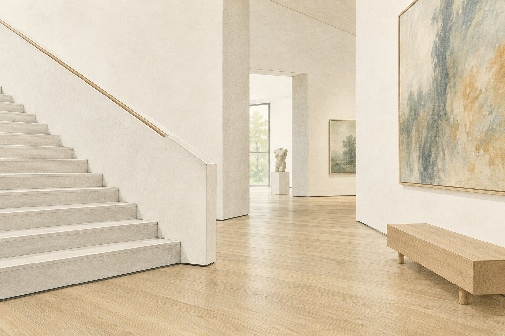

# 계단 아래의 작은 틈이 건물을 가볍게 만든다

*시카고 미술관에서 바닥을 한 번 더 보는 방법*

Culture · Architecture

> 출처 대조와 공개 게시 승인을 마친 이야기입니다. 실제 게시 여부는 사이트 배포 상태를 따릅니다.

*KnowledgeWalk 제작 · AI 설명용 삽화. 실제 유물·작품·건축물·전시 배치를 재현한 사진이나 역사적 증거가 아닙니다.*

큰 건물을 보고 가볍다는 느낌을 받을 때가 있다. 실제 무게가 가벼울 리는 없는데 벽이나 계단이 살짝 떠 있는 것처럼 보이는 순간이다. 시카고 미술관의 모던 윙 설명에는 그 느낌을 만드는 작은 틈이 등장한다.

설계자는 이탈리아 건축가 렌초 피아노다. 미술관이 소개하는 그의 생각 가운데 하나는 건물이 떠오르듯 보이게 하는 제로 그래비티라는 표현이다. 말은 거창하지만 눈여겨볼 곳은 의외로 발밑이다.

## 벽이 바닥과 만나는 자리

기관의 글은 벽 아랫부분에 약 1인치의 드러난 틈이 있다고 설명한다. 약 2.5센티미터다. 벽 전체에 비하면 작은 높이지만 바닥과 벽 사이에 가느다란 선을 만든다.

벽은 당연히 바닥에 닿아 있을 것이라고 생각하기 쉽다. 그 만나는 자리를 조금 다르게 처리하면 덩어리의 느낌도 달라질 수 있다. 천장만 올려다보던 시선을 아래로 내리는 이유가 생긴다.

## 의자와 받침도 함께

글에 따르면 피아노가 디자인한 벤치도 작은 받침 위에 놓여 바닥에서 조금 올라가 있다. 조각의 받침대와 단 역시 바닥에서 떨어져 보이도록 했으며, 큰 계단 아래에도 틈이 있다.

벽 하나에만 넣은 우연한 장식이 아니라 여러 부분에서 이어지는 선택이었다. 다른 모양의 가구와 구조물이 비슷한 방식으로 바닥을 만나면 공간 전체에도 공통된 인상이 만들어진다.

## 건축을 보는 작은 출발점

물론 건물이 실제로 공중에 매달렸다는 뜻은 아니다. 기관 글은 눈에 보이는 접점과 틈이 가벼운 인상을 주는 방식을 설명한다. 구조를 지탱하는 원리를 전부 알아야만 즐길 수 있는 대목은 아니다.

다음에 새로운 건물에 들어가면 창문이나 멋진 천장을 본 뒤 의자 밑도 한 번 보자. 바닥과 만나는 선을 어떻게 다뤘는지 살피는 것이다. 건축가의 생각이 가장 작은 그림자처럼 남아 있는 자리일 수 있다.

## 이야기의 바탕이 된 자료

- [시카고 미술관 — Secrets of the Modern Wing](https://raw.githubusercontent.com/art-institute-of-chicago/api-data/main/json/articles/14.json) · 확인일 2026-10-28
  - 확인 내용: 렌초 피아노의 제로 그래비티 개념에 대한 기관 설명 / 벽 하부 1인치 틈 / 작은 받침의 벤치·조각 받침·주계단 하부 틈

---

[같은 소주제의 이야기](README.md) · [전체 서가](../../README.md)
