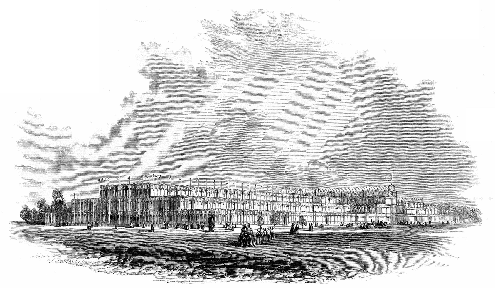

# 수정궁 — 온실의 생각으로 거대한 전시장을 만들다

*1851년 런던에서 유리와 철, 반복되는 부품이 만난 건축*

Culture · Architecture

> 자료 대조를 마친 검토용 이야기입니다. 공개 게시 승인은 아직 받지 않았습니다.

*Peter Berlyn / Charles Fowler, The Crystal Palace 수록 General View of the Building from the South-West · Project Gutenberg · Public Domain. 당대의 도판이며 현대 사진이나 AI 복원도가 아닙니다. 원본 파일 그대로 사용했습니다.*

[이미지 출처·제작 근거](https://raw.githubusercontent.com/GITenberg/The-Crystal-PalaceIts-Architectural-History-and-Constructive-Marvels_44192/master/44192-h/images/p40f.jpg) · Public Domain

거대한 전시장을 세워야 하는데 시간이 넉넉하지 않다. 돌을 한 장씩 쌓아 두꺼운 벽을 만드는 방식으로 가능할까. 1851년 런던 만국박람회를 위한 건물에서 조지프 팩스턴이 가져온 중요한 경험은 궁전보다 온실에 가까웠다.

철과 유리로 이루어진 수정궁은 크기만으로 놀라운 건물이 아니었다. 같은 부품을 반복하고 짧은 시간 안에 조립할 수 있도록 생각한 과정도 중요했다. 당시의 『수정궁: 건축의 역사와 건설의 경이』를 바탕으로 그 과정을 읽는다.

## 01. 박람회에 필요한 것은 오래된 궁전과 달랐다

만국박람회에는 많은 물건과 사람이 들어갈 넓은 실내가 필요했다. 전시품을 보고 이동할 빛과 통로가 있어야 했고, 일정 안에 지어야 했다. 영원히 남길 왕실 건물과는 다른 과제가 있었다. 임시적인 목적에 맞는 건축이라는 조건이 중요해진 것이다.

여러 설계와 비용을 비교하는 과정에서 건물을 어떤 모양으로 만들지뿐 아니라 어떻게 실제로 지을지가 함께 논의되었다. 웅장한 정면을 그리는 것만으로 사업이 끝나지 않는다. 제작과 운송, 설치의 순서를 감당할 수 있는 계획이어야 한다. 건축의 이야기는 도면 뒤의 공장과 현장으로 넓어진다.

## 02. 식물을 기르던 집에서 가져온 경험

팩스턴은 유리로 된 식물 재배 공간을 만들고 개선해 온 사람이었다. 두껍고 무거운 구조는 실내를 어둡게 하고, 지붕과 유리 사이의 틈으로 비가 들기도 했다. 식물을 위해 빛과 물을 다루는 실무적인 문제가 새로운 구조를 생각하게 했다.

자료에는 팩스턴 자신이 이런 경험을 설명하는 대목이 들어 있다. 수정궁의 아이디어가 아무 배경 없이 한순간에 완성되었다고 보기는 어렵다. 작은 건축에서 여러 해에 걸쳐 다룬 문제가 훨씬 큰 전시장으로 옮겨 갔다. 다른 용도의 경험을 새 문제에 적용하는 능력이 드러난다.

## 03. 빛을 넣으면서 비는 밖으로 보내기

유리 지붕은 빛을 들이지만 그 위의 빗물도 처리해야 한다. 가벼운 틀을 쓰면 좋을 것 같아도 약해져서는 안 되고, 물이 새면 전시품과 관람객이 곤란해진다. 아름다운 투명함의 뒤에는 홈과 이음, 배수와 지지라는 구체적인 일이 있다.

이것은 건축을 기술 설명으로만 줄이자는 뜻이 아니다. 오히려 커다란 공간을 편하게 경험할 수 있는 이유를 보게 한다. 천장이 밝다는 감탄과 바닥이 젖지 않는 일은 같은 설계 안에서 해결해야 했다. 빛만 생각하거나 물만 생각해서는 그 공간이 유지되지 않는다.

## 04. 같은 부품이 여러 번 나온다

수정궁의 중요한 특징은 반복되는 단위였다. 기둥과 보, 유리와 틀을 일정한 규격으로 만들고 연결하면 매번 전혀 다른 조각을 현장에서 맞추는 일을 줄일 수 있다. 규모를 키우는 방법이 하나의 거대한 덩어리를 만드는 데에만 있지 않았던 것이다.

오늘의 눈으로는 대량생산과 조립이 당연해 보이지만, 그 부품들이 건축 전체의 리듬을 만든다는 생각은 여전히 흥미롭다. 반복은 단조로움일 수도 있지만 밝고 긴 공간을 만들 힘이 되기도 한다. 한 단위가 제자리를 찾을 때 많은 단위가 함께 이해되는 질서가 생긴다.

## 05. 유리의 크기는 설계와 따로 있지 않았다

유리를 원하는 크기로 아무 제한 없이 만들 수 있는 것은 아니다. 실제 제조가 가능한 판의 크기와 틀의 배치, 자재의 공급이 건물의 모양과 연결된다. 건축가는 그림을 그리고 다른 사람은 그대로만 만들면 된다는 분업의 상상보다 훨씬 긴 대화가 필요했다.

자료가 철과 유리의 생산, 설치 장비와 작업 순서를 자세히 다루는 이유도 여기에 있다. 보이지 않는 제조업의 능력이 관람객이 보게 될 실내의 조건을 정한다. 완성된 건물의 단순함은 과정이 단순했다는 뜻이 아니라, 많은 조건을 하나의 반복 가능한 방식으로 정리했다는 결과다.

## 06. 공원의 나무가 건물 안으로 들어온다

건설 부지의 큰 나무들을 둘러싼 문제도 있었다. 수정궁의 높게 솟은 가로 공간은 그 나무들을 안에 두는 방식과 연결된다. 건물을 짓기 전에 그곳에 이미 있던 것을 무조건 없애기보다 설계 안에 포함한 것이다. 유리의 거대한 공간에서 살아 있는 나무가 함께 보이는 풍경이 만들어진다.

이 장면은 기술이 자연을 완전히 정복했다는 선언과는 조금 다르게 읽을 수 있다. 온실의 경험에서 출발한 건물 안에 다시 나무가 들어온다. 물론 그 한 선택만으로 사업 전체가 오늘의 환경 기준에 맞았다고 말할 수는 없다. 다만 남아 있던 조건이 설계를 바꾸는 한 사례다.

## 07. 옛 도판은 무엇을 보여 줄까

이 글의 그림은 당시 건축서에 실린 수정궁의 외관 도판이다. 실제 사진이나 AI가 만든 복원도가 아니다. 길게 반복되는 기둥과 유리, 높이가 달라지는 부분을 눈으로 따라가면 글로 읽던 단위와 규모의 관계가 조금 더 쉽게 느껴진다.

동시에 이런 책은 당대의 성취를 크게 기념하는 자료이기도 하다. 저자의 감탄을 그대로 모든 사람의 경험으로 생각할 필요는 없다. 완공의 영광과 현장의 노동, 박람회가 보여 주려 한 세계 사이에는 다른 질문도 있을 수 있다. 자료의 시선을 알고 읽으면 도판이 더 풍부해진다.

## 08. 규모보다 오래 남은 생각

수정궁의 이야기는 유리로 아주 큰 건물을 지었다는 사실만으로 끝나지 않는다. 시간이 촉박할 때 어떤 경험을 가져왔고, 부품의 크기와 물의 길을 어떻게 하나의 공간으로 묶었는지가 중요하다. 눈에 띄는 아름다움과 반복되는 실무가 함께 만든 건축이었다.

옛 그림의 긴 벽을 다시 보자. 하나하나 다른 궁전 장식 대신 같은 단위가 이어진다. 그 반복 속에는 온실에서 기른 감각과 공장의 생산, 현장에서 조립한 손들이 들어 있다. 식물을 위한 작은 공간의 문제를 끝까지 들여다본 경험이 사람들을 위한 거대한 공간으로 자랐던 것이다.

## 이야기의 바탕이 된 자료

- [Peter Berlyn / Charles Fowler, The Crystal Palace: Its Architectural History and Constructive Marvels](https://raw.githubusercontent.com/GITenberg/The-Crystal-PalaceIts-Architectural-History-and-Constructive-Marvels_44192/master/44192-8.txt) · 확인일 2026-11-01
  - 확인 내용: 팩스턴의 온실 경험·시공사/자재 협의·짧은 건설 시간과 임시 건물의 목적 / 철/유리/반복 단위/유리판 크기/빗물과 이음·나무를 포함한 transept / 남서쪽에서 본 외관의 당시 도판. 저자의 산업 찬양과 기술 설명을 구분

---

[같은 소주제의 이야기](README.md) · [전체 서가](../../README.md)
