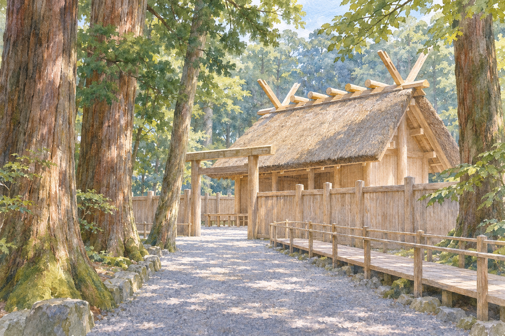

# 이세 신궁 — 새로 지은 건물에 오래된 시간이 남는 법

*신궁은 하나의 건물보다 넓다에서 시작하는 역사와 작품 읽기*

Culture · Architecture

> 자료 대조를 마친 검토용 이야기입니다. 공개 게시 승인은 아직 받지 않았습니다.

*AI 관련 장면 삽화 · 작품과 장소를 떠올리기 위한 상상 그림이며 실제 사진·배우 초상·정확한 복원이 아닙니다.*

오래된 건축이라면 처음의 재료가 많이 남아 있을수록 가치 있다고 생각하기 쉽다. 일본의 이세 신궁은 다른 질문을 던진다. 일정한 주기에 건물을 새로 짓는 전통 속에서, 무엇이 이어지면 같은 성소라고 할 수 있을까. 이곳의 역사는 나무의 나이와 전통의 나이가 반드시 같지 않음을 보여 준다.

## 01. 신궁은 하나의 건물보다 넓다

이세 신궁이라는 이름은 한 채의 전각만을 가리키지 않는다. 내궁과 외궁을 비롯한 여러 제의 공간과 숲, 길이 함께 관계를 이룬다. 내궁은 아마테라스와 연결되는 성소다. 신화와 제의의 의미를 가진 장소를 단순한 옛 목조건축 전시장으로 보는 데에는 한계가 있다.

방문객이 걸어 들어가는 길과 물, 숲도 경험의 일부다. 건물 정면의 사진 한 장은 이런 접근 과정을 충분히 전달하지 못한다. 어디까지 갈 수 있고 어떤 곳은 멀리서 바라보게 되는지에 따라, 공간을 받아들이는 방식이 달라진다.

## 02. 스무 해의 주기로 다시 짓기

식년천궁은 정해진 주기에 건물을 새로 마련하고 신성한 대상을 옮기는 전통으로 알려져 있다. 이세에서는 흔히 스무 해라는 주기가 핵심으로 설명된다. 다만 오랜 역사 내내 어떤 중단도 없었다고 말해서는 안 된다. 전통에도 전쟁과 경제적 조건이 영향을 주었다.

이 재건을 낡은 집을 새집으로 바꾸는 실용적 수선만으로 설명하면 제의의 의미를 놓친다. 시간에 맞추어 준비하고 옮기는 행위 자체가 전통의 일부다. 중요한 것은 새 건물이라는 결과뿐 아니라 그 결과에 이르는 절차를 함께 이어 간다는 점이다.

## 03. 단순한 모양이 요구하는 정교함

나무와 지붕, 지붕 위로 뻗는 부재는 강한 인상을 준다. 화려한 채색이나 복잡한 장식을 중심으로 감상하는 궁전과는 다른 방식으로 구조와 재료를 보게 한다. 겉모습이 간결하다고 제작 기술도 단순한 것은 아니다.

목재를 고르고 다듬고 맞추는 일에는 축적된 판단이 필요하다. 완성된 건물을 볼 때 잘 드러나지 않는 접합과 비례, 순서를 이해해야 한다. 단순해 보이는 형태를 일정한 수준으로 다시 만드는 일은 대충 비슷하게 모방하는 것과 다르다.

## 04. 기술은 사람을 거쳐 이어진다

건축이 수백 년 동안 서 있기만 하면 특정한 큰 공정을 경험하는 장인은 드물 수 있다. 주기적 재건은 여러 세대가 실제 작업을 함께 할 기회를 만든다. 이전에 배운 사람이 다음 작업에서 경험을 전하는 관계가 생기는 것이다.

기술은 도면과 글에 모두 담기지 않는다. 재료의 상태를 판단하고 손으로 힘을 조절하는 능력도 있다. 이세의 재건은 건물을 보존하는 문제와 일을 할 줄 아는 사람을 이어 가는 문제가 서로 연결된다는 사실을 생각하게 한다.

반복은 매번 똑같은 시간을 복사하는 일과 다르다. 처음 작업에 참여하는 사람은 배우고, 여러 공정을 겪은 사람은 다음 세대를 지도한다. 같은 형태를 목표로 하는 작업 안에서도 참여자의 경험은 달라진다. 전통이 개인의 삶보다 길게 이어지는 과정은 이런 역할의 변화 속에서 이루어진다.

방문할 때에는 종교 시설의 접근 범위와 안내를 존중하는 태도도 중요하다. 가까이 들어가 모든 내부를 보지 않아도 길과 숲, 외부의 구조를 통해 장소를 경험할 수 있다. 보이지 않는 부분을 상상한 삽화는 실제 내부의 기록 사진과 구분해서 읽어야 한다.

## 05. 오래된 목재가 남기는 또 다른 관계

라프카디오 헌의 1904년 기록에는 재건 때 나온 목재와 가정에서 모시는 신성한 표지의 관계가 등장한다. 이는 신궁의 시간이 경내 안에서만 끝나지 않고 사람들의 집과 이어졌음을 보여 주는 오래된 증언이다. 당시 관찰을 오늘 모든 가정의 생활로 일반화할 수는 없다.

중심 성소와 멀리 있는 생활 공간 사이에는 물건과 사람의 이동이 있었다. 건물을 새로 짓고 남는 재료도 의미 없는 폐기물로만 이해되지 않았다. 재료가 쓰이는 자리와 종교적 의미가 달라질 수 있다는 점이 흥미롭다.

## 06. 순례를 함께 준비한 마을

헌은 마을에서 대표를 보내거나 비용을 모아 순례를 준비하는 모습도 기록했다. 이런 기록은 순례가 언제나 개인 한 사람의 자발적인 여행만은 아니었음을 보여 준다. 길을 떠나는 사람 뒤에 공동체의 돈과 기대가 놓일 수 있었다.

다만 그의 글에는 당시의 제도와 일본 사회를 넓게 일반화하는 시선도 섞여 있다. 한 시대의 외국인 기록을 일본인 전체의 변하지 않는 신앙으로 읽어서는 안 된다. 구체적인 관찰은 참고하되 그가 보지 못한 차이와 변화도 남겨 두어야 한다.

## 07. 전통의 나이는 어디에 있을까

이세를 이해할 때에는 이 목재가 얼마나 오래되었는가와 이 일을 얼마나 오래 이어 왔는가를 나누어 물어 보자. 두 질문은 모두 중요하지만 같은 답을 요구하지 않는다. 오래된 물질을 지키는 보존과 기술과 절차를 되풀이하는 전승은 다른 가치를 가질 수 있다.

새로 지었다는 사실만으로 역사가 사라지는 것도, 같은 형식을 반복한다는 이유로 시간이 멈추는 것도 아니다. 준비에 참여하는 사람과 재료를 얻는 조건은 시대마다 달라진다. 유지와 갱신을 대립시키지 않고 함께 생각할 수 있는 사례다. 이세 신궁은 전통을 완성된 물건보다 계속 수행해야 하는 일로 바라보게 한다.

## 이야기의 바탕이 된 자료

- [Lafcadio Hearn, Japan: An Attempt at Interpretation (1904)](https://raw.githubusercontent.com/GITenberg/Japan-An-Attempt-at-Interpretation_5979/master/5979.txt) · 확인일 2026-11-06
  - 확인 내용: 이세·20년 재건·목재와 가정의 표지·마을 공동 순례·장인. 1904년 기록을 현대 전체의 신앙으로 일반화하지 않음

---

[같은 소주제의 이야기](README.md) · [전체 서가](../../README.md)
