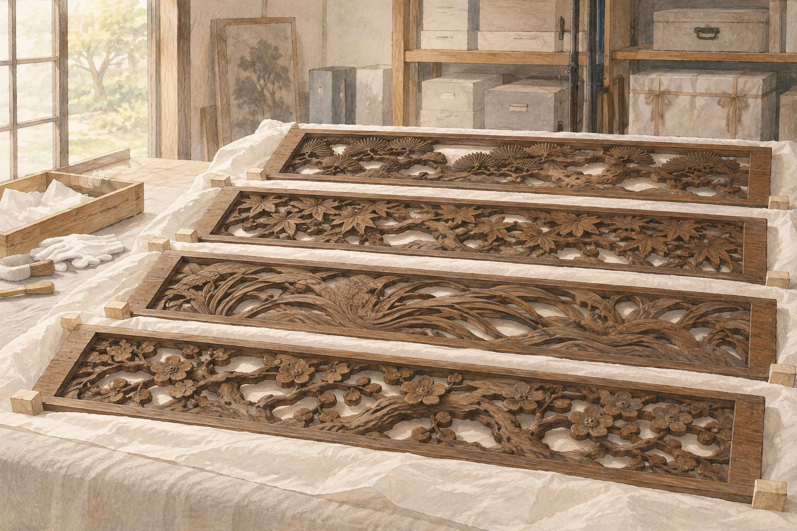

# 일본의 나무 장식은 관람석 아래에서 발견됐다

*박람회 건물에서 미술관으로 이어진 네 조각*

Culture · Architecture

> 출처 대조와 공개 게시 승인을 마친 이야기입니다. 실제 게시 여부는 사이트 배포 상태를 따릅니다.

*KnowledgeWalk 제작 · AI 설명용 삽화. 실제 유물·작품·건축물·전시 배치를 재현한 사진이나 역사적 증거가 아닙니다.*

운동장 관람석 아래에서 일본 건축 장식이 나온다면 조금 엉뚱하게 들린다. 하지만 시카고 미술관이 소개하는 네 점의 목조 장식에는 그런 시간이 있었다. 한때 박람회 건물에 달렸던 물건들이다.

이 장식은 란마라고 부르는 목조 건축 부재다. 문 위쪽 공간에 놓이는 장식이라고 생각하면 이해하기 쉽다. 처음부터 유리장 안에 전시하려고 만든 조각은 아니었다.

## 시카고에 세운 일본식 건물

1893년 시카고 만국박람회에서 일본은 피닉스 홀이라는 국가 전시관을 세웠다. 미술관 설명은 이 건물이 교토 근교의 11세기 사찰을 본떴다고 소개한다. 다른 전시관들과는 구별되는 일본식 건물이었다.

네 점의 목조 장식도 그 전시관을 위해 만들어졌다. 건물의 일부였으니 사람들은 조각 하나를 따로 보기보다 그 아래를 지나가며 공간 전체를 만났을 것이다. 이것은 건축 부재의 자리를 떠올려 보는 방식이다.

## 건물이 사라진 뒤 남은 것

박람회가 끝난 뒤 일본 정부는 전시관을 시카고시에 기증했다. 그러나 건물은 1945년과 1946년의 화재로 훼손되어 철거되었다고 한다. 미술관은 네 장식이 남은 부재였다고 설명한다.

그 뒤 이 물건들은 솔저 필드의 관람석 아래에 보관되었고, 잊힌 채 지내다가 1973년에 발견되었다. 건축 장식의 다음 주소가 사찰도 박물관도 아닌 경기장이었다는 점이 뜻밖이다.

## 다시 한자리에 모으는 일

발견 뒤에는 두 점씩 다른 기관으로 나뉘었다가 네 점 모두 시카고 미술관으로 모였다. 기관이 남긴 글은 이 장식들을 함께 보존하고 보여 주려던 과정을 소개한다. 오래전의 전시 준비를 기록한 글이므로 지금의 전시실 안내와는 구분해서 읽으면 된다.

건물은 사라져도 그 일부가 다른 시간을 살아갈 수 있다. 일본식 전시관과 미국의 운동장, 미술관을 이어 주는 것은 네 조각의 나무였다. 물건의 이력은 뜻밖의 장소에서 한 장 더 늘어나기도 한다.

## 이야기의 바탕이 된 자료

- [시카고 미술관 — Transoms from the Ashes of Phoenix Hall](https://raw.githubusercontent.com/art-institute-of-chicago/api-data/main/json/articles/34.json) · 확인일 2026-10-28
  - 확인 내용: 1893년 일본 전시관과 교토 근교 사찰을 본뜬 구성 / 화재·철거 뒤 네 란마 보존 / 솔저 필드 관람석 아래 보관과 1973년 발견 / 분산 뒤 네 점이 미술관으로 모인 경위

---

[같은 소주제의 이야기](README.md) · [전체 서가](../../README.md)
