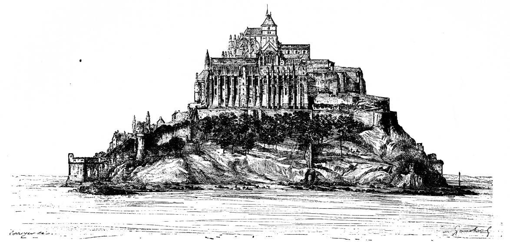

# 몽생미셸 — 작은 바위 위에 수도원의 하루를 쌓다

*조수와 바위, 성당 아래의 방과 순례자의 마을*

Culture · Architecture

> 출처 대조와 공개 게시 승인을 마친 이야기입니다. 실제 게시 여부는 사이트 배포 상태를 따릅니다.

*Saint-Michel et le Mont-Saint-Michel, Fig.25, 북쪽에서 본 몽생미셸 · Public Domain. 출판 당시의 전경을 그린 역사 도판으로 현재 현장 사진과 구분합니다.*

[이미지 출처·제작 근거](https://raw.githubusercontent.com/GITenberg/Saint-Michel-et-le-Mont-Saint-Michel_68245/master/68245-h/images/ill_040.jpg) · Public Domain · 저작권 만료 작품 및 역사 출판 자료

바다와 모래 위로 솟은 몽생미셸은 멀리서 보면 하나의 성처럼 보인다. 그러나 안에는 수도원과 성당, 마을과 방어 시설, 순례자가 다니던 길이 겹쳐 있다. 프랑스 노르망디의 작은 바위섬이 왜 이런 모습을 갖추게 되었는지, 윤곽 안에 들어 있는 여러 사람의 하루를 생각하며 읽어 보자.

## 01. 바다가 보인다는 것과 섬이라는 것은 다르다

몽생미셸 주변의 풍경은 조수에 따라 달라진다. 물이 물러나면 넓은 모래와 갯벌이 드러나고 물이 차면 바위의 고립감이 커진다. 먼 곳에서 보이는 한 장면을 이 장소의 항상 같은 상태로 생각해서는 안 된다.

이 변화는 아름다운 배경을 넘어 접근과 이동의 조건이었다. 순례자와 물자를 실은 사람들이 어떻게 도착하고 돌아가는지에 영향을 주었기 때문이다. 여기서 역사적인 길을 설명하는 일은 오늘날 갯벌을 혼자 건너도 된다는 안내와 다르다. 실제 이동은 현재의 안내와 통제에 따라야 한다.

## 02. 성 미카엘의 이름과 수도원의 시작

이름의 몽은 산이나 언덕을, 생미셸은 성 미카엘을 가리킨다. 오베르 주교가 천사의 지시를 받았다는 전승이 성소의 기원과 연결된다. 전승 속 기적과 이후의 건축·제도에 관한 역사를 구분하면 이야기를 더 정확하게 읽을 수 있다.

10세기에는 베네딕도회 수도 공동체가 자리 잡으며 장소의 성격이 뚜렷해졌다. 이후 건물은 여러 세대에 걸쳐 커지고 달라졌다. 오늘 보이는 수도원을 한 사람의 청사진이 한 번에 실현된 결과로 상상하기보다, 덧대고 고친 시간의 축적으로 보는 편이 알맞다.

건물의 시대를 구분하면 양식의 차이도 단순한 장식 취향 이상의 의미를 갖는다. 구조를 보강하거나 무너진 곳을 새로 만들면서 각 시대의 기술이 더해졌다. 오래되었다는 말 안에는 같은 모습으로 버틴 시간과 달라지며 살아남은 시간이 함께 있다.

## 03. 꼭대기의 성당 아래에는 무엇이 있을까

바위의 넓이는 제한되어 있고 경사는 가파르다. 성당처럼 큰 공간을 위에 두려면 아래의 바위와 받침 구조, 그 주변의 여러 방이 함께 작동해야 한다. 건물은 평지에서 옆으로 늘어나는 대신 높낮이를 이용해 복잡하게 겹쳐진다.

겉에서 보이는 거대한 벽은 어느 한 방의 벽만이 아닐 수 있다. 위에는 예배의 공간, 다른 높이에는 공동생활과 식사, 저장과 출입의 공간이 놓인다. 단면도를 떠올리며 여러 층이 어떤 무게와 활동을 지탱하는지 생각하면 성 같은 외양이 다른 의미를 갖는다.

## 04. 메르베유에는 생활의 질서가 쌓여 있다

북쪽의 고딕 수도원 건물군은 메르베유라는 이름으로 알려졌다. 흔히 경이로움이라는 뜻과 연결되는 이름이다. 높은 곳의 회랑과 식당, 아래쪽의 여러 홀과 실무 공간을 보면 수도원의 하루가 기도만으로 이루어지지 않았음을 알 수 있다.

사람들은 먹고 공부하고 손님을 맞았으며 물건을 보관했다. 건물 안의 장식과 동선은 그런 행위를 나누고 연결한다. 아름다운 기둥 하나만 감상하는 데서 더 나아가 그곳이 누구의 이동을 허용하고 어느 활동을 품었는지 묻는 것이 건축을 읽는 방법이다.

순례 역시 한 사람의 마음속 신앙으로만 이루어지지 않았다. 먼 곳에서 오는 길과 먹을 것, 잠자리와 안내가 필요했다. 높은 성소를 가능하게 한 것은 아래에서 반복된 평범한 일들이기도 했다. 마을의 길을 함께 보아야 할 이유다.

## 05. 회랑의 정원은 먼 바다와 다른 속도로 보인다

회랑은 지붕 아래 통로와 가운데의 열린 공간을 함께 가진다. 기둥과 아치의 반복을 따라 걷다 보면 멀리서 보던 수도원의 압도적인 덩어리와 다른, 작고 반복적인 리듬이 생긴다. 밖의 광대한 만과 안의 제한된 공간이 대비된다.

이곳을 오늘날의 조용한 명상 장소로만 낭만화할 필요는 없다. 공동체의 규율과 반복되는 생활 속에 놓인 건축이었기 때문이다. 누가 언제 이 길을 지났을지 떠올리면 정원의 아름다움도 생활의 시간과 연결된다.

## 06. 순례지이면서 방어의 장소였다

몽생미셸에는 수도자만 있었던 것이 아니다. 순례자의 방문은 숙박과 음식, 물건을 파는 마을의 활동과 이어졌다. 높은 성소로 올라가는 길은 종교적 여정인 동시에 돈과 물자가 움직이는 길이었다. 섬의 실루엣 아래에 이런 생활이 들어 있었다.

전쟁의 시대에는 방어 시설도 중요해졌다. 특히 백년전쟁의 맥락에서 굳건한 요새라는 기억이 더해졌다. 하지만 성벽이 있다는 이유로 처음부터 군사 기지였다고만 설명하면 성소와 수도원, 마을이 만든 긴 역사를 놓친다.

오래된 도판 가운데에는 실제 관찰과 복원 상상을 섞은 그림도 있다. 이 글은 출판 당시 북쪽 전경으로 표기된 도판을 사용했다. 출처의 시점과 성격을 확인하면 현재 모습과 다른 부분을 무조건 과거의 사실로 받아들이는 일을 줄일 수 있다.

## 07. 수도원과 감옥, 복원된 유산의 시간

프랑스혁명 이후에는 감옥으로 사용된 시기도 있다. 같은 건물의 문과 벽이 다른 제도 아래에서 전혀 다른 의미를 갖게 된 것이다. 오늘날의 유산은 중세에서 그대로 멈춘 공간이 아니라 이후의 전용과 복원을 함께 겪은 장소다.

함께 실은 이미지는 옛 출판물의 실제 몽생미셸 도판이며 현대 방문 사진은 아니다. 바위 위에 층층이 쌓인 외곽선을 본 뒤 성당의 아래와 회랑의 바깥, 마을의 안쪽을 상상해 보자. 경관을 이루는 덩어리 안에서 서로 다른 삶과 시간이 조금씩 갈라져 보인다.

## 이야기의 바탕이 된 자료

- [Henry Adams, Mont-Saint-Michel and Chartres — Mont-Saint-Michel](https://raw.githubusercontent.com/GITenberg/Mont-Saint-Michel-and-Chartres_4584/master/4584.txt) · 확인일 2026-11-06
  - 확인 내용: 성 미카엘·바위/조수/순례·높은 성당과 아래 구조·로마네스크/고딕·수도원 생활·여러 건축 시기
- [Saint-Michel et le Mont-Saint-Michel — histoire et architecture](https://raw.githubusercontent.com/GITenberg/Saint-Michel-et-le-Mont-Saint-Michel_68245/master/68245-0.txt) · 확인일 2026-11-06
  - 확인 내용: 오베르 전승과 수도원 기원·시대별 조성·메르베유/회랑/식당·마을과 방어·감옥 전용·Fig.25 북쪽에서 본 당시 전경 도판. 기적은 전승으로, 복원 상상도는 실제 관찰과 구분

---

[같은 소주제의 이야기](README.md) · [전체 서가](../../README.md)
