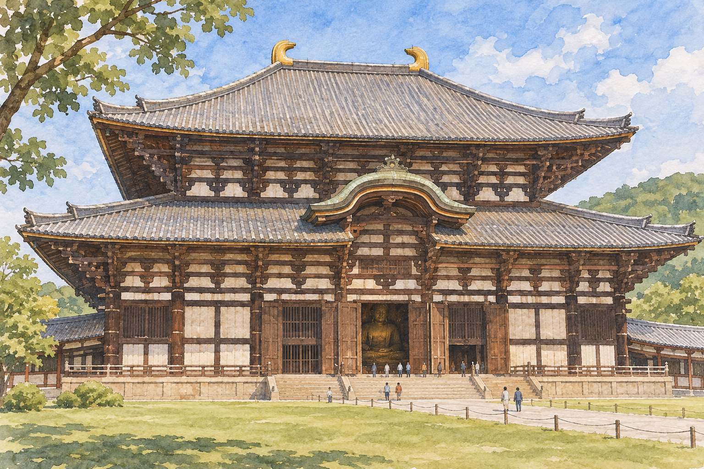

# 나라의 도다이지 — 거대한 불상에 담긴 국가의 바람

*쇼무의 발원과 752년 개안, 불상과 건축을 둘러싼 사람들*

Culture · Architecture

> 자료 대조를 마친 검토용 이야기입니다. 공개 게시 승인은 아직 받지 않았습니다.

*AI 이야기 장면 삽화 · 작품과 장소를 떠올리기 위한 그림이며 실제 사진·배우 초상·정확한 복원이 아닙니다.*

일본 나라의 도다이지에서는 건물의 크기부터 몸으로 느끼게 된다. 큰 목조 전각 안에 거대한 불상이 자리한다. 처음에는 얼마나 큰가라는 질문이 앞서지만 곧 다른 궁금증이 생긴다. 왜 이만한 규모의 불상을 만들려 했을까. 누가 그 일을 계획하고 무엇을 기대했을까.

도다이지의 역사는 불교 미술과 국가 운영이 만난 8세기의 세계로 이어진다. 신앙의 대상인 불상은 동시에 많은 자원과 노동을 모은 결과였다. 감탄할 만한 크기에서 출발해 그 안에 담긴 정치와 기술, 이후의 시간을 함께 읽어 보자.

## 01. 나라가 정치와 종교의 중심이던 시기

8세기의 나라는 왕실과 관료 조직이 모인 중요한 중심지였다. 중국 대륙과 한반도를 통해 들어온 지식과 제도, 불교의 여러 전통이 일본의 권력과 문화 속에서 새롭게 자리 잡았다. 외부의 것을 단순히 복사한 공간이라기보다 그것을 자기 체계와 결합한 곳이었다.

오늘의 국경을 당시의 이동에 그대로 적용하지 않는 것이 좋다. 사람과 경전, 공예의 기술은 여러 경로를 거쳤다. 도다이지를 일본의 대표 사찰로 읽으면서도 그 바탕에 국경을 넘는 교류가 있었다는 사실을 함께 보아야 한다. 한 장소의 문화는 고립된 채 자라지 않았다.

## 02. 쇼무의 발원은 무엇을 바랐을까

쇼무 천황은 거대한 불상 조성을 추진했다. 그 배경에는 불교의 힘을 통해 국가의 안정과 평안을 바라는 생각이 있었다. 오늘의 관람객에게는 유산과 예술이지만 당시에는 실제로 세계에 영향을 줄 수 있는 신앙의 행위였다. 정치와 종교를 서로 먼 영역으로 나누기 어려운 시대다.

왕실의 기원이라고 해서 개인적인 마음만으로 설명되지는 않는다. 지방 사찰을 포함한 불교의 조직과 국가의 질서가 연결되었다. 큰 불상은 한 사람의 깊은 믿음을 보여 주면서 동시에 그 믿음이 공적인 사업이 되는 과정을 드러낸다. 크기에는 이런 제도적 배경도 들어 있다.

## 03. 거대한 청동불은 한 번의 손기술로 완성되지 않는다

큰 청동불을 만들려면 재료를 모으고 주조하며 여러 부분을 맞추는 기술이 필요했다. 작은 불상을 크게 확대하는 것만으로 해결되는 일이 아니다. 크기가 바뀌면 무게와 작업의 방법, 실패했을 때의 부담도 달라진다. 종교적 뜻을 가진 사업은 구체적인 기술의 문제를 만나야 했다.

이때 화려한 완성품만 보면 재료를 마련하고 현장에서 일한 사람들은 잘 보이지 않는다. 국가가 큰 자원을 모을 수 있었다는 사실과 그 일을 수행한 노동은 함께 생각해야 한다. 거대한 불상은 신앙의 이미지이면서 많은 사람의 일이 집중된 물질이기도 했다.

## 04. 752년 눈을 여는 의례

불상과 관련된 중요한 사건은 752년의 개안 의례다. 눈을 연다는 표현은 단순히 완성품의 덮개를 벗기는 행사를 넘어 종교적 의미를 갖는다. 만든 물건을 예배의 대상으로 대하는 과정에서 의식이 중요한 역할을 했다. 제작의 완료와 신앙적 시작은 서로 관련되면서도 다르다.

왕실과 여러 지위의 사람들이 참여한 큰 행사는 불상을 개인이 따로 감상하는 조각과 다른 자리에 놓는다. 공동체가 함께 보며 뜻을 확인하는 사건이었다. 건물과 불상의 역사를 연대만으로 설명하지 않고 어떤 행위가 그 주위에서 이루어졌는지 함께 보아야 하는 이유다.

## 05. 불상과 대불전을 함께 바라보기

거대한 불상은 그것을 둘러싼 공간과 함께 경험된다. 문을 통과해 안으로 들어가는 과정, 빛과 그림자의 차이, 사람 몸과 비교되는 크기가 감상에 영향을 준다. 불상 사진 한 장과 전각 안에 서 있는 경험이 다른 이유다. 건축은 조각의 배경만이 아니다.

불상의 표면만 보다가 전각의 지지 구조와 지붕, 열린 공간으로 눈을 옮겨 보자. 무엇을 담기 위해 이만한 공간이 필요했는지 생각하게 된다. 조각과 건축을 별개의 항목으로만 나누지 않을 때 거대한 종교 공간이 사람에게 주는 느낌도 더 잘 이해할 수 있다.

사람의 얼굴과 비교되는 불상의 큰 얼굴, 그 앞에서 움직이는 작은 몸의 차이를 느껴 보자. 규모를 숫자로 아는 것과 자기 몸을 기준으로 경험하는 것은 다르다. 종교 공간은 그 차이를 감각적으로 드러내기도 한다.

## 06. 8세기의 시작과 오늘의 모습 사이

오래된 목조 사찰은 화재와 손상, 수리와 재건의 시간을 거쳤다. 그래서 오늘 눈앞에 있는 모든 요소를 8세기의 손길이 그대로 멈춘 모습으로 생각해서는 안 된다. 시작의 연도와 현존하는 물질의 역사는 나누어 보아야 한다.

이 차이가 유산의 가치를 줄이지는 않는다. 오히려 그 장소를 계속 남기려 한 후대 사람들의 일이 보인다. 오래되었다는 것은 아무도 손대지 않았다는 뜻만이 아니다. 고치고 유지하고 다시 의미를 부여한 시간이 쌓였다는 뜻이기도 하다. 도다이지의 역사에는 그 긴 이어짐이 있다.

## 07. 큰 불상 앞에서 작은 사람의 일을 생각하다

도다이지의 규모는 왕실의 힘과 종교적 이상을 느끼게 한다. 그러나 감탄이 거기에만 머물 필요는 없다. 외부에서 온 지식과 지역의 선택, 주조의 기술과 반복되는 보존이 한 장소에 모여 있었다. 세계를 설명하는 믿음이 실제 건물과 물질로 만들어진 것이다.

다음에 나라의 대불을 볼 때에는 거대한 얼굴 옆에 그것을 바라보고 만들고 지켜 온 사람들을 떠올려 보자. 불상은 고요하게 앉아 있지만 그 주변의 역사는 계속 움직였다. 신앙과 국가, 기술과 사람의 시간을 함께 읽으면 사찰의 큰 공간이 더 구체적인 이야기를 들려준다.

## 이야기의 바탕이 된 자료

- [F. Brinkley and Dairoku Kikuchi, A History of the Japanese People — Nara, Religion and Politics](https://raw.githubusercontent.com/GITenberg/A-History-of-the-Japanese-People--13-From-the-Earliest-Times-to-the-End-of-the-Meiji-Era_27604/master/27604-8.txt) · 확인일 2026-11-05
  - 확인 내용: 나라 시대의 대륙 교류·쇼무의 발원·743년 조성 의도·주조·752년 개안·국가적 불교 조직·목조 사찰과 화재. 과장된 금속 중량과 모든 부분이 원형 그대로라는 설명은 사용하지 않음

---

[같은 소주제의 이야기](README.md) · [전체 서가](../../README.md)
