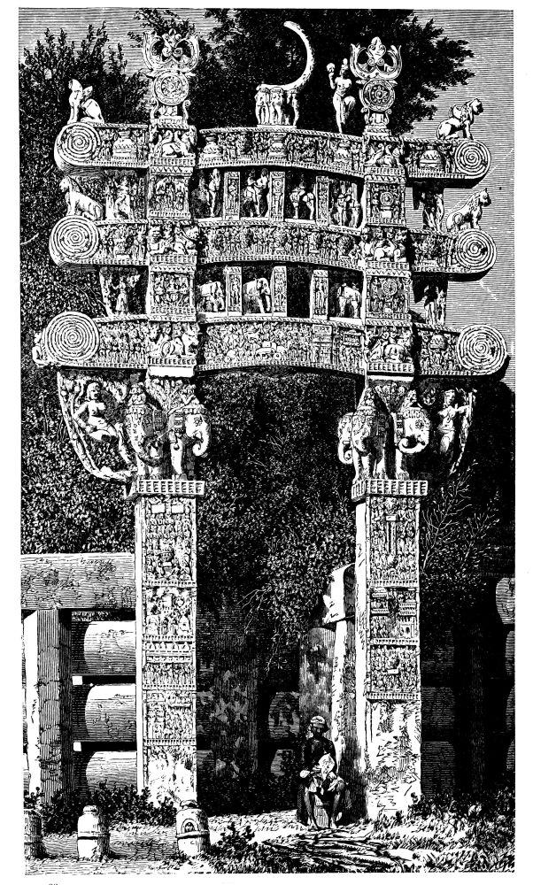

# 산치 대탑 — 들어가는 대신 주위를 도는 건축

*돔과 둘레길, 토라나의 조각으로 경험하는 불교 건축*

Culture · Architecture

> 출처 대조와 공개 게시 승인을 마친 이야기입니다. 실제 게시 여부는 사이트 배포 상태를 따릅니다.

*James Fergusson, History of Indian and Eastern Architecture, Fig. 33, Northern Gateway of Tope at Sanchi, from a photograph · Public Domain. 역사 출판 도판이며 현대 촬영이 아닙니다.*

[이미지 출처·제작 근거](https://raw.githubusercontent.com/GITenberg/History-of-Indian-and-Eastern-Architecture_61178/master/61178-h/images/ill_pg_096_lg.jpg) · Public Domain · 저작권 만료 작품 및 역사 출판 자료

종교 건축을 보면 문을 열고 내부로 들어가는 장면을 떠올리기 쉽다. 인도 산치의 대탑은 다른 방식으로 몸을 움직이게 한다. 둥근 덩어리와 둘레길, 조각으로 채운 문이 함께 경험을 만든다. 안에 어떤 방이 있는지 묻기 전에 그 주변에서 무엇을 하도록 했는지 살펴보자.

## 01. 돔처럼 보이지만 큰 실내의 지붕은 아니다

산치의 큰 둥근 형태는 예배당의 넓은 내부를 덮은 지붕과 다르다. 스투파는 사리와 기억, 신앙의 의미를 담은 기념 구조로 이해해야 한다. 겉의 모양만 보고 오늘의 공연장이나 성당 같은 실내를 상상하면 목적을 놓친다.

무엇이 보관되었는지를 아는 것과 그것을 모두 직접 보는 일도 같지 않다. 성스러운 대상을 둘러싼 공간을 경험하는 방법이 있었다. 건축의 기능을 방과 문으로만 설명할 수 없음을 보여 주는 출발점이다.

## 02. 한 왕의 한 번의 공사로 끝나지 않았다

산치의 초기 역사는 아쇼카와 연결되지만 지금 보이는 모든 요소가 그때 한꺼번에 완성되었다고 할 수는 없다. 규모와 표면, 둘레의 시설과 문에 여러 시기의 작업이 겹쳐 있다. 오래된 유적은 한 시대의 모습이 그대로 굳은 물건보다 긴 변화의 결과에 가깝다.

19세기 건축사가 제임스 퍼거슨도 산치의 구조와 문을 나누어 설명했다. 다만 당시의 정확한 연대 추정과 문화 평가를 모두 오늘의 확정 사실로 옮길 필요는 없다. 남은 형상에서 관찰할 수 있는 것과 후대 연구의 판단을 구별할 수 있다.

## 03. 둘레길이 사람의 방향을 정하다

난간과 둘레의 통로는 움직임의 범위를 만든다. 탑의 중심을 곧바로 통과하는 대신 그 주위를 따라 걷게 된다. 계단과 위쪽의 길도 높이와 동선을 나눈다. 가만히 서서 정면만 보는 경험과는 다르다.

사람이 움직이면 조각과 둥근 탑의 겹침도 계속 달라진다. 같은 구조가 다른 각도에서 반복해서 나타난다. 공간을 이해하는 데에는 눈뿐 아니라 걷는 몸과 시간이 필요하다. 건축의 의미가 한 장의 정면 사진으로 다 담기지 않는 이유다.

## 04. 문은 통과하는 틀보다 넓은 이야기판이다

토라나라고 부르는 문은 기둥과 가로 부재로 이루어져 조각을 담는다. 도시의 방어문처럼 안을 지키는 장치로만 이해하기 어렵다. 접근과 통과를 강조하면서 동시에 여러 장면을 바라보게 한다.

가로 부재가 겹치고 그 위아래로 형상들이 이어지면서 시선은 한곳에 멈추지 않는다. 멀리서는 문 전체의 윤곽을 보고 가까이서는 세부의 동물과 사람, 장식을 읽게 된다. 작은 조각과 큰 구조가 다른 거리의 관객을 함께 상대한다.

문은 기둥 사이에 비어 있는 부분도 갖는다. 조각으로 가득 찬 표면과 통과할 수 있는 빈 틀이 함께 있다는 점이 중요하다. 관객은 이야기를 바라보면서 동시에 그 아래를 지나는 사람이다. 그림을 벽에 걸어 멀리서만 보는 경험과는 다른 관계가 생긴다.

같은 조각도 보는 높이와 거리, 걷는 방향에 따라 먼저 눈에 들어오는 부분이 달라진다. 문을 단독 작품의 사진으로 떼어 놓으면 이런 몸의 조건이 줄어든다. 그래서 세부를 확대해 본 다음 탑과 문의 전체 관계로 다시 돌아가 볼 필요가 있다. 조각을 감상하는 일과 공간을 경험하는 일이 이곳에서는 서로 나뉘지 않는다. 건축은 서 있는 물체이지만 그 의미는 움직이는 사람과의 만남 속에서 이어진다. 이 점을 생각하면 장식이라는 말로 지나치던 부조도 활동의 일부로 읽힌다.

## 05. 나무와 빈자리도 인물을 말할 수 있다

산치의 부조에서는 나무나 자리, 여러 상징을 통해 불교의 이야기를 암시하는 장면을 볼 수 있다. 사람의 얼굴을 크게 보여 주는 방식만이 이야기를 전달하는 방법은 아니다. 무엇이 그 자리에 있고 무엇이 비어 있는지도 의미를 만든다.

이를 초기 불교 전체가 언제나 같은 규칙을 따랐다는 단정으로 넓힐 필요는 없다. 구체적인 장면과 표현을 살피는 것이 먼저다. 관객은 익숙한 상징과 이야기를 알고 있을수록 그 관계를 더 풍부하게 읽을 수 있었을 것이다.

## 06. 돌은 다른 재료의 기억을 남기기도 한다

난간과 문의 구성에는 목조 구조를 떠올리게 하는 형식이 보인다. 돌을 사용하면서도 다른 재료에서 익숙했던 짜임과 모양이 이어질 수 있다. 건축의 재료가 바뀌었다고 형태의 모든 생각이 새로 시작되는 것은 아니다.

퍼거슨의 도판은 이런 관계를 비교하는 데 도움을 준다. 다만 옛 도면과 사진에서 만든 재현은 오늘 현장의 표면을 그대로 보여 주는 현대 촬영이 아니다. 원자료의 시대를 표시하면 유적의 역사와 그것을 조사한 역사를 함께 읽을 수 있다.

## 07. 무엇을 향해 걷고 있었을까

산치 대탑을 볼 때에는 중앙의 크기와 문에 새긴 세부를 번갈아 보자. 다음에는 그 사이를 걸어가는 사람의 높이를 상상해 보아도 좋다. 중심을 직접 보지 못해도 주변에서의 행동이 의미를 가진다는 점이 드러난다.

이곳의 건축은 내부로 들어가야만 깊은 경험이 가능하다는 생각을 넓힌다. 돌의 덩어리와 길, 조각과 몸의 움직임이 함께 신앙의 장소를 만든다. 출입하지 못하는 중심을 둘러싼 행동에도 깊이가 있을 수 있다. 공간을 만든 사람이 무엇을 보게 하고 어떤 움직임을 유도했는지 묻게 된다. 산치는 눈에 띄는 기념물뿐 아니라 그 주위를 도는 시간까지 건축의 일부로 보게 한다.

## 이야기의 바탕이 된 자료

- [James Fergusson, History of Indian and Eastern Architecture — Sanchi](https://raw.githubusercontent.com/GITenberg/History-of-Indian-and-Eastern-Architecture_61178/master/61178-0.txt) · 확인일 2026-11-06
  - 확인 내용: 대탑/난간/둘레길/계단·여러 조성 시기·토라나/부조·상징·목조 형태와 석재·Fig.33 북문 도판. 옛 절대 연대와 인종적 설명을 현대 사실로 옮기지 않음

---

[같은 소주제의 이야기](README.md) · [전체 서가](../../README.md)
