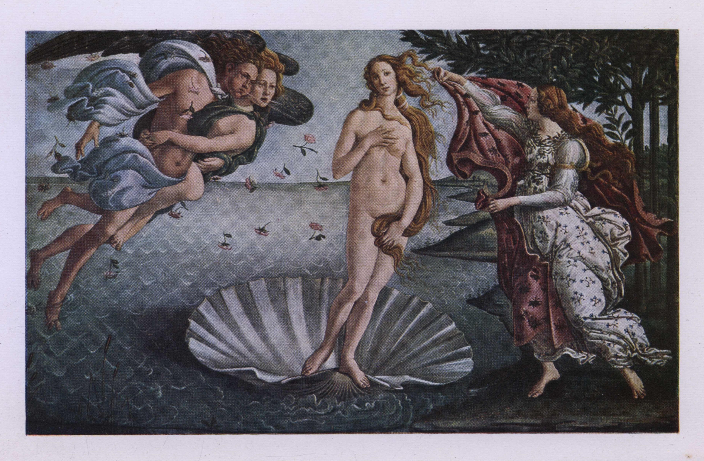

# 「비너스의 탄생」 — 조개 위의 여인은 어디로 가는가

*제목보다 먼저 바람의 방향을 따라 읽는 보티첼리*

Culture · Art

> 자료 대조를 마친 검토용 이야기입니다. 공개 게시 승인은 아직 받지 않았습니다.

*Sandro Botticelli (1445–1510), The Birth of Venus · Henry Bryan Binns, Botticelli, Plate I 수록 복제 도판 · Project Gutenberg · Public Domain. 원본 파일 그대로 사용했으며 옛 인쇄물의 색은 원화와 다를 수 있습니다.*

[이미지 출처·제작 근거](https://raw.githubusercontent.com/GITenberg/Botticelli_39942/master/39942-h/images/img-pl1.jpg) · Public Domain

거대한 조개 위에 한 여인이 서 있다. 왼쪽에서는 두 인물이 바람을 불고, 오른쪽에서는 다른 여인이 옷을 펼쳐 기다린다. 「비너스의 탄생」은 제목을 알고 보면 익숙한 명화지만, 화면을 천천히 살피면 뜻밖에 움직임이 많은 그림이다.

여기에 실은 이미지는 보티첼리의 실제 작품을 옛 미술서에 복제한 도판이다. 새로 만든 상상 그림이 아니다. 오래된 인쇄물의 색은 원화와 차이가 있을 수 있다. 설명은 헨리 브라이언 빈스의 『보티첼리』에서 작품을 다룬 대목을 참고하되, 저자의 개인적인 감상과 확인할 수 있는 화면을 구분했다.

## 탄생이라는 제목 다음의 순간

중앙의 여인은 로마 신화의 사랑과 아름다움의 여신 비너스다. 제목은 탄생을 말하지만 화면은 아기가 태어나는 장면이 아니다. 이미 성숙한 모습의 여신이 바다에서 육지로 다가오는 순간에 가깝다. 그림을 처음 보는 사람이 장면을 이해할 때 가장 먼저 풀어 두면 좋은 점이다.

거대한 조개 역시 자연 관찰 그림 속의 사실적인 배가 아니다. 신화의 바다에서 여신을 옮기는 받침이자, 화면의 중앙을 넓게 받쳐 주는 형태다. 사람이 실제로 저 조개 위에 설 수 있는지 따지기 시작하면 화가가 만든 다른 종류의 질서를 놓치게 된다.

## 왼쪽에서 오른쪽으로 부는 이야기

시선을 왼쪽으로 옮기면 바람을 부는 인물과 그에게 몸을 기대는 동반자가 보인다. 입술에서 나온 바람은 눈에 보이지 않지만 머리카락과 옷자락, 떠다니는 꽃을 움직인다. 바람을 직접 칠하는 대신 바람에 반응하는 것들을 그려 그 힘을 느끼게 한다.

그 힘을 따라 중앙으로 돌아오면 비너스의 머리카락도 한쪽으로 흘러간다. 다시 오른쪽에서는 꽃무늬 옷을 입은 인물이 큰 망토를 펼쳐 든다. 화면의 세 무리는 떨어져 서 있지만 같은 사건에 참여한다. 보내는 쪽, 도착하는 존재, 맞이하는 쪽이 이어지는 셈이다.

## 비너스는 왜 조금 비현실적으로 보일까

비너스의 몸은 안정된 조각상처럼 단단히 서 있기보다 길고 가늘게 흔들리는 느낌을 준다. 머리의 기울기와 어깨, 몸의 곡선이 이어지고 머리카락이 다시 선을 만든다. 해부학 교과서의 정확한 자세를 확인하는 눈으로만 보면 어색한 부분이 먼저 보일 수 있다.

하지만 보티첼리의 화면에서는 바로 그 긴 선이 중요하다. 인물의 무게보다 리듬을 앞세워, 바람과 몸과 옷이 한 선율 안에 있는 듯 보이게 한다. 비현실적인 비례를 모두 실수로 처리할 필요도, 반대로 어떤 과장도 천재의 암호라고 떠받들 필요도 없다. 화면에서 어떤 효과를 만드는지 먼저 보면 된다.

## 몸을 가리는 자세와 보는 사람

비너스는 손과 머리카락으로 몸의 일부를 가린다. 이런 자세는 고전 미술의 여신 표현을 떠올리게 한다. 완전히 감추지도, 아무렇지 않게 드러내지도 않는 동작이어서 보는 시선을 의식하게 만든다. 아름다움의 여신은 자신이 보이는 존재라는 사실과 함께 등장한다.

오른쪽의 망토도 같은 주제를 잇는다. 곧 몸을 덮을 옷이 준비되어 있지만 아직 닿지 않았다. 도착과 환영, 드러남과 가림 사이의 짧은 시간이 화면에 멈춰 있다. 큰 사건의 절정 대신 그 직전의 순간을 오래 보게 하는 것이 이 그림의 묘미다.

## 바다와 옷의 서로 다른 표정

바다의 작은 물결은 반복되고, 해안의 나무와 풀은 촘촘하게 자리를 잡는다. 인물의 머리카락과 직물에는 더 풍성한 곡선이 생긴다. 시선은 넓은 바탕과 섬세한 무늬 사이를 오간다. 멀리서 볼 때의 단순함과 가까이 볼 때의 장식성이 함께 있는 그림이다.

빈스는 이 작품에서 차가운 바다의 색과 붉은 옷의 대비에도 주목한다. 오늘의 복제 도판에서는 색을 정확히 판단하기 어려운 부분이 있지만, 넓은 바다와 오른쪽 직물이 서로 다른 덩어리를 만든다는 것은 확인할 수 있다. 색 이름을 외우기보다 화면이 어디에서 차분하고 어디에서 풍성해지는지 살펴보면 좋다.

## 신화를 그린 르네상스 화가

15세기 피렌체의 보티첼리에게 고대 신화는 새로운 그림의 언어가 되었다. 그렇다고 르네상스 사람들이 종교를 버리고 그리스·로마 이야기만 보기 시작했다는 뜻은 아니다. 보티첼리 자신도 종교화를 그렸다. 서로 다른 주제와 후원, 생각이 같은 시대 안에 함께 존재했다.

이 작품을 누가 어떤 대화 끝에 주문했는지, 여신의 얼굴이 정확히 누구를 닮았는지에는 널리 알려진 여러 설명이 붙는다. 그러나 흥미로운 이름이 등장한다고 모두 확정된 사실은 아니다. 모델의 연애 사연을 단정하지 않아도 바람과 천과 몸의 관계만으로 그림은 충분히 풍부하다.

## 정답보다 먼저 보이는 것

옛 미술서의 저자는 자신의 보티첼리상을 바탕으로 이 여인을 특별한 뮤즈처럼 해석하기도 한다. 그런 글은 한 시대가 명화를 어떻게 사랑했는지 알려 준다. 다만 작가의 감상을 그림의 등장인물을 확정하는 문서처럼 받아들이지는 않는 편이 좋다.

다시 그림을 보면 오른쪽 망토가 곧 비너스에게 닿을 것 같다. 그런데 바람은 아직 불고, 여신의 발은 여전히 조개 위에 있다. 우리가 보는 것은 한 신의 이름을 설명하는 삽화만이 아니다. 한 존재가 새로운 세계에 막 도착한 순간이다. 제목을 잠깐 잊고 바람부터 따라가면 오래된 명화도 조금 새롭게 움직이기 시작한다.

## 이야기의 바탕이 된 자료

- [Henry Bryan Binns, Botticelli — The Birth of Venus 해설 및 Plate I](https://raw.githubusercontent.com/GITenberg/Botticelli_39942/master/39942-8.txt) · 확인일 2026-11-01
  - 확인 내용: 중앙의 조개와 비너스·왼쪽 바람·오른쪽 망토를 든 봄의 인물 / 화면의 곡선과 비례·바다와 직물 색의 대비·고전 신화와 종교화. 저자의 뮤즈 해석을 확정된 도상으로 채택하지 않음

---

[같은 소주제의 이야기](README.md) · [전체 서가](../../README.md)
