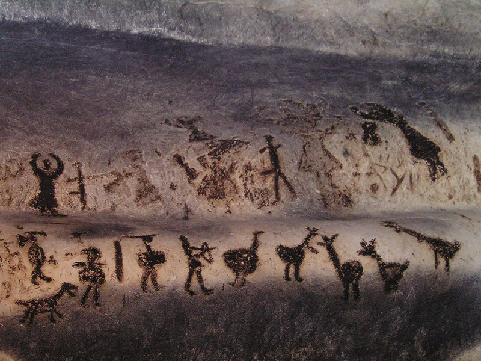

# 동굴 벽에는 동물만 그려진 것이 아니다

*불가리아 마구라 동굴에서 찾는 사람의 모습*

Culture · Art

> 출처 대조와 공개 게시 승인을 마친 이야기입니다. 실제 게시 여부는 사이트 배포 상태를 따릅니다.

*“Prehistoric drawings in the Magura cave, Bulgaria” by Nk/Wikimedia Commons, Public Domain · OpenStax 수록본. 원본 전체 사진을 자르지 않고 사용했습니다.*

[이미지 출처·제작 근거](https://raw.githubusercontent.com/openstax/osbooks-introduction-anthropology/main/media/ANTHRO_Figure_16_01_003.jpg) · 퍼블릭 도메인 · 공개 교재의 개별 사진 표기

동굴 벽화라고 하면 커다란 들소나 말이 먼저 떠오를 수 있다. 그런데 불가리아의 마구라 동굴 사진을 보면 사람처럼 보이는 여러 형상도 동물들과 함께 눈에 들어온다. 팔과 다리를 벌린 듯한 어두운 선들이다.

OpenStax 교재는 이 그림들을 사람과 동물이 함께 등장하는 선사시대 동굴 그림으로 소개한다. 이름을 모르던 동굴에서도 시선을 어디에 두느냐에 따라 다른 장면이 열린다.

## 몸의 작은 단서를 찾아보기

사진 속 형상들은 오늘의 정밀한 인물화처럼 얼굴을 자세히 보여 주지 않는다. 대신 몸통과 팔다리를 떠올리게 하는 간단한 모양이 있다. 무엇을 사람으로 읽게 만드는지 살펴보는 재미가 생긴다.

옆에는 몸의 형태가 다른 동물 그림들도 놓여 있다. 선을 하나씩 따라가며 서로 닮은 것과 다른 것을 구별해 보자. 먼저 눈앞의 형태를 보는 데 복잡한 해독표가 필요한 것은 아니다.

## 보이는 것과 뜻을 아는 것

어떤 형상이 두 팔을 올린 것처럼 보인다고 그 사람이 무엇을 하던 중인지까지 바로 알 수는 없다. 그림의 형태를 알아보는 일과 그 장면의 뜻을 확정하는 일은 다르다.

그래서 이 글에서는 특정 의례나 이야기를 정답처럼 붙이지 않는다. 교재가 사람과 동물의 그림이라고 설명한 범위 안에서 실제 사진을 살펴본다. 오래된 그림을 볼 때 모르는 부분을 남겨 두는 것도 보는 방법이다.

## 사람이 남긴 사람의 모습

이번 사진은 벽화를 AI로 다시 그린 것이 아니다. 바위의 표면과 그 위에 남은 선을 함께 보려면 실제 이미지가 더 적절하다. 매끈한 흰 종이에 옮겨 놓았을 때와는 다른 인상이 있다.

동굴의 시간을 한 번에 이해하려 애쓸 필요는 없다. 오늘은 동물 옆에 사람이 있었다는 점부터 기억해 보자. 오래된 벽면에도 세상을 보는 사람뿐 아니라, 자기와 닮은 몸을 남기는 사람의 손길이 있었다.

## 이야기의 바탕이 된 자료

- [OpenStax — Introduction to Anthropology: Anthropology of the Arts](https://raw.githubusercontent.com/openstax/osbooks-introduction-anthropology/main/modules/m00096/index.cnxml) · 확인일 2026-10-29
  - 확인 내용: 마구라 동굴의 불가리아 소재와 실제 벽화 사진 / 선사시대 그림에 사람·동물이 함께 등장한다는 교재 캡션 / 형태에 관한 본문 관찰은 실제 사진과 대조

---

[같은 소주제의 이야기](README.md) · [전체 서가](../../README.md)
