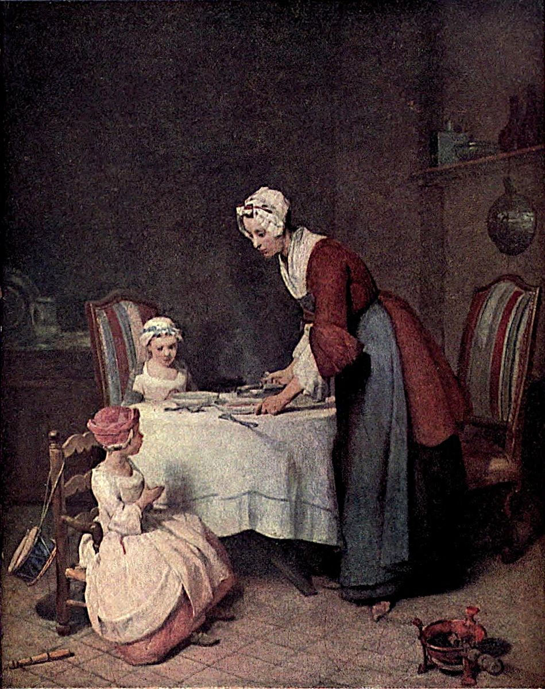

# 식사 전의 기도 — 수프가 식기 전, 잠깐 멈춘 시간

*샤르댕의 작은 식탁에서 그림의 중심을 찾는 방법*

Culture · Art

> 자료 대조를 마친 검토용 이야기입니다. 공개 게시 승인은 아직 받지 않았습니다.

*장바티스트 시메옹 샤르댕 원작 · 옛 루브르 도록 Plate XLI의 색채 재현 도판 · Project Gutenberg*

[이미지 출처·제작 근거](https://raw.githubusercontent.com/GITenberg/The-Louvre-Fifty-Plates-in-Colour_63719/master/63719-h/images/i_plate41.jpg) · 퍼블릭 도메인 원작·역사적 재현 자료 · Project Gutenberg 수록본

수프를 담으려던 어른이 고개를 돌린다. 식탁 곁의 두 아이는 손을 모으고 있다. 아주 잠깐 멈춘 식사 시간이다. 큰 역사적 사건도 기적도 없는데 장바티스트 시메옹 샤르댕은 이 순간을 한 장의 그림으로 남겼다.

〈식사 전의 기도〉는 누가 무엇을 하는지 비교적 쉽게 알 수 있는 작품이다. 그렇다고 첫눈에 내용을 알아보았으니 다 보았다고 생각할 필요는 없다. 사람과 물건이 어떻게 놓였는지 살피면 평범한 장면의 짜임이 보인다.

## 1. 제목이 가리키는 것은 식사 앞의 감사

프랑스어 제목 Le Bénédicité는 식사 전에 드리는 감사의 기도를 가리킨다. 아이들이 손을 모은 이유를 알려 주는 단서다. 장면을 이해하는 데 긴 종교적 배경지식이 필요하지는 않다. 음식이 나오기 전 함께 잠시 멈추는 시간으로 들어가면 된다.

그렇다고 이 장면을 모든 유럽 가정의 공통된 모습으로 일반화해서는 안 된다. 특정 시대의 가정생활을 소재로 화가가 구성한 그림이다. 옛 일상의 한 단면을 보여 준다는 점과, 당시 모든 사람의 생활을 그대로 증명한다는 주장은 다르다.

## 2. 어른의 손과 얼굴이 서로 다른 일을 한다

어른의 손은 음식을 담는 일에 가까이 있고 얼굴은 아이들 쪽으로 향한다. 몸 전체를 한 번에 보면 돌봄이 단순한 물건의 전달만은 아니라는 느낌을 받을 수 있다. 음식을 내면서 아이가 무엇을 하는지도 살피는 것이다.

이것을 특정 인물의 속마음을 우리가 정확히 안다는 뜻으로 받아들일 필요는 없다. 손과 시선이 서로 다른 방향의 관계를 만든다는 사실을 관찰하면 된다. 한 몸 안의 작은 방향 차이가 사람 사이의 연결을 보여 준다.

## 3. 두 아이는 같은 기도를 해도 같지 않게 보인다

아이들의 크기와 앉은 자세, 바라보는 방향에는 차이가 있다. 두 사람을 한 덩어리로 보고 ‘기도하는 아이들’이라고만 부르면 이런 작은 차이를 지나치기 쉽다. 각자의 얼굴과 손을 따로 본 뒤 다시 함께 보면 관계가 선명해진다.

어린아이에게 식사 예절을 가르치는 시간처럼 읽을 수도 있지만, 그림이 모든 대화를 직접 알려 주지는 않는다. 누가 방금 무슨 말을 했는지 확정하기보다 지금 눈앞에 남은 자세를 보자. 회화의 이야기는 들리지 않는 대사를 반드시 만들어 넣어야만 생기는 것은 아니다.

## 4. 의자 곁의 작은 북을 찾아보기

작은 북은 이 방이 엄숙한 기도만을 위한 곳이 아니라 아이가 생활하는 공간임을 떠올리게 한다. 아이들은 식사하기 전에 다른 놀이를 했을 수도 있다. 다만 실제로 언제 북을 쳤는지까지 그림이 알려 주는 것은 아니다. 물건이 더하는 생활의 기운을 느껴 보면 충분하다.

식탁과 의자, 그릇들은 배경의 빈칸을 채우려고 아무렇게나 놓인 것처럼 보이지 않는다. 몸과 물건 사이의 거리가 장면의 크기를 정한다. 방 전체가 거대한 무대가 아니라 서로 손과 눈길이 닿는 자리로 다가온다.

## 5. 흰 식탁보에서 주변의 어둠으로

밝은 식탁보는 화면에서 넓은 자리를 차지한다. 주변의 어두운 부분과 비교하면 시선이 자연스럽게 식사하는 자리로 모인다. 인물의 옷과 그릇을 볼 때도 그 밝은 바탕이 어떤 역할을 하는지 함께 살펴보자.

색을 화려함의 정도로만 평가하지 않으면 이 그림의 재미가 커진다. 무엇이 앞으로 다가오고 무엇이 뒤로 물러나는지, 다른 물건의 색이 곁에 놓일 때 어떻게 느껴지는지 볼 수 있다. 정물화를 많이 그린 샤르댕의 그림에서 사람과 사물은 서로의 자리를 만든다.

## 6. 왕의 초상 대신 일상의 시간이 중심이 된다

샤르댕은 1699년에 태어나 1779년에 세상을 떠난 프랑스 화가다. 이 작품에서는 화려한 의식이나 영웅의 행동 대신 식사 전의 가족과 생활 물건이 중심이 된다. 무엇이 그림의 중요한 주제가 될 수 있는지 생각하게 하는 선택이다.

그러나 소박해 보이는 장면이라고 해서 화가가 손을 대지 않은 생활 사진처럼 볼 수는 없다. 각자의 자세와 빛, 물건의 간격은 화면의 일부다. 평범한 소재와 세심한 구성은 반대말이 아니다. 오히려 익숙한 순간이 오래 보게 되는 그림으로 바뀌는 이유가 그 안에 있다.

## 7. 비슷한 그림이 여러 점 있다는 사실

옛 도록은 이 주제의 여러 판본을 언급한다. 따라서 같은 장면이 보이는 다른 사진을 만나더라도 모두 지금 도판과 완전히 같은 그림이라고 생각하지 않는 편이 좋다. 이 글에서 함께 보는 것은 루브르 도록에 실린 소장본의 색채 재현 자료다.

옛 인쇄의 색과 세부가 현재의 실물을 그대로 보여 주지는 않는다. 도판을 보면서 정확한 표면이나 실제 크기를 마음대로 추정하기보다 세 사람의 배치와 식탁의 밝기, 주변 물건의 관계를 살펴보면 좋다. 매체의 한계를 알아도 감상의 길은 충분히 남는다.

## 8. 우리 식탁과 곧바로 같게 만들지 않으면서

오늘의 가족 식사와 이 장면은 옷도 음식도 생활 방식도 다르다. 그 차이를 지운 채 ‘예나 지금이나 똑같다’고 끝내기보다, 달라진 것과 알아볼 수 있는 것을 함께 보면 좋다. 누군가 음식을 내고 다른 사람의 손짓을 살피는 관계는 낯선 옛 방 안에서도 눈에 들어온다.

처음에는 기도하는 장면을 확인했다면, 두 번째에는 음식과 아이를 함께 보는 어른의 얼굴을, 세 번째에는 장난감과 식기를 찾아보자. 큰 사건이 없는 그림도 시선을 옮길 때마다 새로운 중심을 내어 준다. 식사가 시작되기 전의 잠깐이 이렇게 긴 감상이 될 수 있다.

## 이야기의 바탕이 된 자료

- [Konody·Brockwell — The Louvre: Fifty Plates in Colour, 샤르댕과 Plate XLI](https://raw.githubusercontent.com/GITenberg/The-Louvre-Fifty-Plates-in-Colour_63719/master/63719-0.txt) · 확인일 2026-10-29
  - 확인 내용: 샤르댕 1699~1779·가정 장면과 정물화 / Le Bénédicité 표제·식탁·수프 그릇·어른과 두 아이·작은 북·주변 물건 / 여러 판본이 존재하며 이 도판은 루브르 소장본

---

[같은 소주제의 이야기](README.md) · [전체 서가](../../README.md)
